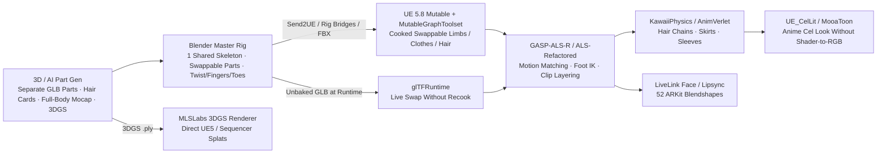
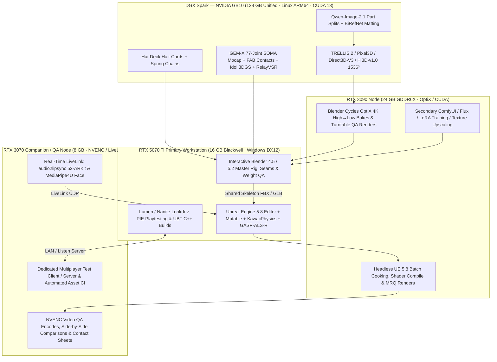

# Awesome Unreal Engine Game Templates, Blueprints & Pro Open-Source Frameworks

A source-verified catalog of **Unreal Engine 5 (UE 5.x–5.8)** game templates, Blueprint kits, official Epic Games samples, production-grade open-source C++/GAS frameworks, UEFN/Verse libraries, editor DevOps tools, Blender ↔ UE5 character pipelines, CC0 asset hubs, and open-source AI 3D tools (**40 sections · 1,190+ verified links**).

> **Note on versions & licenses:** UE4 / UE 5.0–5.5 Blueprint projects typically upgrade cleanly to UE 5.8; C++ plugins/projects may require minor API updates on compile. Always inspect each repository's `LICENSE` (and any bundled third-party asset notices) before shipping a closed-source commercial game — `MIT` / `Apache-2.0` / `BSD` vs `GPL-2.0/3.0` and `*(Archived)*` repositories are labeled explicitly.

---

## Filter Views, JSON Index & Companion Catalogs

### Instant Filter Views (Auto-Synced from `README.md`)
- **[UE 5.7 & UE 5.8 Ready](catalogs/UE58_READY.md)** — active templates, plugins, and MCP tools explicitly targeting UE 5.7 or 5.8.
- **[Commercial-Safe Open-Source (`MIT` / `Apache-2.0` / `BSD` / `CC0`)](catalogs/MIT_APACHE_COMMERCIAL_SAFE.md)** — SPDX-verified permissive repository code licenses filtered per link via `catalogs/GITHUB_SPDX.json`.
- **[Pure-Blueprint Templates & Kits (No C++ Required)](catalogs/BLUEPRINT_ONLY.md)** — designer-ready pure-Blueprint game starters, gameplay kits, and visual scripting node libraries.
- **[Unreal Architecture & License Audits (`60` Deep-Dives)](catalogs/UNREAL.md)** — `.uproject`/`.uplugin` descriptor checks, dependency caveats, and adoption guidance.
- **[Machine-Readable Catalog (`catalogs/INDEX.json`)](catalogs/INDEX.json)** — structured JSON export of all 38 table-backed resource sections (`1–23`, `25`, `27–40`), license tags, and URLs.

### Companion Engine & 3D Repositories
- **[Awesome Blender Tools](https://github.com/TimothyVang/awesome-blender-tools)** — modeling, rigging, rendering, asset interchange, and automation.
- **[Awesome Godot Templates & Demos](https://github.com/TimothyVang/awesome-godot-templates-demos)** — playable 2D/3D demos and reusable Godot 4 recipes.
- **[Awesome Unity Templates & Samples](https://github.com/TimothyVang/awesome-unity-templates-samples)** — Unity 6 game templates, netcode samples, and package workflows.

---

## Quick-Jump Pillars

| Pillar | Sections |
|---|---|
| **Official, Core & Learning** | [1. Epic Samples](#1-official-epic-games-built-in-templates--free-fab-samples) · [2. Core & GAS](#2-production-grade-free--open-source-core-frameworks) · [22. Pro Fab Ref](#22-commercial--pro-fab-frameworks-reference) · [23. Indexes & Guides](#23-giant-indexes-blueprint-paste-bins--free-hubs) · [24. MIT/Apache Stack](#24-recommended-commercial-safe-open-source-stack-mit--apache-20) · [38. Courses & Unreal Fest](#38-unreal-engine-courses-complete-book-codebases--unreal-fest-talk-samples) |
| **Action, Shooter & RPG Genres** | [3. FPS & Tactical](#3-fps-arena-tactical--extraction-shooters) · [4. Souls-like & Fighting](#4-third-person-action-souls-like-stealth-parry--fighting) · [5. ARPG, cRPG & Roguelike](#5-action-rpg-top-down-arpg-diablo-like-crpg--roguelikes) · [6. MOBA](#6-moba--hero-arena) · [7. Inventory, Quests & VN](#7-inventory-equipment-quests-dialogue--visual-novels) · [8. Survival & Horror](#8-survival-crafting-base-building--horror) |
| **Strategy, 2D, Vehicles, Casual & UEFN** | [11. 2D / 2.5D & PaperZD](#11-platformer-side-scroller-metroidvania--2d--25d) · [12. RTS, Tactics & City](#12-rts-turn-based-strategy-tower-defense--cityfarm-builders) · [13. Vehicles, Space & Flight](#13-racing-vehicles-6dof-space-flight--drone-simulators) · [14. Cards, Board, Puzzle & Rhythm](#14-card-games-board-games--puzzles) · [17. Portals, Voxels & Dungeons](#17-portals-physics-sandboxes-chaos-destruction--level-builders) · [40. UEFN & Verse](#40-uefn-unreal-editor-for-fortnite-verse-language--island-tooling) |
| **Characters, Locomotion & XR** | [9. Locomotion, Mover & Ragdoll](#9-locomotion-animation-parkour--secondary-haircloth-physics) · [10. Mutable, glTF & LipSync](#10-modular-character-creators-mutable-ue-58-runtime-gltfvrm--facial-mocap) · [16. VR, Quest 3 MR & OpenXR](#16-vr--xr--ar) · [25. Blender ↔ UE 5.8 Pipeline](#25-blender--ue-58-modular-character-full-joint-rigging-haircloth--mocap-pipeline) |
| **Multiplayer, World, AI & RHI** | [15. Multiplayer & Backends](#15-multiplayer-party-co-op-online-services-ossv2steamplayfab--mmo-backends) · [18. AI, StateTree & Crowds](#18-ai-statetree-3d-navigation--mass-entity-crowds) · [19. PCG, Cesium, Water & 3DGS](#19-world-pcg-ue-58-weather-gpu-water-foliage--3d-gaussian-splatting) · [20. Shaders, Toon & Audio](#20-stylized--anime-toon-rendering--audio--metasounds-dsp) · [21. UI, MVVM, Save & Scripting](#21-ui-settings-menus-loading-screens-pooling-validation-telemetry--testing) · [37. Console, Mobile, DLSS/FSR & RHI](#37-console-mobile-steam-deck-upscalers-dlss--streamline--fsr--xess--low-level-rhi) |
| **DevOps, Modding, VP, Sim & 3D/AI** | [26. Multi-GPU Routing](#26-multi-gpu-compute-routing-pipeline-dgx-spark-gb10--rtx-5070-ti--rtx-3090--rtx-3070) · [27. CC0 Hubs](#27-free-cc0--open-source-3d-models-pbr-textures-hdris-animations--audio-hubs) · [28. Blender Rigging](#28-blender-3d--rigging-weight-painting-modular-characters--game-rigs) · [29. Blender Retopo/UV](#29-blender-3d--retopology-uv-unwrapping-baking-lods--mesh-cleanup) · [30. Blender Modeling](#30-blender-3d--hard-surface-modeling-cad-kitbashing--add-on-indexes) · [31. Blender Groom/Cloth](#31-blender-3d--hair-cards-grooming-cloth-animenpr-shaders-geometry-nodes--3d-texturing) · [32. AI 3D & Mocap](#32-open-source-ai-3d-generation-auto-rigging-hair-cards--video-to-mocap-repositories) · [33. Editor & CI/CD](#33-blueprint-graph-formatters-editor-productivity-source-control--buildci-devops) · [34. Virtual Production](#34-cinematics-virtual-production-sequencer-spoutosc--cloud-render-farms) · [35. Robotics & Sim](#35-robotics-autonomous-vehicles-drones-ros2--synthetic-vision-simulation) · [36. AI Agents & MCP](#36-ai-coding-agents-unreal-mcp-servers--editor-co-pilots-ue-5458) · [39. Modding & Pak/UAsset Tools](#39-modding-pakiostore-inspection-asset-serialization-runtime-bps--live-sdk-debugging) |

---

## Table of Contents

1. [Official Epic Games Built-In Templates & Free Fab Samples](#1-official-epic-games-built-in-templates--free-fab-samples)
2. [Production-Grade Free & Open-Source Core Frameworks](#2-production-grade-free--open-source-core-frameworks)
3. [FPS, Arena, Tactical & Extraction Shooters](#3-fps-arena-tactical--extraction-shooters)
4. [Third-Person Action, Souls-like, Stealth, Parry & Fighting](#4-third-person-action-souls-like-stealth-parry--fighting)
5. [Action RPG, Top-Down ARPG (Diablo-like), cRPG & Roguelikes](#5-action-rpg-top-down-arpg-diablo-like-crpg--roguelikes)
6. [MOBA & Hero Arena](#6-moba--hero-arena)
7. [Inventory, Equipment, Quests, Dialogue & Visual Novels](#7-inventory-equipment-quests-dialogue--visual-novels)
8. [Survival, Crafting, Base Building & Horror](#8-survival-crafting-base-building--horror)
9. [Locomotion, Animation, Parkour & Secondary Hair/Cloth Physics](#9-locomotion-animation-parkour--secondary-haircloth-physics)
10. [Modular Character Creators, Mutable (UE 5.8), Runtime glTF/VRM & Facial Mocap](#10-modular-character-creators-mutable-ue-58-runtime-gltfvrm--facial-mocap)
11. [Platformer, Side-Scroller, Metroidvania & 2D / 2.5D](#11-platformer-side-scroller-metroidvania--2d--25d)
12. [RTS, Turn-Based Strategy, Tower Defense & City/Farm Builders](#12-rts-turn-based-strategy-tower-defense--cityfarm-builders)
13. [Racing, Vehicles, 6DOF Space Flight & Drone Simulators](#13-racing-vehicles-6dof-space-flight--drone-simulators)
14. [Card Games, Board Games & Puzzles](#14-card-games-board-games--puzzles)
15. [Multiplayer, Party, Co-op, Online Services (OSSv2/Steam/PlayFab) & MMO Backends](#15-multiplayer-party-co-op-online-services-ossv2steamplayfab--mmo-backends)
16. [VR / XR / AR](#16-vr--xr--ar)
17. [Portals, Physics Sandboxes, Chaos Destruction & Level Builders](#17-portals-physics-sandboxes-chaos-destruction--level-builders)
18. [AI, StateTree, 3D Navigation & Mass Entity Crowds](#18-ai-statetree-3d-navigation--mass-entity-crowds)
19. [World, PCG (UE 5.8), Weather, GPU Water, Foliage & 3D Gaussian Splatting](#19-world-pcg-ue-58-weather-gpu-water-foliage--3d-gaussian-splatting)
20. [Stylized / Anime Toon Rendering & Audio / MetaSounds DSP](#20-stylized--anime-toon-rendering--audio--metasounds-dsp)
21. [UI, Settings Menus, Loading Screens, Pooling, Validation, Telemetry & Testing](#21-ui-settings-menus-loading-screens-pooling-validation-telemetry--testing)
22. [Commercial / Pro Fab Frameworks (Reference)](#22-commercial--pro-fab-frameworks-reference)
23. [Giant Indexes, Blueprint Paste-Bins & Free Hubs](#23-giant-indexes-blueprint-paste-bins--free-hubs)
24. [Recommended Commercial-Safe Open-Source Stack (MIT / Apache-2.0)](#24-recommended-commercial-safe-open-source-stack-mit--apache-20)
25. [Blender ↔ UE 5.8 Modular Character, Full-Joint Rigging, Hair/Cloth & Mocap Pipeline](#25-blender--ue-58-modular-character-full-joint-rigging-haircloth--mocap-pipeline)
26. [Multi-GPU Compute Routing Pipeline (DGX Spark GB10 + RTX 5070 Ti + RTX 3090 + RTX 3070)](#26-multi-gpu-compute-routing-pipeline-dgx-spark-gb10--rtx-5070-ti--rtx-3090--rtx-3070)
27. [Free CC0 & Open-Source 3D Models, PBR Textures, HDRIs, Animations & Audio Hubs](#27-free-cc0--open-source-3d-models-pbr-textures-hdris-animations--audio-hubs)
28. [Blender 3D — Rigging, Weight Painting, Modular Characters & Game Rigs](#28-blender-3d--rigging-weight-painting-modular-characters--game-rigs)
29. [Blender 3D — Retopology, UV Unwrapping, Baking, LODs & Mesh Cleanup](#29-blender-3d--retopology-uv-unwrapping-baking-lods--mesh-cleanup)
30. [Blender 3D — Hard-Surface Modeling, CAD, Kitbashing & Add-on Indexes](#30-blender-3d--hard-surface-modeling-cad-kitbashing--add-on-indexes)
31. [Blender 3D — Hair Cards, Grooming, Cloth, Anime/NPR Shaders, Geometry Nodes & 3D Texturing](#31-blender-3d--hair-cards-grooming-cloth-animenpr-shaders-geometry-nodes--3d-texturing)
32. [Open-Source AI 3D Generation, Auto-Rigging, Hair Cards & Video-to-Mocap Repositories](#32-open-source-ai-3d-generation-auto-rigging-hair-cards--video-to-mocap-repositories)
33. [Blueprint Graph Formatters, Editor Productivity, Source Control & Build/CI DevOps](#33-blueprint-graph-formatters-editor-productivity-source-control--buildci-devops)
34. [Cinematics, Virtual Production, Sequencer, Spout/OSC & Cloud Render Farms](#34-cinematics-virtual-production-sequencer-spoutosc--cloud-render-farms)
35. [Robotics, Autonomous Vehicles, Drones, ROS2 & Synthetic Vision Simulation](#35-robotics-autonomous-vehicles-drones-ros2--synthetic-vision-simulation)
36. [AI Coding Agents, Unreal MCP Servers & Editor Co-Pilots (UE 5.4–5.8)](#36-ai-coding-agents-unreal-mcp-servers--editor-co-pilots-ue-5458)
37. [Console, Mobile, Steam Deck, Upscalers (DLSS / Streamline / FSR / XeSS) & Low-Level RHI](#37-console-mobile-steam-deck-upscalers-dlss--streamline--fsr--xess--low-level-rhi)
38. [Unreal Engine Courses, Complete Book Codebases & Unreal Fest Talk Samples](#38-unreal-engine-courses-complete-book-codebases--unreal-fest-talk-samples)
39. [Modding, Pak/IoStore Inspection, Asset Serialization, Runtime BPs & Live SDK Debugging](#39-modding-pakiostore-inspection-asset-serialization-runtime-bps--live-sdk-debugging)
40. [UEFN (Unreal Editor for Fortnite), Verse Language & Island Tooling](#40-uefn-unreal-editor-for-fortnite-verse-language--island-tooling)

---

## 1. Official Epic Games Built-In Templates & Free Fab Samples

### Built-In UE 5.8 Templates & Genre Variant Packs
Included offline in every Unreal Engine 5.8 installation under `<UE_5.8>/Templates/` (`FeaturePacks/*.upack` and `TemplateResources/Standard/Variant_*`):
- **Core Templates:** `TP_FirstPersonBP`, `TP_ThirdPersonBP`, `TP_TopDownBP`, `TP_VehicleAdvBP`, `TP_VirtualRealityBP`, `TP_HandheldARBP`
- **9 Built-In Genre Variant Packs:** `Variant_Combat`, `Variant_Shooter`, `Variant_Horror`, `Variant_Platforming`, `Variant_SideScroller`, `Variant_TwinStick`, `Variant_Strategy`, `Variant_Offroad`, `Variant_Timetrial`
- **Reference:** [Templates Reference](https://dev.epicgames.com/documentation/unreal-engine/unreal-engine-templates-reference) · [Samples & Tutorials](https://dev.epicgames.com/documentation/unreal-engine/samples-and-tutorials-for-unreal-engine)

### Official Free Epic Games Samples (Fab)

| Project | Focus | Link |
|---|---|---|
| **Lyra Starter Game** | Modular multiplayer FPS/TPS, GAS, CommonUI, GameFeatures | [Fab](https://www.fab.com/listings/93faede1-4434-47c0-85f1-bf27c0820ad0) · [Docs](https://dev.epicgames.com/documentation/unreal-engine/lyra-sample-game-in-unreal-engine) |
| **Game Animation Sample (GASP)** | Motion Matching, Choosers, traversal/parkour, modular AnimBPs | [Fab](https://www.fab.com/listings/880e319a-a59e-4ed2-b268-b32dac7fa016) |
| **Stack-O-Bot** | Third-person Blueprint platformer/puzzle (rebuilt for UE 5.6+) | [Fab](https://www.fab.com/listings/b4dfff49-0e7d-4c4b-a6c5-8a0315831c9c) · [Docs](https://dev.epicgames.com/documentation/en-us/unreal-engine/stack-o-bot-sample-game-in-unreal-engine?application_version=5.7) |
| **Cropout Sample Project** | Cross-platform top-down Casual RTS (Blueprints + CommonUI) | [Fab](https://www.fab.com/listings/bd733d81-7c29-44fe-b53f-65b14d06a9e2) · [Overview](https://www.unrealengine.com/blog/cropout-casual-rts-game-sample-project) |
| **Action RPG** | Official C++/Blueprint Action RPG (GAS, inventory, melee, save/load) | [Fab](https://www.fab.com/listings/ef04a196-03c1-4204-998a-c7d5264fade7) |
| **Multiplayer Shootout** | Official multiplayer lobby, matchmaking, and arena shootout Blueprints | [Fab](https://www.fab.com/listings/4d9fddcd-2c92-4d08-b359-ba4b0568fdfa?lang=en) |
| **Content Examples** | Per-feature Blueprint, Anim, Niagara, Material, and UMG showcase maps | [Fab](https://www.fab.com/listings/4d251261-d98c-48e2-baee-8f4e47c67091) · [Docs](https://dev.epicgames.com/documentation/unreal-engine/content-examples-sample-project-for-unreal-engine?lang=en-US) |
| **Epic Blueprints Showcase** | Level design tools, security systems, and AI Blueprint demos | [Fab](https://www.fab.com/listings/720af3f1-cd24-40a3-a881-ee695a7c9779?lang=en) |
| **A-COM Animation Sample** | Stylized biped & quadruped animation rigs/blueprints | [Fab](https://www.fab.com/listings/7a019296-852d-47b8-86ed-ddcf2835a352?lang=en) |
| **City Sample / Electric Dreams / Valley of the Ancient** | Open-world traffic/crowds, PCG, Substrate, Nanite/Lumen showcases | [Feature Examples](https://dev.epicgames.com/documentation/unreal-engine/engine-feature-examples-for-unreal-engine) · [Sample Games](https://dev.epicgames.com/documentation/unreal-engine/sample-game-projects-for-unreal-engine) |
| **Parrot Game Sample** | Pirate 2.5D platformer (UE 5.6+ C++/BP, Enhanced Input, CommonUI, Sequencer; cross-engine Unity parity guide) | [Announcement & Guide](https://www.unrealengine.com/news/parrot-game-sample-a-new-practical-resource-for-game-devs-switching-to-unreal-engine) |
| **Mutable Sample Project** | Official Customizable Object showcase: modular clothing, MetaHumans, weapon swaps, stickers & crowd stress tests | [Docs](https://dev.epicgames.com/documentation/unreal-engine/mutable-skeletal-mesh-generation-in-unreal-engine?lang=en-US) · [Tutorials](https://dev.epicgames.com/community/learning/tutorials/yjw9/unreal-engine-mutable-tutorials) |
| **City Sample (Direct Docs)** | *The Matrix Awakens* urban open world: Mass AI/Traffic, World Partition, PCG, Nanite & Lumen | [Docs](https://dev.epicgames.com/documentation/unreal-engine/city-sample-project-unreal-engine-demonstration?lang=en-US) |
| **Electric Dreams Environment** | Procedural Content Generation (PCG) jungle, Substrate materials & Chaos physics showcase | [Docs](https://dev.epicgames.com/documentation/unreal-engine/electric-dreams-environment-in-unreal-engine?lang=en-US) |
| **Valley of the Ancient** | Nanite, Lumen, World Partition, Chaos destruction & modular gameplay feature showcase | [Docs](https://dev.epicgames.com/documentation/unreal-engine/valley-of-the-ancient-sample-game-for-unreal-engine) |
| **Slay Animation Sample** | Mold3D virtual production, Sequencer lighting, camera rigs & Windwalker Echo cinematic sample | [Docs](https://dev.epicgames.com/documentation/unreal-engine/slay-sample-project-for-unreal-engine?lang=en-US) |
| **Meerkat Demo (Weta Digital)** | Real-time strand hair/fur grooms, Control Rig & cinematic Sequencer short-film sample | [Docs](https://dev.epicgames.com/documentation/unreal-engine/meerkat-sample-project-for-unreal-engine?lang=en-US) |
| **Epic MetaHuman DNA & OpenRigLogic** | Official Epic Games open-source MetaHuman `.dna` calibration tools, RigLogic runtime & MotionBuilder LiveLink | [DNA Calibration](https://github.com/EpicGames/MetaHuman-DNA-Calibration) · [OpenRigLogic](https://github.com/EpicGames/OpenRigLogic) · [MobuLiveLink](https://github.com/EpicGames/MobuLiveLink) |
| **Sample-PersistenceLab (Epic Dev)** | **UE 5.8+** examples & reusable utilities for saving/reloading actors and instanced world state | [GitHub](https://github.com/ZKShao-EpicGames/Sample-PersistenceLab) |
| **Epic Unreal Engine Agent Skills** | Official Epic Games open-source Unreal Engine coding & workflow skills plugin (MIT, 2k+★) | [GitHub](https://github.com/EpicGames/unreal-engine-skills-for-claude-code-plugin) |

[↑ Back to top](#table-of-contents)

---

## 2. Production-Grade Free & Open-Source Core Frameworks

| Framework | License | UE / Stack | What It Gives You | Link |
|---|---|---|---|---|
| **Omega Game Framework** | MIT | UE5 · C++/BP | Modular RPG/action framework: abilities, attributes, XP, turn order, inventory, equipment, save system, zone manager, FlowGraph integration | [GitHub](https://github.com/StudioSyndiCatCaius/OmegaGameFramework) · [Fab](https://www.fab.com/listings/1e72596a-b243-43b8-a6f2-b972570fb5f8?lang=en) · [Basic Template](https://www.fab.com/listings/59e40fc2-4d7b-4edf-8722-184da669a160) |
| **AyaDogGames GameplayFramework** | Apache-2.0 | UE 5.7 · C++/BP | Replicated data-driven GAS framework: `AbilitySet`/`PawnData`, CommonUI + MVVM, tag-mapped Enhanced Input, `FFastArraySerializer` inventory, AI/item spawners | [GitHub](https://github.com/AyaDogGames/GameplayFramework) |
| **GameCoreFramework (GCF)** | Open Source | UE5 · C++/BP | Lyra-inspired modular multiplayer framework with Dual ASC architecture, input routing, tickless event-driven design | [GitHub](https://github.com/asugeno/GameCoreFramework) |
| **XistCommonGameSample** | MIT | UE 5.7 · C++/BP | Clean single-player stripped setup of Lyra's `CommonGame`, `CommonUser`, `GameplayMessageRouter`, and `ModularGameplayActors` plugins | [GitHub](https://github.com/XistGG/XistCommonGameSample) |
| **ArtilleryEco** *(pre-alpha)* | MIT | UE5 · C++ | Off-game-thread deterministic gameplay & ability simulation backed by Jolt Physics (Barrage) and input-stream replication (Bristlecone) | [GitHub](https://github.com/OversizedSunCoreDev/ArtilleryEco) |
| **OpenUnrealUtilities (OUU)** | Open Source | UE4/5 · C++/BP | Studio-proven general-purpose Unreal C++/Blueprint utilities plugin | [GitHub](https://github.com/JonasReich/OpenUnrealUtilities) |
| **Unreal Angelscript** | Open Source | UE5 · C++ | Hazelight Studios' hot-reloading gameplay scripting language (vanilla engine plugin port) | [Docs](https://github.com/Hazelight/Docs-UnrealEngine-Angelscript) · [Plugin Port](https://github.com/WillGordon9999/UE-Angelscript) |
| **EssentialUE5BPs** | Open Source | UE5 · BP | Modular third-person Blueprints collection | [GitHub](https://github.com/lostcrowdev/EssentialUE5BPs) |
| **UE5 Game Starter Template** | Open Source | UE5 | General-purpose project starter | [GitHub](https://github.com/motionforge/Unreal-Engine-5-Game-Starter-Template) |
| **Nano** | Open Source | UE | Minimalist starter template for small/jam games | [GitHub](https://github.com/pfist/Nano) |
| **ProjectCallisto** | Open Source | **UE 5.8** · C++/BP | Action-RPG Gameplay Ability System technical showcase & event-driven combat architecture | [GitHub](https://github.com/ramzelsuarez/ProjectCallisto) |
| **UE5-GAS-Multiplayer-Framework** | Open Source | UE5 · C++ | Multiplayer GAS template with client prediction & AAA-style replication patterns | [GitHub](https://github.com/NickMC05/UE5-GAS-Multiplayer-Framework) |
| **ElementalArsenal** | Open Source | UE5 · C++/BP | Modular GAS equipment pipelines, automated elemental reactions (e.g., Fire + Oil = Explosion) & asset generation tools | [GitHub](https://github.com/hemalpatel2990/ElementalArsenal) |
| **GameplayActionFramework** | Open Source | UE5 · C++ | Lightweight GAS-inspired ability framework designed for single-player games with zero replication overhead | [GitHub](https://github.com/Viktor-Antonyak/GameplayActionFramework) |
| **ModularGameplayAbilities** | Open Source | UE5 · C++ | Lyra-inspired GAS boilerplate & modular ability extension plugin | [GitHub](https://github.com/MajorTomAW/ModularGameplayAbilities) |
| **ue5-gas-prototype** | Open Source | UE 5.6 · C++ | Dual ASC ownership patterns, native Gameplay Tags, Enhanced Input & reactive UI | [GitHub](https://github.com/nbertoa/ue5-gas-prototype) |
| **ue5-rpg-ability-system** | Open Source | UE5 · GAS | Skill book, action bar, cooldowns & animation-driven ability casting reference | [GitHub](https://github.com/Mustafa-Kum/ue5-rpg-ability-system) |
| **Narxim-GAS-Example** | MIT | UE5 · C++/BP | Clean, well-documented starter setup for Epic's Gameplay Ability System (attributes, replication, effects) | [GitHub](https://github.com/Narxim/Narxim-GAS-Example) |
| **SimpleGameplayAbilitySystem** | MIT | UE5 · C++/BP | Streamlined, lightweight alternative to GAS with minimal boilerplate | [GitHub](https://github.com/strayTrain/SimpleGameplayAbilitySystem) |
| **UltimateStarterKit** | MIT | UE5 · C++/BP | All-in-one starter plugin: menus, audio, save data, input glyphs, dialogue & interaction helpers | [GitHub](https://github.com/hfjooste/UltimateStarterKit) |
| **Debloated StarterProject** | MIT | UE5 · `.uproject` | Stripped-down `.uproject` baseline disabling unused engine bloat for smaller packages & faster boot | [GitHub](https://github.com/daftsoftware/StarterProject) |
| **Perfectly-Optimized Template** | MIT | UE5 · `.uproject` | Performance-tuned UE5 project starter engineered for high baseline FPS | [GitHub](https://github.com/Imloopdev/Perfectly-Optimized) |
| **PipeRift Attributes & Actions** | Apache-2.0 | UE4/5 · C++/BP | Lightweight reflection-friendly attribute modifiers & async gameplay action tasks | [Attributes](https://github.com/PipeRift/AttributesExtension) · [Actions](https://github.com/PipeRift/ActionsExtension) |
| **TheEmidee GameBase & GAS Suite** | MIT | UE5 · C++ | Studio-proven modular game framework, GAS extensions & core C++ libraries | [GameBaseFramework](https://github.com/TheEmidee/UEGameBaseFramework) · [GASExtensions](https://github.com/TheEmidee/UEGASExtensions) · [CoreExtensions](https://github.com/TheEmidee/UECoreExtensions) |
| **RemAbilityUtility** | MIT | UE5 · C++ | Modern C++ utilities & extensions for Gameplay Ability System | [GitHub](https://github.com/RemRemRemRe/RemAbilityUtility) |
| **Splash Damage FutureExtensions** | BSD-3-Clause | UE5 · C++ | Async task chaining, cancellation & `TFuture` extensions for Unreal C++ | [GitHub](https://github.com/splash-damage/future-extensions) |
| **UE4EnhancedCodeFlow** | MIT | UE4/5 · C++ | Coroutine-style delays, tickers, time-sliced loops & async wait helpers in C++ | [GitHub](https://github.com/zompi2/UE4EnhancedCodeFlow) |
| **UE5Coro** *(Archived)* | BSD-3-Clause-Clear | UE4/5 · C++20 | Deeply integrated C++20 coroutine plugin for latent Blueprint actions, async loads & GAS tasks (1.1k+★) | [GitHub](https://github.com/landelare/ue5coro) |
| **PsData (Reactive Data Model)** | MIT | UE5 · C++/BP | Typed reactive game state, configs & protocol models with change events bound to UMG | [GitHub](https://github.com/PushkinStudio/PsData) |
| **ScriptableFramework** | MIT | UE5 · C++/BP | Designer-friendly data-driven logic sequences, conditions & modular actions | [GitHub](https://github.com/kirzo/ScriptableFramework) |
| **GlobalEventSystem-Unreal** | MIT | UE4/5 · C++/BP | Loosely coupled pub/sub event bus across actors and Blueprints | [GitHub](https://github.com/getnamo/GlobalEventSystem-Unreal) |
| **Rama's Victory BP Plugin & Blueprint Helpers** | MIT | UE4/5 · C++/BP | Iconic 300+ extra Blueprint math, file I/O, system & utility nodes (880+★) + CSV/math helpers | [VictoryPlugin](https://github.com/EverNewJoy/VictoryPlugin) · [RyHelpfulHelpers](https://github.com/rfsheffer/RyHelpfulHelpers) · [StevesUEHelpers](https://github.com/sinbad/StevesUEHelpers) · [BP CSV Parsing](https://github.com/Incanta/unreal-bp-csv-parsing) · [MathVM](https://github.com/rdeioris/MathVM) |
| **ZipUtility & RuntimeArchiver** | MIT / OS | UE4/5 · C++/BP | Event-driven 7zip/ZIP/TAR runtime archive compression & extraction in Blueprints | [ZipUtility-Unreal](https://github.com/getnamo/ZipUtility-Unreal) · [RuntimeArchiver (Archived)](https://github.com/gtreshchev/RuntimeArchiver) |
| **GameExperiencesPlugin** | MIT | UE5 · C++/BP | Modular game-mode extensions built on top of Epic's `GameFeatures` & Lyra experience architecture | [GitHub](https://github.com/bohdon/GameExperiencesPlugin) |
| **GameplayMessageSubsystem (Standalone)** | Open Source | UE 5.7 · C++/BP | Decoupled Lyra `GameplayMessageSubsystem` event bus extracted cleanly for UE 5.7 projects | [GitHub](https://github.com/TakenGrace/GameplayMessageSubsystem) |
| **GLUCOSE & OpenWorld_Plugin (Lyra)** | Open Source | UE5 · C++/BP | Genre-agnostic Lyra-based gameplay starter framework + open-world Lyra extension project | [GLUCOSE](https://github.com/UEbo4ka/GLUCOSE) · [OpenWorld_Plugin](https://github.com/OpenWorldGame-Io/OpenWorld_Plugin) |
| **unreal-helper-library (UHL)** | Open Source | UE5 · C++/BP | Production helper suite for Gameplay Ability System, Behavior Tree AI & editor customization | [GitHub](https://github.com/Ciberusps/unreal-helper-library) |
| **Unreal-GenericVar** | MIT | UE5 · C++/BP | Standalone type-safe generic Blackboard/variable container extracted from MaidGameFramework | [GitHub](https://github.com/bot-hopps/Unreal-GenericVar) |

[↑ Back to top](#table-of-contents)

---

## 3. FPS, Arena, Tactical & Extraction Shooters

| Name | Source | UE / License | Highlights | Link |
|---|---|---|---|---|
| **GASShooter (UE 5.5)** | GitHub | UE 5.5 · MIT | Full multiplayer FPS/TPS built on Gameplay Ability System | [GitHub](https://github.com/pikogoro/GASShooter_UE55) |
| **GASShooter (Original)** | GitHub | UE4/5 · MIT | Canonical GAS shooter reference | [GitHub](https://github.com/tranek/GASShooter) |
| **Realistic Assault Rifle Template** | GitHub (Overview) | UE5 · BP | Modular weapon attachments, animations, FPS Blueprint system | [GitHub](https://github.com/OctavianTocan/Realistic-Assault-Rifle-Template) |
| **Unreal Shooter Base** | GitHub | UE5 · C++/BP | Multiplayer shooter w/ GAS, AI Behavior Trees, networked physics | [GitHub](https://github.com/SucceedHQ-innovations/unreal-shooter-base) |
| **SuperSimpleFPSPack** | GitHub (Overview) | UE 5.5 · BP | Extended First Person Shooter starter | [GitHub](https://github.com/KPettingerEEN/SuperSimpleFPSPack) |
| **UE5 Arena Shooter Sample** | GitHub | UE5 · C++ | Arena / boomer shooter movement & combat | [GitHub](https://github.com/KamikaziUk/UE5-Arena-Shooter-Sample) |
| **Blackline Contract (PTA)** | GitHub | UE 5.5 | Tactical extraction shooter prototype | [GitHub](https://github.com/triopstudios/blacklinecontract_pta) |
| **UE5 Weapon System** | GitHub | UE5 · BP/C++ | Projectiles, muzzle flash, bullet hole decals, impact VFX | [GitHub](https://github.com/ArtemChig/UE5-Weapon-System) |
| **UE5-EnhancedProjectile** | GitHub | UE5 · C++/BP | StateTree-driven projectile framework with pooling & prediction validation | [GitHub](https://github.com/HanYe0817/UE5-EnhancedProjectile) |
| **SimpleFPSTemplate** | GitHub | UE4/5 · C++ | Minimalist FPS starter by Tom Looman | [GitHub](https://github.com/tomlooman/SimpleFPSTemplate) |
| **Kosm Classic FPS Template** | GitHub | UE4 · BP | Classic arena shooter mechanics & pickups | [GitHub](https://github.com/vtx-factory/Kosm-Classic-FPS-Template-UE4) |
| **Project Isolation** | GitHub | UE · MIT | Open-source single-player FPS C++ codebase | [GitHub](https://github.com/whoisEllie/Project-Isolation) |
| **Free FPS Template & Tutorial** | Fab | UE5 · Free | Free starter FPS Blueprint project & tutorial | [Fab](https://www.fab.com/listings/6a0af880-2b74-480c-a82c-8e597918dffe?lang=en) |
| **Realistic FP Movement V1** | itch.io | UE5 · Free | Free realistic first-person movement template | [itch.io](https://treetygames.itch.io/realistic-first-person-movement-template-v1-in-unreal-engine-5-free-download) |
| **PBCharacterMovement** | GitHub | UE4/5 · MIT | HL2 / Source-style classic FPS C++ movement (bunnyhop, air-strafe, surfing, friction tuning; 1.5k+★) | [GitHub](https://github.com/ProjectBorealis/PBCharacterMovement) |
| **EternalCrusadeResurrection** | GitHub | UE5 · C++ | Large-scale multiplayer third/first-person shooter C++ codebase following modern UE5 best practices | [GitHub](https://github.com/JediKnightChan/EternalCrusadeResurrection) |
| **UE5-CrystalRecoil** | GitHub | UE5 · MIT | Patterned firearm recoil plugin with dedicated in-editor recoil pattern GUI | [GitHub](https://github.com/CrystalVapor/UE5-CrystalRecoil) |
| **ProceduralFPSAnimationsPlugin** | GitHub | UE4/5 · MIT | Curve-driven procedural FPS weapon sway, walk bob, ADS & recoil animations | [GitHub](https://github.com/gerlogu/ProceduralFPSAnimationsPlugin) |
| **WeaponFOVAndClippingFix** | GitHub | UE4/5 · MIT | Solves first-person weapon wall clipping and separate viewmodel FOV scaling | [GitHub](https://github.com/gerlogu/WeaponFOVAndClippingFix) |
| **FPSCore** | GitHub | UE5 · MIT | Open-source C++ plugin kickstarting tactical/modern first-person shooters | [GitHub](https://github.com/whoisEllie/FPSCore) |
| **Advanced Dual Weapon System** | GitHub | UE5 · C++ | C++ primary/secondary weapon pickup, holstering, swapping & ammo management | [GitHub](https://github.com/unrealroshan/Advanced-Dual-Weapon-System-UE5) |
| **OnAllFronts (MilSim FPS/RTS)** | GitHub | UE5 · MIT | Combined-arms tactical MilSim FPS + RTS hybrid codebase | [GitHub](https://github.com/HaywireInteractive/OnAllFronts-Public) |
| **CheekyFPS** | GitHub | UE4/5 · MIT | Clean, minimal pure-Blueprint first-person controller starter | [GitHub](https://github.com/DaveFace/CheekyFPS) |
| **U5_FPS_Multiplayer** | GitHub | UE5 · C++/BP | Counter-Strike-inspired round-based multiplayer FPS in Blueprints | [GitHub](https://github.com/AlvaroBishop/U5_FPS_Multiplayer) |
| **FPS-template-with-shooting-AI** | GitHub | UE5 · BP/C++ | First-person shooter starter paired with ranged combat enemy AI | [GitHub](https://github.com/AsmundSchei/FPS-template-with-shooting-AI) |
| **UE5 Multiplayer Shooter (C++)** | GitHub | UE5 · C++ | Dedicated multiplayer shooter C++ samples (lag compensation, replication, HUD) | [DruidMech](https://github.com/DruidMech/UE5_Multiplayer_FPS) · [intrxx TPS](https://github.com/intrxx/Multiplayer-Shooter) |
| **Lyra Capture the Flag** | GitHub | UE5 · GameFeature | Modular `GameFeatures` plugin adding Capture the Flag mode to Epic's Lyra | [GitHub](https://github.com/Amirans/LyraGameCaptureTheFlag) |
| **Angelscript FPS Starter** | GitHub | UE5 · Angelscript | UE5 C++ FPS starter ported cleanly to Hazelight Unreal Angelscript | [GitHub](https://github.com/zuru33/UnrealEngine-Angelscript-FpsStarter) |
| **LyraFirstPersonCamera** | GitHub | UE5 · C++/BP | True first-person socket-bound camera & full-body awareness setup for Epic's Lyra Starter Game | [GitHub](https://github.com/ScaleSculptor/LyraFirstPersonCamera) |
| **TPSOnline & VehicularCombat** | GitHub | UE5 · C++/BP | Replicated online shooter template + third-person vehicular weapon combat starter | [TPSOnline](https://github.com/DanialKama/TPSOnline) · [VehicularCombat](https://github.com/DanialKama/VehicularCombat) |
| **Rhythm-Range (Beat FPS)** | GitHub | UE5 · BP/C++ | Rhythm-synchronized first-person target & arena shooter prototype | [GitHub](https://github.com/jake599/Rhythm-Range) |
| **MPTwinStickShooter** | GitHub | UE · MIT / Mixed | Network-replicated multiplayer twin-stick shooter C++/Blueprint reference | [GitHub](https://github.com/moritz-wundke/MPTwinStickShooterWithUE4) |

[↑ Back to top](#table-of-contents)

---

## 4. Third-Person Action, Souls-like, Stealth, Parry & Fighting

| Name | Source | UE / License | Highlights | Link |
|---|---|---|---|---|
| **CoopSoulsGame (UE 5.7)** | GitHub (Showcase) | UE 5.7 · C++/BP | Light/heavy/charge attacks, parry, dodge, backstab, poise, boss AI, lock-on | [GitHub](https://github.com/Roomixer/Souls-game-UE-5.7) |
| **Sekiro Clone (Action Adventure)** | GitHub | UE5 · C++ (GAS) | Deflect/parry, posture stagger, backstab & plunging deathblows, grappling hook, wall jump, stealth whistle, lock-on | [GitHub](https://github.com/kantam5/UE5-Action-Adventure-Sekiro-Clone) |
| **StealthDemo** | GitHub | UE 5.5 · C++ | Third-person stealth action: AI security cameras, patrol robots, Attack ↔ Search ↔ Patrol Behavior Trees | [GitHub](https://github.com/CanReader/StealthDemo) |
| **UE5 RPG Melee Combat System** | GitHub | UE5 · C++/BP | Modular melee combat: combo windows, input buffering, anim-driven hit detection | [GitHub](https://github.com/Mustafa-Kum/ue5-rpg-melee-combat-system) |
| **UE5 Soulslike Combat** | GitHub | UE 5.7 | Souls-like combat project | [GitHub](https://github.com/Kulahala/UE5-Soulslike-Combat) |
| **Soulsborne** | GitHub | UE5 | Third-person Souls-like project | [GitHub](https://github.com/St4rman/Soulsborne) |
| **Echoes of the Lost Sands** | GitHub | UE5 | Souls-like RPG with melee combat & AI enemies | [GitHub](https://github.com/Mecha-NOX/Echoes-of-the-Lost-Sands) |
| **MedivalCombatGame** | GitHub | UE5 · C++ | Souls-inspired medieval combat prototype | [GitHub](https://github.com/KevinRusev/MedievalCombatGame) |
| **UE5 Hack and Slash** | GitHub | UE5 · GPL-3.0 | Third-person hack & slash action game | [GitHub](https://github.com/willroberts/ue5-hack-and-slash) |
| **NightSkyEngine** | GitHub | UE · MIT | C++ fighting-game framework | [GitHub](https://github.com/WistfulHopes/NightSkyEngine) |
| **TargetSystemPlugin** | GitHub | UE4/5 | Dark Souls-style camera lock-on / targeting plugin | [GitHub](https://github.com/mklabs/ue4-targetsystemplugin) |
| **WeaponTrace-Unreal** | GitHub | UE · Plugin | Reliable melee weapon socket/sweep hit tracing | [GitHub](https://github.com/getnamo/WeaponTrace-Unreal) |
| **Enhanced Third Person Template** | Fab | UE5 · BP | Modernized drop-in third-person starter | [Fab](https://www.fab.com/listings/90517cb6-120b-4d8c-b8b3-1f9a74b91104?lang=en) |
| **ComboGraph** | GitHub | UE5 · MIT | Custom graph editor plugin for authoring branching melee/action combo chains | [GitHub](https://github.com/apokrif6/ComboGraph) |
| **MeleeTrace** | GitHub | UE5 · MIT | Frame-accurate interpolated socket melee hit-tracing component | [GitHub](https://github.com/rlewicki/MeleeTrace) |
| **Dismemberment / SKMeshDismemberment** | GitHub | UE5 · MIT | Dynamic limb separation, weapon dropping & recursive skeletal mesh damage breaking | [Thyke Dismemberment](https://github.com/Thyke/Dismemberment) · [SKMeshDismemberment](https://github.com/Cutter-H/SKMeshDismemberment) · [SkeletalMeshDestruction](https://github.com/Lim-Young/SkeletalMeshDestruction) |
| **sekiro-genichiro-ue5** | GitHub | **UE 5.8** · C++/BP | Three-phase Sekiro boss combat showcase: deflect/posture, perilous Mikiri counter & lightning reversal | [GitHub](https://github.com/volieteven-end/sekiro-genichiro-ue5) |
| **ue5-warrior** | GitHub | UE5 · C++ (GAS) | Advanced third-person melee warrior combat built on C++ Gameplay Ability System | [GitHub](https://github.com/bp-shirai/ue5-warrior) |
| **ThirdPersonShooter (DanialKama)** | GitHub | UE5 · BP/C++ | Clean third-person cover/aim shooter sample project | [GitHub](https://github.com/DanialKama/ThirdPersonShooter) |
| **MeleeWander** | GitHub | UE5 | Third-person melee combat combined with parkour traversal | [GitHub](https://github.com/liulong1994/MeleeWander) |
| **FightingGame-UE5 / FighterGame** | GitHub | UE5 · C++ | C++ 3D/2.5D hand-to-hand & multiplayer fighting game prototypes | [FightingGame-UE5](https://github.com/stackOverflower92/FightingGame-UE5) · [FighterGame](https://github.com/tkclef/FighterGame) |
| **UnrealAITokenSystem** | GitHub | UE5 · MIT | *Doom* / Souls-style AI attack-token coordinator preventing simultaneous enemy dogpiling | [GitHub](https://github.com/Lim-Young/UnrealAITokenSystem) |
| **UE4_DarkSoulsCamera & ModalCamera** | GitHub | UE4/5 | Souls-style lock-on/orbit camera rig + mode-transitioning third-person gameplay camera plugin | [DarkSoulsCamera](https://github.com/donanroherty/UE4_DarkSoulsCamera) · [ModalCamera](https://github.com/chronicler-software/ModalCamera) · [ue-gameplay-cameras](https://github.com/ludovicchabant/ue-gameplay-cameras) |
| **SoulsLikeGame (Makyrios)** | GitHub | UE5 · C++/BP | Third-person Souls-like melee stamina, dodge-roll & boss encounter prototype | [GitHub](https://github.com/Makyrios/SoulsLikeGame) |
| **WarriOrb (Full Action-Platformer Source)** | GitHub | UE · MIT | Complete shipped Dark-Souls-like 3D action-platformer C++/Blueprint game codebase (340+★) | [GitHub](https://github.com/NotYetGames/WarriOrb) |
| **XSXB-Slash (Blade Trail Exporter)** | GitHub | UE5 · MIT | Procedural melee sword-slash mesh & ribbon trail generator exporting directly to Unreal | [GitHub](https://github.com/sparklecatta-lang/XSXB-Slash) |

[↑ Back to top](#table-of-contents)

---

## 5. Action RPG, Top-Down ARPG (Diablo-like), cRPG & Roguelikes

| Name | Source | UE / License | Highlights | Link |
|---|---|---|---|---|
| **ActionRoguelike (Tom Looman)** | GitHub | UE5 · C++/BP | Co-op action roguelike: abilities, AI, items, multiplayer (4.5k+★) | [GitHub](https://github.com/tomlooman/ActionRoguelike) |
| **Obsidian** | GitHub | UE5 · GPL-3.0 | Multiplayer Diablo-2-style GAS ARPG: procedural loot/affixes, replicated grid inventory, equipment mesh spawning, stash tabs, boss AI | [GitHub](https://github.com/intrxx/Obsidian) |
| **CharmingCraft** | GitHub | UE 5.3 · GPL-2.0 | Top-down low-poly RPG (Minecraft Dungeons / Albion Online): GAS item skills, modular armor/weapon assembly, chunks, farming & building | [GitHub](https://github.com/Caishangqi/CharmingCraft) |
| **UE5TopDownARPG** | GitHub | UE5 · C++/BP | Clean top-down ARPG starter (Ubisoft Sofia / Univ. of Sofia architecture course) | [GitHub](https://github.com/k1p1/UE5TopDownARPG) |
| **cRPG-Project** | GitHub | UE5 · C++/BP | Multiplayer turn-based cRPG: data-driven Gameplay Action System, encounter manager, inventory, DFS GOAP AI | [GitHub](https://github.com/e-oneill/cRPG-Project) |
| **ActionRPG-UE5** | GitHub | UE5 · C++/BP | Epic's official ActionRPG sample upgraded to UE5 | [GitHub](https://github.com/BoilTask/ActionRPG-UE5) |
| **ActionRPGV5** | GitHub | UE5 · MIT | Clean Action RPG sample for UE5 | [GitHub](https://github.com/dahlgrenmartin/ActionRPGV5) |
| **Open RPG Template** *(Archived)* | GitHub | UE 5.4 · MIT | Open-source RPG starter template | [GitHub](https://github.com/polygonvariable/open-rpg-template) |
| **RPGTemplate** | GitHub | UE5 | Modular RPG project template | [GitHub](https://github.com/eren-pekdemir/RPGTemplate) |
| **ParagonGAS** | GitHub | UE5 · GAS | GAS combat system using free Fab Paragon assets | [GitHub](https://github.com/realchrisparker/ParagonGAS) |
| **UE5 C++ GAS Code Samples** | GitHub | UE5 · C++ | GAS abilities, attributes, effects, AI & RPG progression | [GitHub](https://github.com/jessebr2/UE5-Cpp-GAS-Code-Samples) |
| **GASDocumentation** | GitHub | UE4/5 · MIT | Definitive GAS documentation + multiplayer sample project | [GitHub](https://github.com/tranek/GASDocumentation) |
| **Solo-Leveling-ARPG** | GitHub | UE 5.7.2 · C++ | Large ARPG foundation: procedural dungeons (10 biomes / 6 ranks), world events, quests, guilds, NPC schedules (WIP) | [GitHub](https://github.com/clarkstone/Solo-Leveling-ARPG) |
| **ActionRPG_UE5 (Upgraded)** | GitHub | UE 5.3+ · C++/BP | Community-maintained port of Epic's ActionRPG sample updated for modern UE5 GAS (400+★) | [GitHub](https://github.com/vahabahmadvand/ActionRPG_UE5) |
| **ActionRPGGame (iniside)** | GitHub | UE4/5 · C++ | Modular Action RPG starter kit with ability, attribute & inventory architecture (1k+★) | [GitHub](https://github.com/iniside/ActionRPGGame) |
| **OpenPF2 Framework & Playground** | GitHub | UE5 · C++/GAS | Open-source RPG ruleset framework implementing Pathfinder 2e tactical turn/action rules on GAS | [Plugin](https://github.com/OpenPF2/Plugin) · [Playground](https://github.com/OpenPF2/Playground) |
| **unreal-pokemon** | GitHub | UE5 · C++/BP | Modular plugin suite & starter kit for monster-taming / creature-battler RPGs in UE5 | [GitHub](https://github.com/retroandchill/unreal-pokemon) |
| **UE5_HybridRPG (HD-2D)** | GitHub | UE5 · MIT | HD-2D hybrid RPG combining PaperZD 2D sprites with 3D environments, dialogue & quests | [GitHub](https://github.com/FahimKamal/UE5_HybridRPG) |
| **UE5_DungeonAdvanture** | GitHub | UE5 · MIT | Top-down 2D wave-based roguelite arena survivor built with Blueprints & PaperZD | [GitHub](https://github.com/FahimKamal/UE5_DungeonAdvanture) |
| **Embermere RPG** | GitHub | **UE 5.8** | Classic high-fantasy tab-target RPG prototype built on UE 5.8 | [GitHub](https://github.com/disbitski/embermere-rpg) |
| **elysium-unreal** | GitHub | **UE 5.8** · MIT | Immersive Vampire RPG engine reimplementation in UE 5.8 C++ (BYO assets) | [GitHub](https://github.com/jlagedo/elysium-unreal) |
| **mirchd/ActionRPG & AngelScript RPG** | GitHub | UE5 · MIT / AS / Mixed | Lightweight C++ and AngelScript UE5 RPG starter projects | [mirchd/ActionRPG](https://github.com/mirchd/ActionRPG) · [AngelScript UE5RPG](https://github.com/btarg/UE5RPG) |
| **Ethereal Legends** | GitHub | UE · Open Source | Full commercial-scale open-source Action RPG codebase (party combat, magic, bosses, UI; 240+★) | [GitHub](https://github.com/Soverance/EtherealLegends) |
| **DungeonTemplateLibrary & AsPJT Roguelike** | GitHub | UE4/5 · BSL-1.0 | Header-only C++ roguelike dungeon/terrain generation library (1.4k+★) + Unreal roguelike project | [DungeonTemplateLibrary](https://github.com/AsPJT/DungeonTemplateLibrary) · [AsPJT/Roguelike](https://github.com/AsPJT/Roguelike) |
| **Chronicle & Dungeon-Deathmatch** | GitHub | UE5 · MIT / OS | Action RPG progression prototype + online multiplayer team dungeon-crawler arena | [Chronicle](https://github.com/janikowski-dev/Chronicle) · [Dungeon-Deathmatch](https://github.com/ikesjohnston/Dungeon-Deathmatch) |

[↑ Back to top](#table-of-contents)

---

## 6. MOBA & Hero Arena

| Name | Source | UE / License | Highlights | Link |
|---|---|---|---|---|
| **Tartarus Arena** | GitHub | **UE 5.8** · MIT | Full 5v5 MOBA (Smite-style Arena + 3-lane Conquest), GAS, 11 Paragon hero configs, 27-item shop, smart bots, LAN multiplayer, plus a Hades-style action prototype | [GitHub](https://github.com/BartekZawadzki/TartarusArena) |
| **OpenMOBA** | GitHub | UE4/5 · MIT | Pure-Blueprint open-source MOBA project (lanes, towers, minions, abilities, shop; zero C++ required) | [GitHub](https://github.com/yasgamesdev/OpenMOBA) |
| **OpenRTSVision (MOBA Line-of-Sight)** | GitHub | UE5 · MIT | High-performance customizable RTS/MOBA Fog-of-War and elevation-aware Line-of-Sight plugin | [GitHub](https://github.com/HeyZoos/OpenRTSVision) |
| **EnhancedCamera (RTS/MOBA)** | GitHub | UE5 · MIT | Edge-panning, hero lock, zoom & bounds-clamped RTS/MOBA camera plugin | [GitHub](https://github.com/XpycT/EnhancedCamera) |
| **Hero AI: Orders & Abilities** | GitHub | UE4/5 · MIT | Daedalic Entertainment's Unreal Fest sample pairing GAS hero abilities with Behavior Tree orders | [GitHub](https://github.com/DaedalicEntertainment/ue4-orders-abilities) |
| **RealmOfWar** | GitHub | UE5 | Third-person/top-down MOBA prototype built in Unreal Engine 5 | [GitHub](https://github.com/zerodaycode/RealmOfWar) |
| **Project_MOBA (Paragon GAS)** | GitHub | UE5 · GAS | Gameplay Ability System MOBA architecture designed around free Fab Paragon heroes | [GitHub](https://github.com/CuNhatHoang/Project_MOBA) |
| **Swashbucklers** | GitHub | UE5 | Naval team-vs-team high-seas MOBA project in Unreal Engine 5 | [GitHub](https://github.com/odysseuskelton/Swashbucklers) |
| **Mythos-Realm / CommissarYarrick MOBA** | GitHub | UE4/5 · MIT / Mixed | RTS-hybrid MOBA project & modular MOBA mechanics plugin | [Mythos-Realm](https://github.com/weelcheel/Mythos-Realm) · [MOBA Plugin](https://github.com/CommissarYarrick/MOBA) |

[↑ Back to top](#table-of-contents)

---

## 7. Inventory, Equipment, Quests, Dialogue & Visual Novels

| Name | Source | UE / License | Highlights | Link |
|---|---|---|---|---|
| **InventoryPluginUE5** | GitHub | UE 5.6+ · MIT | Server-authoritative multiplayer spatial-grid inventory (`FInv_ItemFragment` + `FFastArraySerializer`), drag-drop UI, equipment socket spawning, weight system | [GitHub](https://github.com/alessandrobelli/InventoryPluginUE5) |
| **UE5 RPG Inventory System** | GitHub | UE5 · GAS/UI | Modular inventory, equipment stats & modular mesh swapping | [GitHub](https://github.com/Mustafa-Kum/ue5-rpg-inventory-system) |
| **InventorySystem (Hotbar)** | GitHub | UE5 · BP · MIT | Drag-and-drop hotbar & inventory Blueprint starter | [GitHub](https://github.com/benolimits/InventorySystem) |
| **Free Modular List Inventory** | Fab | UE5 · Free | Free modular list inventory Blueprint system | [Fab](https://www.fab.com/listings/e28df43c-6ed8-4616-9d02-0fa3756f39f8?lang=en) |
| **Mountea Framework Suite** | GitHub | UE5 · MPL-2.0 / GPL-2.0 | Dialogue Tree editor + validator (MPL-2.0), Interaction System, Inventory & Equipment with visual slots (GPL-2.0) | [Org](https://github.com/Mountea-Framework) · [Dialogue](https://github.com/Mountea-Framework/MounteaDialogueSystem) · [Interaction](https://github.com/Mountea-Framework/MounteaInteractionSystem) · [Inventory](https://github.com/Mountea-Framework/MounteaInventoryEquipment) |
| **FlowGraph (MothCocoon)** | GitHub | UE5 · MIT | Production node-based narrative, quest & event scripting graph (1.8k+★) | [GitHub](https://github.com/MothCocoon/FlowGraph) |
| **SUQS** | GitHub | UE4/5 · MIT | Steve's data-driven Unreal Quest System | [GitHub](https://github.com/sinbad/SUQS) |
| **ArcActivities** | GitHub | UE5 | Custom graph editor for quests & gameplay activities | [GitHub](https://github.com/punyhumangames/ArcActivities) |
| **DlgSystem (NotYetGames)** | GitLab | UE4/5 · MIT | Graph-based branching dialogue plugin | [GitLab](https://gitlab.com/NotYetGames/DlgSystem) |
| **OpenRPG Modules** | GitHub | UE4/5 · BP | Modular Inventory, Quests, Stats, and 360° Radar | [Inventory](https://github.com/angelhodar/OpenRPG_Inventory) · [Quests](https://github.com/angelhodar/OpenRPG_Quest) · [Stats](https://github.com/angelhodar/OpenRPG_Stats) · [Radar](https://github.com/angelhodar/OpenRPG_RadarSystem) |
| **Shiden Visual Novel Editor** | GitHub | **UE 5.3–5.8** · MIT | Complete VN/narrative editor with live preview, 41 commands, branching, save/load, backlog, gallery, CSV/JSON I/O | [GitHub](https://github.com/HANON-games/Shiden) |
| **KaedeVN** | GitHub | **UE 5.8** · MIT | Script-driven visual novel runtime (Slate UI, KSC VM, shaders, sample 2D novel) | [GitHub](https://github.com/kaedeasset/kaedevn) |
| **Inkpot (The Chinese Room)** | GitHub | UE5 · MIT | Studio-grade Inkle **`ink`** narrative scripting integration for Unreal Engine 5 + playable demo project | [Inkpot](https://github.com/The-Chinese-Room/Inkpot) · [InkpotDemo](https://github.com/The-Chinese-Room/InkpotDemo) |
| **SUDS (Steve's Unreal Dialogue System)** | GitHub | UE5 · MIT / Mixed | Text-scripted branching dialogue plugin with variables, speaker cameras, localization & companion sample | [SUDS](https://github.com/sinbad/SUDS) · [SUDSExample](https://github.com/sinbad/SUDSExample) |
| **NotYetGames DlgSystem (GitHub)** | GitHub | UE4/5 · MIT | Official GitHub repository for the graph-based branching Dialogue Plugin System (640+★) | [GitHub](https://github.com/NotYetGames/DlgSystem) |
| **Articy3ImporterForUnreal** | GitHub | UE4/5 · MIT | Official Articy:Draft narrative/dialogue database importer plugin for Unreal Engine | [GitHub](https://github.com/ArticySoftware/Articy3ImporterForUnreal) |
| **GenericGraph** | GitHub | UE4/5 · MIT | Foundational node-graph asset & Slate editor plugin for building custom quest, skill, or dialogue trees (775★) | [GitHub](https://github.com/jinyuliao/GenericGraph) |
| **HeartGraph** | GitHub | UE5 · MIT | Generic **runtime** and editor node-graph framework for skill trees, narrative & gameplay graphs | [GitHub](https://github.com/Drakynfly/HeartGraph) |
| **GenericItemization** | GitHub | UE5 · MIT | Flexible ARPG item, loot table & affix generator powered by DataTables and `FInstancedStruct` | [GitHub](https://github.com/mattyman174/GenericItemization) |
| **Synock UE5Inventory** | GitHub | UE5 · MIT | Clean network-replicated inventory plugin for Unreal Engine 5 | [GitHub](https://github.com/Synock/UE5Inventory) |
| **UE5_CommonConversationSample** | GitHub | UE5 · Unlicense | Working reference project for Epic's built-in `CommonConversation` dialogue graph plugin | [GitHub](https://github.com/pafuhana1213/UE5_CommonConversationSample) |
| **UEMissionSystem & Sequential Interaction** | GitHub | UE5 · MIT | Modular mission objective tracking & multi-step actor interaction sequence plugins | [UEMissionSystem](https://github.com/TheEmidee/UEMissionSystem) · [Sequential-Interaction](https://github.com/EvelynSchwab/Sequential-Interaction-Plugin) |
| **YarnSpinner-Unreal** *(Archived)* | GitHub | UE5 · MIT | Yarn Spinner narrative dialogue prototype plugin for Unreal Engine | [GitHub](https://github.com/YarnSpinnerTool/YarnSpinner-Unreal-Prototype) |

[↑ Back to top](#table-of-contents)

---

## 8. Survival, Crafting, Base Building & Horror

| Name | Source | UE / License | Highlights | Link |
|---|---|---|---|---|
| **DyingCity** | GitHub | **UE 5.8** · C++ | Modular survival: AI, combat, inventory, dynamic world | [GitHub](https://github.com/HideInFade/DyingCity) |
| **ALIS** | GitHub | UE5 · C++ | Open-source survival game, modular plugins, JSON data-driven architecture | [GitHub](https://github.com/fallintodusk/alis) |
| **BiomeSurvivor** | GitHub | UE5 · Co-op | Open-world multiplayer survival: biomes, crafting, building, weather, LAN/co-op | [GitHub](https://github.com/KasparPlaas/BiomeSurvivor) |
| **Survival Prototype UE5** | GitHub (Overview) | UE5 · BP | Blueprint interaction, inventory, and equipment handling | [GitHub](https://github.com/vatsalmandali/survival-prototype-ue5) |
| **EpicSurvivalGame** | GitHub | UE4/5 · MIT | Classic third-person survival reference (3.3k+★) | [GitHub](https://github.com/tomlooman/EpicSurvivalGame) |
| **Survival Horror Game Template** | GitHub | UE 5.6 | Starter survival horror project | [GitHub](https://github.com/TirdadMH/Survival-Horror-Game-Template) |
| **SurvivalHorrorProject** | GitHub | UE5 | 9 environmental puzzles, per-limb hit reactions, map & inventory | [GitHub](https://github.com/andrewRCr/SurvivalHorrorProject) |
| **Forest of Nightmares** | GitHub | UE5 · C++ | Cinematic horror survival with Lumen, Nanite & VSM | [GitHub](https://github.com/hunterleek/ForestOfNightmares) |
| **BloodMoon** | GitHub | UE5 · MIT | Third-person zombie survival shooter | [GitHub](https://github.com/FreshBakedCode/BloodMoon_Public) |
| **HordeTemplate** | GitHub | UE · MIT | Wave-based horde survival template | [GitHub](https://github.com/DasBander/HordeTemplate) |
| **Budget-Backrooms** | GitHub | UE · GPL-3.0 | Single-player Backrooms atmospheric horror | [GitHub](https://github.com/dabardibid/Budget-Backrooms) |
| **FREE Complete Horror Template** | Fab | UE5 · Free | Free horror jumpstart template | [Fab](https://www.fab.com/listings/e7196401-afca-474d-88b8-537606c8c1ad?lang=en) |
| **Free Horror Game Template [UE5]** | itch.io | UE5 · Free | Free downloadable UE5 horror template | [itch.io](https://visq.itch.io/free-horror-game-template-ue5) |
| **SurvivalMechanics (UE5)** | GitHub | UE5 · MIT | Clean modular survival stats, hunger/stamina, interaction & crafting mechanics | [GitHub](https://github.com/DanialKama/SurvivalMechanics) |
| **Zombie Survivor FPS (UE5)** | GitHub | UE5 · MIT | Complete Packt wave-based zombie survival FPS codebase | [GitHub](https://github.com/PacktPublishing/Unreal-Engine-5-Create-A-Zombie-Survivor-FPS-Game) |
| **LifePlay** | GitHub | UE · MIT | Open-source modular life-simulation & sandbox RPG framework | [GitHub](https://github.com/Vinfamy-New/LifePlay) |
| **Edmund and Eliza** | GitHub | UE5 | Medieval story-driven atmospheric horror action-adventure with puzzles & combat | [GitHub](https://github.com/avikshenoy/UE5-Edmund-And-Eliza) |
| **dark-ue4 & UnrealApocalypse** | GitHub | UE · C++ / MIT / Mixed | Procedurally generated horror escape & post-apocalyptic survival horror projects | [dark-ue4](https://github.com/dan-singer/dark-ue4) · [UnrealApocalypse](https://github.com/StenBone/UnrealApocalypse) |
| **Survival-Multiplayer-Game** | GitHub | UE5 · C++ | C++ multiplayer survival shooter template with resource gathering & replication | [GitHub](https://github.com/RagingRey/Survival-Multiplayer-Game) |

[↑ Back to top](#table-of-contents)

---

## 9. Locomotion, Animation, Parkour & Secondary Hair/Cloth Physics

| Name | Source | UE / License | Highlights | Link |
|---|---|---|---|---|
| **ALS-Refactored** | GitHub | UE5 · MIT | Production C++ rewrite of Advanced Locomotion System V4 | [GitHub](https://github.com/Sixze/ALS-Refactored) |
| **GASP-ALS-R** | GitHub | UE5 · Epic Content | Epic Motion Matching (GASP) + ALS-Refactored layering + GAS | [GitHub](https://github.com/SAM-tak/GASP-ALS-R) |
| **GASPALS** | GitHub | UE5 | GASP + ALS animation layering (1.1k+★) | [GitHub](https://github.com/PolygonHive/GASPALS) |
| **ALSXT** | GitHub | UE5 · Dual License | Extends `ALS-Refactored` into a modular GAS data-oriented character system | [GitHub](https://github.com/Voidware-Prohibited/ALSXT) |
| **ALS-Refactored-EOS** | GitHub | UE5 | Template combining ALS-Refactored + EOS + Steam + CommonUI | [GitHub](https://github.com/delebash/ALS-Refactored-EOS) |
| **GMCLocomotion** | GitHub | UE5 | General Movement Component + GASP Motion Matching & Warping | [GitHub](https://github.com/Dr-Rank/GMCLocomotion) |
| **MovementExhibition** | GitHub | UE5 · C++ | Replicated CharacterMovementComponent extension: grapple hook, rope, dive roll/dash, ramp physics sliding | [GitHub](https://github.com/zSelimReborn/MovementExhibition) |
| **Parkour & Climbing Systems** | GitHub | UE5 · C++/BP | Vaulting, ledge climbing, wall traversal | [C++ Parkour](https://github.com/RahulChandra99/ue5-cpp-parkour-climbing-mechanics) · [UE5ParkourSystem](https://github.com/peilunnn/UE5ParkourSystem) · [QGDeep Parkour](https://github.com/QGDeep/Parkour-System) |
| **Spider Procedural Locomotion** | GitHub | UE5 · Control Rig | Procedural multi-limb wall/ceiling locomotion | [GitHub](https://github.com/SupernerdX/UE5-Spider-Procedural-Locomotion) |
| **KawaiiPhysics** | GitHub | UE4/5 · MIT | Secondary AnimGraph bone physics for hair, skirts, sleeves, capes, and accessories | [GitHub](https://github.com/pafuhana1213/KawaiiPhysics) |
| **MallangPhysics** | GitHub | **UE 5.6–5.8** · MIT | GPU soft-body deformation on skeletal & static meshes | [GitHub](https://github.com/wjsekrud/MallangPhysics) |
| **ACL Plugin** | GitHub | UE4/5 · MIT | Animation Compression Library plugin (higher precision, lower RAM) | [GitHub](https://github.com/nfrechette/acl-ue4-plugin) |
| **motionmatchingreplicated** | GitHub | UE5 · MIT | Replicated UE5 Motion Matching locomotion sample (198★) | [GitHub](https://github.com/UmutFarukDilli/motionmatchingreplicated) |
| **DaftMover** | GitHub | UE5 · MIT | Custom movement built on Unreal Engine 5's modern **Mover** framework | [GitHub](https://github.com/daftsoftware/DaftMover) |
| **ALSLyra** | GitHub | UE5 · C++ | Advanced Locomotion System V4 Refactored integrated into Lyra | [GitHub](https://github.com/UnrealEnginePersonal/ALSLyra) |
| **ALS-Community & ALSV4-Metahumans** | GitHub | UE 5.4+ | Replicated, optimized community ALS V4 (2.6k+★) + ready-made MetaHuman retarget integration | [ALS-Community](https://github.com/PanicPetal/ALS-Community) · [ALSV4-Metahumans](https://github.com/NxRoot/ALSV4-Metahumans) |
| **Foothold-Core (UE 5.8 Mover)** | GitHub | **UE 5.8** · MIT | Networked **Mover** traversal modes: mantling, ledge hang & ladders built natively on UE 5.8 Mover | [GitHub](https://github.com/gregorik/Foothold-Core) |
| **UE5 Mover Physics Tutorial** | GitHub | UE5 · MIT | Physics-driven character locomotion examples built on Epic's Mover framework | [GitHub](https://github.com/ENC3LL/UnrealEngine5_MoverTutorial) |
| **SMN2 (Networked Movement Prediction)** | GitHub | UE5 · MIT | Character Movement Network Prediction exposed cleanly to UE5 Blueprints | [GitHub](https://github.com/Reddy-dev/SMN2) |
| **ClimbingSystem & Climbing CMC** | GitHub | UE4/5 · MIT | Freeform surface/ledge third-person climbing systems | [DanialKama UE5](https://github.com/DanialKama/ClimbingSystem) · [Climbing-Movement-Component](https://github.com/Deema35/Climbing-Movement-Component) |
| **Active Ragdoll & Physical Reflexes** | GitHub | UE5 | Floating-capsule physical animation active ragdoll & Euphoria-inspired procedural balance reflex engine | [UE5 Active Ragdoll](https://github.com/tigershan1130/UE5-active-ragdoll-with-floating-capsule) · [ARSA](https://github.com/thecapibara/ARSA) |
| **ThreepeatAnimTools (Tatools)** | GitHub | UE 5.4+ | Production animation authoring, curve & root-motion helper suite for UE 5.4+ (520+★) | [GitHub](https://github.com/threepeatgames/ThreepeatAnimTools) |
| **Mocara-Unreal (Text-to-Motion)** | GitHub | **UE 5.8** · Apache-2.0 | Direct text-to-character-motion authoring inside Unreal Engine 5.8 | [GitHub](https://github.com/Conalh/Mocara-Unreal) |
| **MorphsPlayer & NewAnimSystems** | GitHub | UE 5.7 · MIT / Unlicense | Play morph-target curves via Anim Notify States + UE5 Warping/Distance Matching locomotion samples | [MorphsPlayer](https://github.com/JanSeliv/MorphsPlayer) · [UE5_NewAnimSystemsSample](https://github.com/pafuhana1213/UE5_NewAnimSystemsSample) |
| **Learned Motion Matching Training** | GitHub | UE5 · MIT | Neural network training pipeline for UE5 Learned Motion Matching | [GitHub](https://github.com/E1P3/Learned_Motion_Matching_Training) |
| **Advanced Parachute & Gliding System** | GitHub | UE 5.4+ · C++ | Physics-driven freefall, canopy deployment & directional gliding controller in C++ | [GitHub](https://github.com/unrealroshan/Advanced-Parachute-Gliding-System-Cpp-UE5) |
| **BasicMontageSequenceManager & MouseIK** | GitHub | UE5 | Lightweight C++ montage combo queue component + mouse-driven procedural upper-body IK | [MontageSequenceManager](https://github.com/FMelloRodrigo/BasicMontageSequenceManager) · [MouseIKThirdPerson](https://github.com/getnamo/UE4-MouseIKThirdPerson) |

[↑ Back to top](#table-of-contents)

---

## 10. Modular Character Creators, Mutable (UE 5.8), Runtime glTF/VRM & Facial Mocap

| Name | Source | UE / License | Highlights | Link |
|---|---|---|---|---|
| **glTFRuntime** | GitHub | UE5 · MIT | Load `.glb`/`.gltf` meshes, skeletons, morph targets & animations **at runtime** for swappable modular limbs, outfits & hair | [GitHub](https://github.com/rdeioris/glTFRuntime) · [Docs](https://github.com/rdeioris/glTFRuntime-docs) |
| **Mutable Graph Toolset** | GitHub / Fab | **UE 5.8** | 22 native MCP tools to build Epic **Mutable** Customizable Object graphs (clothing, hair/grooms, body options), compile & preview | [GitHub](https://github.com/ITemre/MutableGraphToolset) |
| **FORMA Lite** | GitHub (Docs) | **UE 5.8** · BP | Blueprint character creator studio built on Mutable with third-person gameplay handoff (docs repo; project on Fab) | [GitHub](https://github.com/ITemre/FORMA-Lite) |
| **Project Phoenix (RTFKT)** | GitHub | UE5 · MIT | Open-source UE5 modular trait & wearable equip/edit studio + lighting maps | [GitHub](https://github.com/RTFKT-Ltd/ProjectPhoenix-UE5) |
| **VRM4U** | GitHub | UE5 · MIT / Mixed | Runtime VRM anime character importer (skeleton retarget, spring bones, morphs, toon shaders) | [GitHub](https://github.com/ruyo/VRM4U) |
| **ue5-mmd-toolkit (AMAP5 V2)** | GitHub | UE5 | PMX/VMD model & motion pipeline generating native UE5 Skeletal Meshes and AnimSequences | [GitHub](https://github.com/AMAP-N/ue5-mmd-toolkit) |
| **unreal-audio2lipsync** | GitHub | UE5 | Audio-driven lipsync (HuBERT + Transformer → 52 ARKit blendshapes via LiveLink) | [GitHub](https://github.com/aaryansachdeva/unreal-audio2lipsync) |
| **unreal-motion (MediaPipe4U)** | GitHub | UE5 | Real-time webcam 52-ARKit facial tracking into UE5 over LiveLink | [GitHub](https://github.com/althropic/unreal-motion) |
| **Ready Player Me Unreal SDK** | GitHub | UE5 · MIT / Mixed | Runtime modular 3D avatar loader, morph/outfit caching & in-game avatar creator samples | [SDK](https://github.com/readyplayerme/rpm-unreal-sdk) · [Examples](https://github.com/readyplayerme/UnrealExamples) |
| **glTFRuntime Extensions (FBX / Draco / VOX / Collisions)** | GitHub | UE5 · MIT | Official modular add-ons for `glTFRuntime`: runtime FBX, Draco compression, WebP textures, MagicaVoxel & convex hulls | [FBX](https://github.com/rdeioris/glTFRuntimeFBX) · [Draco](https://github.com/rdeioris/glTFRuntimeDraco) · [WebP](https://github.com/rdeioris/glTFRuntimeWebP) · [VOX](https://github.com/rdeioris/glTFRuntimeVox) · [Collisions](https://github.com/rdeioris/glTFRuntimeConvexCollisions) |
| **RuntimeMeshLoader / UE4_Assimp** | GitHub | UE4/5 · MIT / Mixed | Runtime `.obj`/`.fbx`/`.dae`/`.stl` 3D model importers powered by Assimp | [RuntimeMeshLoader](https://github.com/Chrizey91/RuntimeMeshLoader) · [UE4_Assimp](https://github.com/irajsb/UE4_Assimp) · [UnrealSTL](https://github.com/rdeioris/UnrealSTL) |
| **py_audio2face & OculusLipsync UE5** | GitHub | UE5 | Headless NVIDIA Audio2Face -> UE5 AnimSequence generator + real-time viseme lip-sync plugin | [py_audio2face](https://github.com/SocAIty/py_audio2face) · [OculusLipsync-UE5](https://github.com/Shiyatzu/OculusLipsyncPlugin-UE5) |
| **MegaMocapVR** | GitHub | UE5 · GPL-3.0 | Full-body SteamVR tracker motion capture & calibration suite inside Unreal Engine (430+★) | [GitHub](https://github.com/Megasteakman/MegaMocapVR) |
| **VibeMetaHumans** | GitHub | **UE 5.8** · MIT | Automate UE 5.8 MetaHuman creation, rigging, MetaHuman Animator & LiveLink via MCP | [GitHub](https://github.com/kevinpbuckley/VibeMetaHumans) |
| **IM-for-UE5 & LiveLink Face Remap** | GitHub | UE5 · MIT / Mixed | Additional MMD importer for UE5 + ARKit LiveLink blendshape remapping asset | [IM-for-UE5](https://github.com/axilesoft/IM-for-UE5) · [FacialTrackingRemap](https://github.com/pafuhana1213/FacialTrackingLiveLinkRemapAsset) |
| **OVRLipSync-UE5 & OpenFaceUE** | GitHub | UE5 | Recompiled Oculus viseme lip-sync for UE5 + real-time OpenFace facial landmark tracking | [OVRLipSync-UE5](https://github.com/viniciushelder/OVRLipSync-UE5) · [OpenFaceUE](https://github.com/tbarbanti/OpenFaceUE) |
| **AzureKinect, Pose2Art & BodyState** | GitHub | UE4/5 · MIT / OS | Depth-camera skeleton tracking, edge AI pose streaming & device-agnostic body-tracking input | [AzureKinectForUE](https://github.com/nama-gatsuo/AzureKinectForUE) · [Pose2Art](https://github.com/MauiJerry/Pose2Art) · [BodyState-Unreal](https://github.com/getnamo/BodyState-Unreal) |

[↑ Back to top](#table-of-contents)

---

## 11. Platformer, Side-Scroller, Metroidvania & 2D / 2.5D

| Name | Source | UE / License | Highlights | Link |
|---|---|---|---|---|
| **AP_Template (Action Platformer)** | GitHub | UE4/5 · MIT | Pure-Blueprint Swiss-army knife: grapple swing/pull, wall/rope/ledge/ladder/zipline climbing, portals, swimming + raft, endless runner, character switch | [GitHub](https://github.com/coquigames/AP_Template) |
| **TP_2DSideScrollerBP** | GitHub | UE5 · CC0 | Clean 2D side-scroller Blueprint template | [GitHub](https://github.com/CobraCodeDev/TP_2DSideScrollerBP) |
| **ModernSidescrollerTemplate** | GitHub | UE5–5.4 · BP | Updated 3D/2.5D side-scroller starter | [GitHub](https://github.com/matheuslaidler/ModernSidescrollerTemplate) |
| **UE5_2DPlatformer** | GitHub | UE5 · MIT | 2D platformer template | [GitHub](https://github.com/O-Y-G/UE5_2DPlatformer) |
| **PixelAdventure2D-UE5** | GitHub | UE5 · BP | Open-source 2D pixel-art Blueprint template | [GitHub](https://github.com/YspCoder/PixelAdventure2D-UE5) |
| **Captain 2D Platformer** | GitHub | UE5 · PaperZD | 2D platformer built with PaperZD + Blueprints | [GitHub](https://github.com/hnqca/captain2D-platformer-UE5) |
| **SideScrollerBP** | GitHub | UE5 · MIT | Blueprint side-scroller template | [GitHub](https://github.com/dlarkinc/SideScrollerBP) |
| **2D Hack & Slash Template** | GitHub | UE5 · BP | 2D side-scrolling combat template | [GitHub](https://github.com/Well-known-Game-Studio/2DHackSlash) |
| **UE5 Soul Boy** | GitHub | UE5 | 2.5D Souls-like dark fantasy sidescroller | [GitHub](https://github.com/3sannasia/UE5-Soul-Boy) |
| **UE4 Classic Templates for UE5** | GitHub | UE5 | Classic UE4 SideScroller2D, TwinStick, Flying & Rolling templates ported to UE5 | [GitHub](https://github.com/ScaerieTale/Unreal-Engine-4.27.2-Templates) |
| **PaperZD (UE5)** | GitHub | UE5 · MIT | Essential 2D AnimBP, state-machine, notify & directional flipbook animation plugin for Paper2D | [GitHub](https://github.com/heavybullets/PaperZD) |
| **PixelPerfect2D & Climb2D Samples** | GitHub | UE5 · MIT | Crisp integer-scaled pixel-perfect Paper2D camera setup + custom 2D surface climbing movement | [PixelPerfect2D](https://github.com/Nauja/ue4-pixelperfect2d-sample) · [Climb2D](https://github.com/Nauja/ue4-climb2d-sample) |
| **template-topdown-2D-UE5** | GitHub | UE5 · BP | Top-down 2D pixel-art RPG/adventure Blueprint starter | [GitHub](https://github.com/hnqca/template-topdown-2D-UE5) |
| **TP_RollingBP (UE 5.6+)** | GitHub | UE 5.6+ · MIT | Modernized physics rolling-ball platformer Blueprint template | [GitHub](https://github.com/CobraCodeDev/TP_RollingBP) |
| **Unreal-Test2DPlatformer** | GitHub | UE5 · MIT | Clean C++/BP 2D platformer reference project for UE5 | [GitHub](https://github.com/tanis2000/Unreal-Test2DPlatformer) |
| **Creature 2D Mesh Animation & SpriteRecolour** | GitHub | UE4/5 · Apache-2.0 / MIT | 2D skeletal/mesh deformation runtime + dynamic palette-swapping sprite processor | [Creature_UE4](https://github.com/kestrelm/Creature_UE4) · [spriterecolour](https://github.com/sinbad/spriterecolour) |
| **CameraVolumes (Side-Scroller Camera)** | GitHub | UE5 · MIT | Metroidvania / side-scroller trigger-volume camera framing, rail locking & room transitions | [GitHub](https://github.com/redcatbox/CameraVolumes) |

[↑ Back to top](#table-of-contents)

---

## 12. RTS, Turn-Based Strategy, Tower Defense & City/Farm Builders

| Name | Source | UE / License | Highlights | Link |
|---|---|---|---|---|
| **Skald Turn-Based Strategy** | GitHub | UE5 · C++/BP | Full turn-based strategy codebase (4,200+ commits) | [GitHub](https://github.com/Matrocoles/Skald_TurnBasedStrategy_Code) |
| **TurnBasedTacticalCombat** | GitHub | UE5 | Grid tactical turn-based combat | [GitHub](https://github.com/justAbhi77/TurnBasedTacticalCombat) |
| **UnrealRTS** | GitHub | UE5 | RTS & tower defense foundation | [GitHub](https://github.com/gcclua/UnrealRTS) |
| **ue4-rts** | GitHub | UE4/5 · MIT | Real-time strategy plugin + showcase | [GitHub](https://github.com/npruehs/ue4-rts) |
| **tower-defense-ue5** *(Archived)* | GitHub | UE5 | Tower defense starter project | [GitHub](https://github.com/WilkinGames/tower-defense-ue5) |
| **Hive Mind** | GitHub | UE5 | Hexagon-tile turn-based strategy & building | [GitHub](https://github.com/chFleschutz/hive-mind) |
| **FarmSimulator** | GitHub | UE5 | Farming & management building template | [GitHub](https://github.com/GP2P/FarmSimulator) |
| **city-form** | GitHub | UE · MIT | Open-source city-building project | [GitHub](https://github.com/JonathanWMorris/city-form) |
| **VaFogOfWar** *(Archived)* | GitHub | UE · Plugin | Fog of War system for RTS/MOBA | [GitHub](https://github.com/ufna/VaFogOfWar) |
| **Unreal-Polygonal-Map-Gen** | GitHub | UE4/5 · Apache-2.0 | Voronoi/Delaunay polygonal island, biome, river & elevation map generator for strategy/4X games (385+★) | [GitHub](https://github.com/Jay2645/Unreal-Polygonal-Map-Gen) |
| **FactionsExtension (PipeRift)** | GitHub | UE4/5 · Apache-2.0 | Designer-friendly faction attitude, hostility & reputation matrix in C++ and Blueprints | [GitHub](https://github.com/PipeRift/FactionsExtension) |
| **ProceduralCityGeneration** | GitHub | UE5 · MIT | C++ procedural road, lot & city-block layout algorithms for city builders | [GitHub](https://github.com/Grzybojad/ProceduralCityGeneration) |
| **Dark-Descent Squad Tactics Ref** | GitHub | UE · MIT | Real-time tactical squad architecture reference `.uproject` | [GitHub](https://github.com/korgano/Dark-Descent-Reference-Project) |
| **UnrealSharp-Cropout (.NET C# RTS)** | GitHub | UE5 · MIT | Epic's Cropout Casual RTS rebuilt in C# using UnrealSharp | [GitHub](https://github.com/UnrealSharp/UnrealSharp-Cropout) |
| **RushReborn & ue-tower-defense-game** | GitHub | UE5 | Playable 3D tower defense wave-spawning, turret upgrade & pathing starter projects | [RushReborn](https://github.com/UnrealisticDev/RushReborn) · [ue-tower-defense-game](https://github.com/elboletaire/ue-tower-defense-game) |
| **UE4TopDownCamera** | GitHub | UE4/5 | Clean top-down / isometric strategy camera pan, rotate & zoom reference | [GitHub](https://github.com/ntk4/UE4TopDownCamera) |

[↑ Back to top](#table-of-contents)

---

## 13. Racing, Vehicles, 6DOF Space Flight & Drone Simulators

| Name | Source | UE / License | Highlights | Link |
|---|---|---|---|---|
| **UE5 Vehicle Template** | GitHub | UE5 · C++/BP | Modular driving mechanics + visual car damage | [GitHub](https://github.com/AnastasisMarinos/UE5-Vehicle-Template) |
| **KartingGame** | GitHub | UE5 · C++ | Multiplayer kart racing, vehicle physics & track tooling | [GitHub](https://github.com/HawkDev15/KartingGame) |
| **UE5 Steam Multiplayer Racing** | GitHub | UE 5.6 | Steam listen-server racing: lobby travel, countdown, win/loss | [GitHub](https://github.com/zawadAli/UE5-Steam-Multiplayer-Racing) |
| **RacingGame** | GitHub | UE5 | 3D racing: checkpoints, lap counter, custom tracks | [GitHub](https://github.com/prashannaantony/RacingGame) |
| **DriftScape** | GitHub | UE5 | Drift racing starter project | [GitHub](https://github.com/reyhan0173/DriftScape) |
| **DroneSimulator SDK** | GitHub | UE5 · GPL-3.0 | High-frequency multirotor physics (BEMT + arcade), PID controller, modular frames/motors/props/batteries, EdgeTX/DJI RC input | [GitHub](https://github.com/Evols/DroneSimulator) |
| **Unreal Space Program (JSBSim)** | GitHub | UE5 | Aerospace & flight physics simulator using JSBSim | [GitHub](https://github.com/finger563/unreal-space-program) |
| **FlightForge** | GitHub | UE · BSD-3 | Open-source quadcopter/drone flight simulator | [GitHub](https://github.com/ctu-mrs/flight_forge) |
| **Simple 6DOF Spaceship Example** | GitHub | UE4/5 · MIT | 6DOF zero-G spaceship Blueprints, HUD & space map | [GitHub](https://github.com/jawadato/simple-6DOF-component-example) |
| **UnrealEngineFlightProject** | GitHub | UE5 | Aircraft flight controller project | [GitHub](https://github.com/Michael-Yuan-Trebble/UnrealEngineFlightProject) |
| **PsRealVehicle** | GitHub | UE · Plugin | Force-driven vehicle simulation plugin | [GitHub](https://github.com/PushkinStudio/PsRealVehicle) |
| **Astral Shipwright** | GitHub | UE5 · BSD-3-Clause | Full open-source UE5 6DOF spacecraft construction & orbital flight game codebase | [GitHub](https://github.com/strangergwenn/AstralShipwright) |
| **EngineSimulatorPlugin** | GitHub | UE5 · MIT | Integrates AngeTheGreat's physical internal-combustion engine audio & torque simulator with Chaos Vehicles | [GitHub](https://github.com/nicholas477/EngineSimulatorPlugin) |
| **Unreal_RotaryWingAircraft & SimCopter** | GitHub | UE5 · MIT / Mixed | Realistic helicopter rotor physics plugin + full UE5 urban helicopter mission remake | [RotaryWingAircraft](https://github.com/dannymcgee/Unreal_RotaryWingAircraft) · [sim-copter-remake](https://github.com/JamesIV4/sim-copter-remake) |
| **MMT_Plugin (Machinery Modelling Toolkit)** | GitHub | UE4/5 | Custom physics substepping for tanks, tracked vehicles, hovercraft, airfoils & suspension | [GitHub](https://github.com/BoredEngineer/MMT_Plugin) |
| **BuoyancySystem** | GitHub | UE4/5 · MIT | Multi-point water buoyancy and naval boat physics controller | [GitHub](https://github.com/Jay2645/BuoyancySystem) |
| **UETrafficGame & MassTraffic (UE 5.7)** | GitHub | UE 5.7 · MIT / Mixed | UE5 vehicle traffic playground + standalone Mass Traffic extracted from CitySample | [UETrafficGame](https://github.com/ScrappyCocco/UETrafficGame) · [MassTraffic-Test](https://github.com/Myxcil/MassTraffic-Test) |
| **SpaceKit** | GitHub | UE | Large-scale double & fixed-point coordinate math plugin for planetary/space sims | [GitHub](https://github.com/Evols/SpaceKit) |

[↑ Back to top](#table-of-contents)

---

## 14. Card Games, Board Games & Puzzles

| Name | Source | UE / License | Highlights | Link |
|---|---|---|---|---|
| **K_Cards Game Feature** | GitHub | UE5 · C++/BP | Turn-based card game framework using GAS, AI & custom attributes | [GitHub](https://github.com/Kodingroo/K_Cards-Game-Feature) |
| **ue5-cardgame** | GitHub | UE5 · MIT | Card game plugin for UE5 | [GitHub](https://github.com/perfect-hand/ue5-cardgame) |
| **ACGCard** | GitHub | UE4/5 | Hearthstone-style CCG sample | [GitHub](https://github.com/egojump/ACGCard) |
| **UE5 Chess** | GitHub | UE5 | Full 3D chess board & ruleset | [GitHub](https://github.com/fedeg202/Chess) |
| **CryptRaider** | GitHub | UE5 | 3D first-person environmental puzzle prototype | [GitHub](https://github.com/denyskryvytskyi/CryptRaider) |
| **Unreal Simon Game** | GitHub | UE 5.4 · C++ | 2D music/memory puzzle prototype | [GitHub](https://github.com/reuttaldev/Unreal-Simon-Game) |
| **CardDeck & ScufflCardGame** | GitHub | UE4/5 · MIT / Mixed | Reusable playing-card deck plugin + open-source multiplayer Unreal card game | [CardDeck](https://github.com/iliags/CardDeck) · [ScufflCardGame](https://github.com/MrScruffles/ScufflCardGame) · [BoardCardGames](https://github.com/Akaassha/BoardCardGames) |
| **CATAN 3D Hex Board Game** | GitHub | UE5 | Single-player 3D hex-tile Catan board game implementation in UE5 | [GitHub](https://github.com/Aruuni/CATAN) |
| **3D Chess Implementations** | GitHub | UE4/5 · MIT / Mixed | Alternative C++ and Blueprint 3D chess board, move validation & AI projects | [yilmazfatih6/chess](https://github.com/yilmazfatih6/chess) · [Grociu/UE4-Chess](https://github.com/Grociu/UE4-Chess) · [UEChessGame (5.1)](https://github.com/youn0592/UEChessGame) |
| **Escape Room Starters** | GitHub | UE · C++/BP | First-person escape-the-room environmental inspection & lock puzzle projects | [Escape (GPL-3.0)](https://github.com/ncmbch/Escape) · [Escape-the-room](https://github.com/Vhollow/Escape-the-room) · [MemoryCardGame](https://github.com/WayneKoorts/MemoryCardGame) |
| **Rhythm Game Utilities & UniversalBeatGame** | GitHub | UE5 · MIT / Mixed | Beat-map parsing, BPM sync & drop-in rhythm-game mechanics for any Unreal genre | [rhythm-game-utilities](https://github.com/rhythm-game-utilities/rhythm-game-utilities) · [UniversalBeatGame](https://github.com/josephkirk/UniversalBeatGame) · [Rhythm-Stealth Demo](https://github.com/yeeeezy/DontWakeTheUncle_MyTopDownGame) |
| **Puzzle Collection Blueprint & PuzzleBot** | GitHub | UE5 · BP / C++ | Multi-mechanic Blueprint puzzle collection + programmable logic-grid robot puzzle game | [Puzzle Collection BP](https://github.com/camenduru/unreal-engine-puzzle-collection-blueprint) · [PuzzleBot](https://github.com/SkyeHoefling/PuzzleBot) |

[↑ Back to top](#table-of-contents)

---

## 15. Multiplayer, Party, Co-op, Online Services (OSSv2/Steam/PlayFab) & MMO Backends

| Name | Source | UE / License | Highlights | Link |
|---|---|---|---|---|
| **OnlineServicesSteam (OSSv2)** | GitHub | UE5 | Steam backend for UE5's Online Services (OSSv2) + Steam Datagram Relay net driver (works in PIE) | [GitHub](https://github.com/PoFigGames/OnlineServicesSteam) |
| **AdvancedSessionsPlugin** | GitHub | UE4/5 · MIT | Blueprint-exposed Steam/EOS/LAN sessions, lobbies, friends & voice | [GitHub](https://github.com/mordentral/AdvancedSessionsPlugin) |
| **EnhancedOnlineSessions** | GitHub | UE5 · MIT | Modern UE5 online session management plugin | [GitHub](https://github.com/MajorTomAW/EnhancedOnlineSessions) |
| **PlayFabMultiplayerUnreal** | GitHub | UE5 · MIT | Official PlayFab Online Subsystem plugin (lobbies, matchmaking, party) | [GitHub](https://github.com/PlayFab/PlayFabMultiplayerUnreal) |
| **Multiplayer Party Game Template** | GitHub | UE5 · C++ | Lobbies, modular minigames, abilities | [GitHub](https://github.com/rdelian/Multiplayer-Party-Game-Template-UE5) |
| **Bomber** | GitHub | UE5 · MIT | Clean modern UE5 multiplayer codebase | [GitHub](https://github.com/JanSeliv/Bomber) |
| **UE5 Online Multiplayer Adventure** | GitHub | UE5 · C++ | 2-player Steam co-op with GameInstance subsystem & RPCs | [GitHub](https://github.com/nbertoa/ue5-online-multiplayer-adventure) |
| **Make-Live Multiplayer** | GitHub | UE5 | Pixel Streaming multiplayer + GAS + World Partition | [GitHub](https://github.com/make-live/multiplayer) |
| **Horizon UE5 Template** | GitHub | UE5 | Dedicated game server starter template | [GitHub](https://github.com/Far-Beyond-Dev/Horizon_UE5_Template) |
| **Open World Server (OWS)** | GitHub | UE5 · MMO | Dedicated multi-zone MMO instance server backend | [GitHub](https://github.com/Dartanlla/OWS) |
| **VaRest / unreal-fetch** | GitHub | UE4/5 · MIT | Blueprint & C++ REST/JSON HTTP clients | [VaRest](https://github.com/ufna/VaRest) · [unreal-fetch](https://github.com/GDi4K/unreal-fetch) |
| **Packt UE5 Multiplayer Samples** | GitHub | UE5 | Complete multiplayer book sample projects | [GitHub](https://github.com/PacktPublishing/Multiplayer-Game-Development-with-Unreal-Engine-5) |
| **Rollback-Core** | GitHub | UE5 · MIT | Deterministic GGPO-style rollback netcode: fixed-step sim, SaveGame-reflection state capture & UDP input redundancy | [GitHub](https://github.com/gregorik/Rollback-Core) |
| **Lyra Edgegap Dedicated Server Sample** | GitHub | **UE 5.8** | Epic's Lyra wired for EOS sessions, matchmaking & container dedicated servers | [GitHub](https://github.com/edgegap/game-sample-unreal-engine-lyra) |
| **EasyMatchmaking (EOS)** | GitHub | UE 5.6 · BP/C++ | EOS lobbies, sessions & dedicated servers with full Blueprint support | [GitHub](https://github.com/DanielKocan/EasyMatchmaking) |
| **ue5-steam-session-plugin** | GitHub | UE 5.6 · C++ | Steam listen-server lobby with seamless dedicated server travel on match start | [GitHub](https://github.com/dooyeonk/ue5-steam-session-plugin) |
| **Epic EOS Getting Started** | GitHub | UE5 · MIT | Official Epic Online Services integration samples | [GitHub](https://github.com/EpicGames/EOS-Getting-Started) |
| **Nakama Unreal SDK** | GitHub | UE4/5 · Apache-2.0 | Official open-source Nakama server SDK (accounts, chat, social, matchmaker, realtime multiplayer) | [GitHub](https://github.com/heroiclabs/nakama-unreal) |
| **Replication_Graph_UE5** | GitHub | UE5 · C++ | Network Replication Graph setup tuned for 100+ players | [GitHub](https://github.com/droganaida/Replication_Graph_UE5) |
| **NetworkReplication-UE5** | GitHub | UE 5.6+ · C++/BP | Blueprint-friendly multiplayer networking & replication monitor without manual RPCs | [GitHub](https://github.com/straywriter/NetworkReplication-UE5) |
| **AccelByte EOS Voice / 4Players ODIN** | GitHub | UE5 | Real-time voice chat & spatialized 3D multiplayer voice SDK plugins | [EOS Voice](https://github.com/AccelByte/accelbyte-eos-voice-unreal) · [ODIN Voice](https://github.com/4Players/odin-unreal-demo) |
| **Agones Dedicated Server SDK** | GitHub | UE4/5 · Apache-2.0 | Google/Linux Foundation Kubernetes dedicated game server autoscaling & health SDK (7.1k+★) | [GitHub](https://github.com/agones-dev/agones) |
| **SpacetimeDB** | GitHub | UE5 | Real-time relational database & low-latency MMO/multiplayer server runtime (25k+★) | [GitHub](https://github.com/clockworklabs/SpacetimeDB) |
| **TurboLink (Google gRPC)** | GitHub | UE5 · MIT | Full C++ and Blueprint Google gRPC + Protobuf client/service integration for UE5 | [GitHub](https://github.com/thejinchao/turbolink) |
| **SteamIntegrationKit & SteamBridge** | GitHub | UE 5.2+ · MIT | Comprehensive Blueprint-exposed Steamworks SDK plugins (lobbies, inventory, leaderboards, UGC) | [SteamIntegrationKit](https://github.com/betidestudio/SteamIntegrationKit) · [SteamBridge](https://github.com/trdwll/SteamBridge) |
| **GGPOUE & Rollback-Networking-Shooter** | GitHub | UE4/5 · MIT / Mixed | GGPO rollback netcode plugin port + UE5 GGPO + Bullet3 deterministic FPS project | [GGPOUE](https://github.com/BwdYeti/GGPOUE) · [Rollback-FPS](https://github.com/TheFiftGuy/Rollback-Networking-Shooter) |
| **Rivet, Colyseus & Birdman Backends** | GitHub | UE5 · Apache-2.0 / MIT | Open-source matchmaker, room-state & lightweight non-K8s dedicated server orchestrators | [Rivet UE5](https://github.com/OpenGameBackend/plugin-unreal) · [Colyseus](https://github.com/charisma-ai/colyseus-unreal) · [Birdman](https://github.com/ufna/birdman) |
| **AccelByte SDK & ODIN Voice SDK** | GitHub | UE4/5 | Official AccelByte backend services plugin + 4Players ODIN spatial voice SDK | [AccelByte SDK](https://github.com/AccelByte/accelbyte-unreal-sdk-plugin) · [ODIN SDK](https://github.com/4Players/odin-sdk-unreal) |
| **UE-DSSPlugin & LocusReplicationGraph** | GitHub | UE4/5 · MIT | Scalable MMO/dungeon instance orchestration + Blueprint-exposed `UReplicationGraph` | [UE-DSSPlugin](https://github.com/sha3sha3/UE-DSSPlugin) · [LocusReplicationGraph](https://github.com/locus84/LocusReplicationGraph) |
| **Discord Rich Presence & GameSDK** | GitHub | UE5 · MIT | Discord presence, party invites & spectating plugins | [DiscordRPC](https://github.com/LouisRaverdy/DiscordRPC) · [Xist DiscordGameSample](https://github.com/XistGG/DiscordGameSample) |
| **TCP / UDP / WebSocket / SignalR / MQTT / Kafka** | GitHub | UE4/5 · MIT / EPL-1.0 / Mixed | Battle-tested transport & message-broker plugins for custom backends | [UDP-Unreal](https://github.com/getnamo/UDP-Unreal) · [TCP-Unreal](https://github.com/getnamo/TCP-Unreal) · [TcpSocket](https://github.com/CodeSpartan/UE4TcpSocketPlugin) · [UE5-ServerWebSocket](https://github.com/h2ogit/UE5-ServerWebSocket) · [SignalR](https://github.com/FrozenStormInteractive/Unreal-SignalR) · [MQTT](https://github.com/NinevaStudios/mqtt-utilities-unreal) · [EasyKafka](https://github.com/sha3sha3/UE-EasyKafka) |
| **SQLiteGameDb & unreal-sqlite3** | GitHub | UE5 · MIT / Mixed | Self-contained SQLite3 local/server database persistence plugins | [SQLiteGameDb](https://github.com/Ysgrathe/SQLiteGameDb) · [unreal-sqlite3](https://github.com/cindustries/unreal-sqlite3) |
| **UE5_EOSTemplate & Simple HTTP Server** | GitHub | UE5 · MIT / Mixed | EOS + Steam multiplayer starter + embedded Blueprint/C++ HTTP server | [UE5_EOSTemplate](https://github.com/Gipfel/UE5_EOSTemplate) · [UE-Simple-Http-Server](https://github.com/Kaboms/UE-Simple-Http-Server) |
| **Nakama Server & Gamend Backend** | GitHub | Server · Apache-2.0 / MIT | Heroic Labs' 13.7k+★ Go game server + lightweight Elixir auth/lobbies/leaderboards server | [Nakama Server](https://github.com/heroiclabs/nakama) · [Gamend](https://github.com/appsinacup/gamend) |
| **EOSVoiceIntegrationKit & Chat SDKs** | GitHub | UE5 · MIT / SDK | Blueprint EOS voice rooms + Stream Chat, CometChat, XMPP & Twitch interactive chat plugins | [EOSVoiceIntegrationKit](https://github.com/betidestudio/EOSVoiceIntegrationKit) · [Stream Chat](https://github.com/GetStream/stream-chat-unreal) · [CometChat](https://github.com/cometchat/chat-sdk-unreal) · [XMPP](https://github.com/DescendentStudios/XMPPChatPlugin) · [TwitchPlay](https://github.com/TheDiG3/TwitchPlay) |
| **Squick & NoahGameFrame (C++ MMO Servers)** | GitHub | C++ · Apache-2.0 | Distributed C++/Lua actor-model dedicated backend servers for ARPG/MOBA/MMO worlds | [Squick](https://github.com/MyskyGames/squick) · [NoahGameFrame (4.1k★)](https://github.com/ketoo/NoahGameFrame) |
| **UE-EasyJWT, MasterServer & Infraworld gRPC** | GitHub | UE4/5 · MIT / Zlib / Apache-2.0 / LGPL-3.0 | JWT engine subsystem, Master Server browser, Infraworld gRPC & HTTP resumable downloader/updater | [UE-EasyJWT](https://github.com/sha3sha3/UE-EasyJWT) · [WhatsMyPublicIP](https://github.com/alexhajdu/WhatsMyPublicIP-ue4-plugin) · [UE4MasterServer](https://github.com/RyroNZ/UE4MasterServer) · [InfraworldRuntime](https://github.com/vizor-games/InfraworldRuntime) · [FileDownload](https://github.com/RPG3D/FileDownload-UE4) · [UnrealUpdater](https://github.com/strangergwenn/UnrealUpdater) |

[↑ Back to top](#table-of-contents)

---

## 16. VR / XR / AR

| Name | Source | UE / License | Highlights | Link |
|---|---|---|---|---|
| **VRExpansionPlugin** | GitHub | UE4/5 · MIT | Industry-standard open-source VR framework (gripping, physics hands, climbing, sliders/levers, replication) | [GitHub](https://github.com/mordentral/VRExpansionPlugin) |
| **UE-VRHands-Template** | GitHub | UE5 · BP | Dynamic VR hands, touchscreens, grabbables & locomotion | [GitHub](https://github.com/DanielRBowen/UE-VRHands-Template) |
| **VR Multiplayer Racing** | GitHub | UE5 | Multiplayer VR racing with custom locomotion | [GitHub](https://github.com/SemyanovVisuals/race-multiplayer) |
| **VRExpPluginExample** | GitHub | UE5 · MIT | Official playable template project demonstrating `VRExpansionPlugin` weapons, climbing, dials & OpenXR hands | [GitHub](https://github.com/mordentral/VRExpPluginExample) |
| **UEVR (Universal Unreal VR)** | GitHub | UE 4.8–5.4+ | Universal 6DOF OpenXR/OpenVR runtime injector with C++ & Lua plugin SDK (4.7k+★) | [GitHub](https://github.com/praydog/UEVR) |
| **Meta Quest 3 Passthrough & MRUK Samples** | GitHub | UE5 · Meta XR | Official Meta Quest Mixed Reality Utility Kit (room mesh, scene anchors), color Passthrough & multi-user MR showcases | [MRUtilityKit](https://github.com/oculus-samples/Unreal-MRUtilityKitSample) · [Passthrough](https://github.com/oculus-samples/Unreal-PassthroughSample) · [Discover MR](https://github.com/oculus-samples/Unreal-Discover) · [Phanto MR](https://github.com/oculus-samples/Unreal-Phanto) · [Quest 3 Starter](https://github.com/Ayushanbhore/Unreal-Quest3-PassthroughSample) |
| **Meta XR Interaction, Hand, Body & Shared Spaces** | GitHub | UE5 · Meta XR | Official Meta samples for Interaction SDK, hand gameplay, body/eye/face tracking, spatial anchors & multiplayer lobbies | [InteractionSDK](https://github.com/oculus-samples/Unreal-InteractionSDK-Sample) · [HandGameplay (MIT)](https://github.com/oculus-samples/Unreal-HandGameplay) · [Movement](https://github.com/oculus-samples/Unreal-Movement) · [SharedSpaces](https://github.com/oculus-samples/Unreal-SharedSpaces) · [SpatialAnchors](https://github.com/oculus-samples/Unreal-SpatialAnchorsSample) · [Locomotion](https://github.com/oculus-samples/Unreal-Locomotion) |
| **FSOpenXRHandTracking & ue5-xrcore** | GitHub | UE5 · MIT | Lightweight vendor-neutral OpenXR hand-tracking + multiplayer XR interaction plugins | [FSOpenXRHandTracking](https://github.com/demonixis/FSOpenXRHandTracking) · [ue5-xrcore](https://github.com/V4C38/ue5-xrcore) |
| **Ultraleap, Varjo OpenXR & Stereolabs ZED** | GitHub | UE5 · MIT / SDK | Optical hand tracking, high-res enterprise XR passthrough & ZED depth-camera AR/MR plugins | [Ultraleap](https://github.com/ultraleap/UnrealPlugin) · [Varjo OpenXR](https://github.com/varjocom/VarjoUnrealOpenXRExamples) · [ZED UE5 (MIT)](https://github.com/stereolabs/zed-UE5) |
| **RunebergVRPlugin & SteamVR Input** | GitHub | UE4/5 · MIT / Mixed | Classic Blueprint VR interaction library + Valve SteamVR Input reference | [RunebergVRPlugin](https://github.com/1runeberg/RunebergVRPlugin) · [SteamVR Plugin](https://github.com/ValveSoftware/steamvr_unreal_plugin) |
| **DualSense PlayStation Haptics (UE 5.8)** | GitHub | **UE 5.8** · Unlicense / MIT | PlayStation DualSense raw/Enhanced Input, adaptive triggers & LED support on Windows | [UEPlaystationGamepad (5.8)](https://github.com/DarknessFX/UEPlaystationGamepad) · [DualSenseWindows](https://github.com/KITATUS/DualSenseWindows_UE4) |
| **Ultimate XR Dev Guide & AR-VR Guide** | GitHub | UE5 · Reference | Comprehensive OpenXR, Quest, VisionOS, PCVR & haptics engineering guides | [ultimate-XR-dev-guide](https://github.com/authorTom/ultimate-XR-dev-guide) · [AR-VR-Guide](https://github.com/mikeroyal/AR-VR-Guide) |
| **OpenXR SDKs, WiVRn & VRContentExamples** | GitHub | OpenXR · Apache-2.0 / MIT / GPL-3.0 / Mixed | Official Khronos & Meta OpenXR SDKs, Linux wireless OpenXR streaming (1.8k★), ART DTrack & VR examples | [Khronos OpenXR-SDK](https://github.com/KhronosGroup/OpenXR-SDK) · [Meta-OpenXR-SDK](https://github.com/meta-quest/Meta-OpenXR-SDK) · [WiVRn](https://github.com/WiVRn/WiVRn) · [VRContentExamples](https://github.com/mitchemmc/VRContentExamples) · [UnrealDTrackPlugin](https://github.com/ar-tracking/UnrealDTrackPlugin) · [SteamVRPassthrough](https://github.com/Rectus/UE4SteamVRPassthrough) · [OculusPlatformBP](https://github.com/InnerLoopLLC/OculusPlatformBP) |

[↑ Back to top](#table-of-contents)

---

## 17. Portals, Physics Sandboxes, Chaos Destruction & Level Builders

| Name | Source | UE / License | Highlights | Link |
|---|---|---|---|---|
| **Wormhole Portal** | GitHub | **UE 5.8** · C++/BP | Volumetric lensing wormhole portal plugin with bidirectional actor/projectile transit, portal-aware line traces, audio/light transmission & Portal Gun demo | [GitHub](https://github.com/TeamBeaverStudio/WormholePortal) |
| **Modular Mechanics Toolkit** | GitHub | UE5 · MIT | Grid-free snapping building, tactile inertia physics grabber, Chaos destruction (`BPC_BuildThrowC4`), persistent world save/load | [GitHub](https://github.com/REPIRK/Modular-Mechanics-Toolkit-UE5) |
| **UE-Grapple-Game** | GitHub | UE5 · C++ | First-person grappling hook, physics whipping, wall climbing & turrets | [GitHub](https://github.com/juaxix/UE-Grapple-Game) |
| **WorldMason** | GitHub | UE5 · MIT | Spline, instanced mesh & dynamic mesh level-building Blueprint toolkit (walls, curved stairs, rooms, bridges, domes) | [GitHub](https://github.com/StudioSyndiCatCaius/WorldMason) |
| **RealtimeMeshComponent** | GitHub | UE5 · MIT | High-performance runtime procedural mesh renderer (replaces `ProceduralMeshComponent`) | [GitHub](https://github.com/TriAxis-Games/RealtimeMeshComponent) |
| **ProceduralDungeon** | GitHub | UE4/5 | Room-based procedural dungeon generator plugin | [GitHub](https://github.com/BenPyton/ProceduralDungeon) |
| **Gradientspace UEToolbox & Runtime Tools** | GitHub | UE5 · MPL-2.0 / MIT | Open-source voxel/grid modeling, texture painting, GeometryScript demos & **runtime** `InteractiveToolsFramework` apps | [UEToolboxPlugin](https://github.com/gradientspace/UEToolboxPlugin) · [MeshProcessing](https://github.com/gradientspace/UnrealMeshProcessingTools) · [RuntimeToolsDemo](https://github.com/gradientspace/UE5RuntimeToolsFrameworkDemo) · [ModelingModeExt](https://github.com/gradientspace/UE5ModelingModeExtensionDemo) |
| **UE5-Procedural-Building (GeometryScript)** | GitHub | UE5 · MIT | C++ procedural building generator built directly on UE5's `GeometryScript` API | [GitHub](https://github.com/bendemott/UE5-Procedural-Building) |
| **ProceduralMeshDemos** | GitHub | UE4/5 · MIT | Reference implementations of runtime procedural geometry generation in Unreal (365★) | [GitHub](https://github.com/SiggiG/ProceduralMeshDemos) |
| **Prefabricator** | GitHub | UE4/5 · MIT | Nested actor prefab authoring, randomization & level-design workflow plugin | [GitHub](https://github.com/coderespawn/prefabricator-ue4) |
| **CustomGravityPlugin** | GitHub | UE4/5 | Planetary, spherical, spline & arbitrary directional gravity for characters and physics | [GitHub](https://github.com/HoussineMehnik/UE4-CustomGravityPlugin) |
| **3D Dungeon Generators (UE 5.x–5.8)** | GitHub | **UE 5.0–5.8** · MIT / GPL-3.0 / Mixed | Room/corridor procedural dungeon, minimap & mission layout plugins | [orfeasel (MIT)](https://github.com/orfeasel/DungeonGenerator) · [draquel (UE 5.8)](https://github.com/draquel/ProceduralDungeonPlugin) · [shun126 (GPL-3.0)](https://github.com/shun126/DungeonGenerator) |
| **VoxelWorlds (UE 5.8), VOX4U & VoxelTerrain** | GitHub | **UE 5.8** · MIT / GPL-3.0 / Mixed | GPU-driven UE 5.8 voxel terrain with LODs, MagicaVoxel `.vox` importer & Marching Cubes terrain | [VoxelWorlds (5.8)](https://github.com/draquel/VoxelWorlds) · [VOX4U (MIT)](https://github.com/mik14a/VOX4U) · [UE5VoxelTerrainDemo (GPL-3.0)](https://github.com/bw2012/UE5VoxelTerrainDemo) |
| **Box3DUnreal & Blast Destruction** | GitHub | UE5 · MIT / Mixed | Deterministic Box3D rigid-body physics integration + NVIDIA Blast Chaos destruction plugin | [Box3DUnreal](https://github.com/alattanzio/Box3DUnreal) · [Blast-UE-Plugin](https://github.com/ProjectBorealis/Blast-UE-Plugin) |
| **Spline Spawner, UESplineFollow & Greebler** | GitHub | UE4/5 · MIT | Editor spline mesh/decal placement, spline movement/action components & automatic corner rubble scatter | [Spline-Objects-Tool](https://github.com/Louis1351/Spline-Objects-Tool-UE4) · [UESplineFollow](https://github.com/TheEmidee/UESplineFollow) · [Greebler](https://github.com/alexismorin/Greebler) |
| **SerialCOM Hardware / Arduino Plugin** | GitHub | UE4/5 · MIT | Read/write serial COM ports from Blueprints for Arduino, custom controllers & arcade hardware | [GitHub](https://github.com/videofeedback/Unreal_Engine_SerialCOM_Plugin) |
| **Compute Shader Pivot-Painter Destruction** | GitHub | UE5 · MIT | High-FPS procedural destruction driven by GPU Compute Shaders and Pivot Painter | [GitHub](https://github.com/G4ND44/Unreal-Engine-Compute-Shader-Destory) |
| **KD-Tree, TransformGizmo & Voxel Tutorials** | GitHub | UE5 · MIT / Apache-2.0 | Nearest-neighbor `k-d` tree, runtime 3D Transform Gizmo & procedural voxel mesh tutorials | [UEPlugin-Kdtree](https://github.com/nutti/UEPlugin-Kdtree) · [PhysXInstancedSubsystem](https://github.com/Dragomirson/PhysXInstancedSubsystem) · [UnrealTransformGizmo](https://github.com/robinwood3d/UnrealTransformGizmo) · [UE5VoxelTutorial](https://github.com/BLaZeKiLL/UE5VoxelTutorial) |

[↑ Back to top](#table-of-contents)

---

## 18. AI, StateTree, 3D Navigation & Mass Entity Crowds

| Name | Source | UE / License | Highlights | Link |
|---|---|---|---|---|
| **Gunfire3DNavigation** | GitHub | UE5 | Gunfire Games (*Remnant II*) open-source voxelized 3D navigation plugin for flying/vertical AI | [GitHub](https://github.com/GunfireGames/Gunfire3DNavigation) |
| **Nav3D** | GitHub | UE 5.6 | Sparse Voxel Octree 3D pathfinding with tactical reasoning | [GitHub](https://github.com/darbycostello/Nav3D) |
| **SDF_Grid_Navigation** | GitHub | UE5 | 6DOF volumetric Signed Distance Field + weighted A* navigation for flying, swimming & zero-G AI | [GitHub](https://github.com/Ribin545/SDF_Grid_Navigation) |
| **DLL Mass Units** | GitHub | UE5 · Apache-2.0 | Production Mass Entity crowd framework: movement, behavior LOD, engagement, scalable rendering & optional GAS | [GitHub](https://github.com/DigiLogicLabs/dll-mass-units) |
| **MassSample** | GitHub | UE5 · MIT | Community UE5 Mass Entity ECS showcase (1.1k+★) | [GitHub](https://github.com/Megafunk/MassSample) |
| **CTRL.StateTree** | GitHub | UE5 · MIT | Production StateTree tasks, utilities & property functions | [GitHub](https://github.com/ntystudio/CTRL.StateTree) |
| **Reasonable Planning AI** | GitHub | UE4/5 · Custom | Designer-driven Utility AI + GOAP extension for `AIModule` | [GitHub](https://github.com/hollsteinm/ReasonablePlanningAI) |
| **ParallelBehaviorUnreal** | GitHub | UE5 · C++ | Run multiple independent Behavior Trees in parallel on one AI pawn (combat + locomotion + dialogue) | [GitHub](https://github.com/ArtemIyX/ParallelBehaviorUnreal) |
| **Modular AI Framework / Combat EQS AI** | Fab | UE5 · BP | Blueprint data-driven enemy & EQS combat AI starters | [Modular AI](https://www.fab.com/listings/68dd9da0-80d0-4686-a8d6-92e0a3b5badd?lang=en) · [Combat EQS](https://www.fab.com/listings/517b6789-19bf-47db-9f55-facfa417559f?lang=en) |
| **Tactix** | GitHub | UE5 · C++ | Full tactical AI plugin: Utility AI, GOAP, HTN planning, cover system, influence maps, squads & formations integrated with BT/EQS | [GitHub](https://github.com/CanReader/Tactix) |
| **TacticalSquadAI** | GitHub | UE 5.7 · C++ | Coordinated tactical squad AI behaviors | [GitHub](https://github.com/eren-pekdemir/TacticalSquadAI) |
| **SmartObjectAI** | GitHub | UE5 | Smart Objects AI interaction template | [GitHub](https://github.com/AsmundSchei/SmartObjectAI) |
| **MassAIExample** | GitHub | UE5 | Mass Entity + Smart Objects + StateTree crowd interaction sample | [GitHub](https://github.com/Ji-Rath/MassAIExample) |
| **BTUtility** | GitHub | UE5 · MIT | Lightweight Utility AI response-curve nodes for Behavior Trees | [GitHub](https://github.com/ric-fm/BTUtility) |
| **HTN Example Project** | GitHub | UE4/5 | Hierarchical Task Network (HTN) planning plugin demo | [GitHub](https://github.com/maksmaisak/htn-example-project) |
| **TurboSequence (GPU Skeletal Crowds)** | GitHub | UE5 · MIT | GPU-skinned instanced skeletal mesh crowds rendering tens of thousands of animated characters at high FPS (570+★) | [GitHub](https://github.com/LukasFratzl/TurboSequence) |
| **SUSS (Steve's Utility AI Subsystem)** | GitHub | UE5 · MIT | Data-driven Utility AI subsystem for UE5 with queries, considerations, curves & Brain components | [GitHub](https://github.com/sinbad/SUSS) |
| **Project Borealis IAUS & BTUtilityPlugin** | GitHub | UE4/5 · MIT | Infinite Axis Utility System & utility selector extensions for Unreal Behavior Trees | [IAUS](https://github.com/ProjectBorealis/IAUS) · [BTUtilityPlugin](https://github.com/kamrann/BTUtilityPlugin) |
| **UESVONavigation & UEAIExtensions** | GitHub | UE5 · MIT | Sparse Voxel Octree 3D navigation & Behavior Tree / EQS helper extensions | [UESVONavigation](https://github.com/TheEmidee/UESVONavigation) · [UEAIExtensions](https://github.com/TheEmidee/UEAIExtensions) |
| **MassCommunitySample, MassSimple & Apparatus Crowd** | GitHub | UE5 · MIT / Apache-2.0 | Focused Mass Entity processor, time-dilation, boids & Apparatus ECS crowd battle examples | [MassCommunitySample](https://github.com/getnamo/MassCommunitySample) · [MassSimple](https://github.com/XistGG/MassSimple) · [MassTimeGame](https://github.com/XistGG/MassTimeGame) · [ApparatusCrowd](https://github.com/LeroyMackerl/UE5-ApparatusECS-CrowdBattlePlugin) |
| **StateTree Extensions & Combat Samples** | GitHub | UE5 | Magic/stealth enemy StateTree example + reusable StateTree & SmartObject helper nodes | [StateTreeTest](https://github.com/haktan313/StateTreeTest) · [StateTreeExtension](https://github.com/capralkein/StateTreeExtension) · [NSCoreHelperLite](https://github.com/Next-Stage-Inc/NSCoreHelperLite) |
| **Local LLM & GenAI NPC Plugins (Llama.cpp / Ollama)** | GitHub | UE5 · MIT / Mixed | On-device `llama.cpp`, Ollama + SQLite NPC memory, Whisper STT & multi-provider LLM Blueprint nodes | [Llama-Unreal (MIT)](https://github.com/getnamo/Llama-Unreal) · [UELlama (MIT)](https://github.com/mika314/UELlama) · [Cyrene NPC Memory](https://github.com/zcingerman-dev/Cyrene-AI-NPC-UE5-Demo) · [OpenAI-Api-Unreal (MIT)](https://github.com/KellanM/OpenAI-Api-Unreal) · [RuntimeSpeechRecognizer (Archived)](https://github.com/gtreshchev/RuntimeSpeechRecognizer) |
| **AIFlowGraph, CoverGenerator & HAIPro** | GitHub | UE5 · MIT / OS | Blackboard/AI `FlowGraph` tasks, dynamic tactical cover-point generator (255+★) & Behavior Tree AI plugins | [AIFlowGraph](https://github.com/LindyHopperGT/AIFlowGraph) · [CoverGenerator (MIT)](https://github.com/Deams51/CoverGenerator-UE4) · [HAIPro](https://github.com/haktan313/HAIPro) · [FlockAI](https://github.com/parmandorc/FlockAI) |
| **UnrealUtilityAI Implementations** | GitHub | UE4/5 · MIT | Clean C++/Blueprint Utility AI weight & curve evaluators | [rdeioris UtilityAI](https://github.com/rdeioris/UnrealUtilityAI) · [Jay2645 UtilityAI](https://github.com/Jay2645/UnrealUtilityAI) |
| **Convai, Unreal-Ollama & OpenAI NPC SDKs** | GitHub | UE5 · Apache-2.0 / MIT | Voice-to-voice conversational NPCs, lightweight Ollama integration & OpenAI C++/BP suite | [Convai SDK](https://github.com/Conv-AI/Convai-UnrealEngine-SDK) · [unreal-ollama](https://github.com/MuddyTerrain/unreal-ollama) · [life-exe OpenAI](https://github.com/life-exe/UnrealOpenAIPlugin) · [PiperCLI TTS](https://github.com/getnamo/PiperCLI-Unreal) |

[↑ Back to top](#table-of-contents)

---

## 19. World, PCG (UE 5.8), Weather, GPU Water, Foliage & 3D Gaussian Splatting

| Name | Source | UE / License | Highlights | Link |
|---|---|---|---|---|
| **EssentialUE5PCG** | GitHub | **UE 5.8** · MIT | Procedural Content Generation examples & graphs for UE 5.8 | [GitHub](https://github.com/lostcrowdev/EssentialUE5PCG) |
| **FluidForge** | GitHub | UE5 · MIT | GPU-accelerated real-time water simulation plugin | [GitHub](https://github.com/AlfonsoPrograms/FluidForge) |
| **OceanResearch** | GitHub | UE5 | Gerstner wave ocean, multi-point buoyancy, dynamic weather & Niagara spray | [GitHub](https://github.com/N3onNarwhal/OceanResearch) |
| **SimpleDayNightPlugin** | GitHub | UE5 | Latitude-accurate sun/moon cycle, seasons & constellation star sphere | [GitHub](https://github.com/DKesserich/SimpleDayNightPlugin) |
| **FoliageShadowImposters** | GitHub | UE5 | Adds shadow imposters to Nanite Foliage for higher FPS | [GitHub](https://github.com/SabreDartStudios/FoliageShadowImposters) |
| **VoxelPlugin** | GitHub | UE4/5 | Real-time procedural & destructible voxel worlds | [GitHub](https://github.com/VoxelPlugin/VoxelPluginFreeLegacy) |
| **OpenLand** | GitHub | UE4/5 | Open-source landscape auto-material | [GitHub](https://github.com/GDi4K/unreal-openland) |
| **MLSLabs 3D Gaussian Splatting (3DGS / 4DGS)** | GitHub | UE5 | High-performance real-time 3DGS & dynamic 4D volumetric video renderer with Sequencer playback | [GitHub](https://github.com/mlslabs/MLSLabsGaussianSplattingRenderer-UE) |
| **PCGProTools** | GitHub | **UE 5.7–5.8** · C++ | Custom C++ PCG nodes, presets & debug utilities for placement, scattering & filtering | [GitHub](https://github.com/eXeViruZ/PCGProTools) |
| **PCGLayeredBiomes** | GitHub | UE5 | Multi-layered procedural biome generator built on UE5 PCG | [GitHub](https://github.com/lazycatsdev/PCGLayeredBiomes) |
| **RoadForge OSM Procedural City** | GitHub | UE 5.7 | OpenStreetMap-based procedural city road network generator | [GitHub](https://github.com/YuuhenR/roadforge-osm-ue5-procedural-city) |
| **Flow-Field City Generation** | GitHub | UE 5.6 · Python/EUW | HISM-accelerated procedural city generator via UE5 Python API & Editor Utility Widgets | [GitHub](https://github.com/Coi-Zhi/-Unreal-Engine-5.6-Flow-Field-City-Generation) |
| **ArcGIS CityEngine for Unreal** | GitHub | UE5 · Apache-2.0 / Commercial SDK | Procedural urban/architecture modeling rules directly in Unreal | [GitHub](https://github.com/Esri/cityengine_for_unreal) |
| **WFCPlugin / Wave-Function-Collapse-UE5** | GitHub | UE5 · MIT | C++ Wave Function Collapse tile/environment procedural generators | [WFCPlugin](https://github.com/bohdon/WFCPlugin) · [WFC-UE5](https://github.com/DNL-22/Wave-Function-Collapse-UE5) |
| **Niagara Destruction Driver** | GitHub | UE5 | Converts Chaos Geometry Collections into high-FPS GPU Niagara-simulated destructibles | [GitHub](https://github.com/eanticev/niagara-destruction-driver) |
| **Vapor (Nubis Clouds)** *(Archived)* | GitHub | UE5 | Physically-based volumetric cloud rendering plugin based on Horizon's Nubis | [GitHub](https://github.com/mxcop/vapor) |
| **WeatherEnvironmentSystem** | GitHub | UE5 | Persistent world clock, moving weather fronts, local wind, rain/snow, clouds & foliage response | [GitHub](https://github.com/James-Joslin/WeatherEnvironmentSystem) |
| **DynamicSkySystem / WeatherX** | GitHub | UE5 · BP/Niagara | Spatial & temporal weather transition plugins and dynamic sky rigs | [DynamicSkySystem](https://github.com/alexmegahat/DynamicSkySystem) · [WeatherX](https://github.com/fer0072/WeatherX) |
| **UE5NiagaraComputeShaderIntegration** | GitHub | UE5 | Niagara + Compute Shader GPU boids integration example | [GitHub](https://github.com/Shadertech/UE5NiagaraComputeShaderIntegration) |
| **VolumetricCloudsUnreal** | GitHub | UE5 | Ray-marching volumetric shader & cloud techniques | [GitHub](https://github.com/cavallimarko/VolumetricCloudsUnreal) |
| **AINiagara** | GitHub | UE5 | Natural-language Niagara particle system authoring inside Unreal Editor | [GitHub](https://github.com/andrehrferreira/AINiagara) |
| **PCGExtendedToolkit (PCGEx)** | GitHub | UE5 · MIT | Essential UE5 PCG expansion: graph/cluster theory, A*/Dijkstra pathfinding, spatial Voronoi/Delaunay ops & asset staging (715★) | [GitHub](https://github.com/PCGEx/PCGExtendedToolkit) |
| **GPU-PCG (UE 5.7)** | GitHub | UE 5.7 | GPU-accelerated PCG tools: procedural meshes, terrain erosion, vine growth & shallow-water simulation | [GitHub](https://github.com/KisaragiTomi/GPU-PCG) |
| **Cesium for Unreal** | GitHub | UE5 · Apache-2.0 | Stream global real-world WGS84 3D Tiles photogrammetry & terrain into UE5 (1.2k+★) | [Plugin](https://github.com/CesiumGS/cesium-unreal) · [Samples](https://github.com/CesiumGS/cesium-unreal-samples) · [VR Tutorial](https://github.com/CesiumGS/cesium-unreal-vr-tutorial) |
| **Houdini Engine for Unreal** | GitHub | UE5 | SideFX's official plugin bringing procedural Houdini Digital Assets (`.hda`) & landscapes into Unreal (1.6k+★) | [GitHub](https://github.com/sideeffects/HoudiniEngineForUnreal) |
| **StreetMap (OSM) & OpenDRIVE** | GitHub | UE4/5 · MIT / MPL-2.0 | Import OpenStreetMap buildings/roads (2.2k+★) and OpenDRIVE road specifications into Unreal | [StreetMap](https://github.com/MikeFricker/StreetMap) · [OpenDRIVE](https://github.com/brifsttar/OpenDRIVE) |
| **XScene, LCC & OpenSplat4D (3DGS / 4DGS)** | GitHub | UE5 · Apache-2.0 / OS | Billion-scale relightable 3DGS, hybrid mesh+splat editing & 4D spacetime Gaussian Splatting renderers | [XScene (1.1k★)](https://github.com/xverse-engine/XScene-UEPlugin) · [LCC-3DGS](https://github.com/xgrids/LCC-3DGS-Unreal-Plugin) · [SplatRenderer (5.5+)](https://github.com/DazaiStudio/SplatRenderer-UEPlugin) · [OpenSplat4D](https://github.com/YuanBaoSMadLab/OpenSplat4D) |
| **cashgenUE & UnrealFastNoise2** | GitHub | UE4/5 · MIT | Runtime procedural chunked terrain generator + SIMD FastNoise2 node graph wrapper | [cashgenUE](https://github.com/midgen/cashgenUE) · [UnrealFastNoise2](https://github.com/DoubleDeez/UnrealFastNoise2) |
| **OceanProject, SkyAtmosphere & DynamicWeather** | GitHub | UE4/5 · MIT / Mixed | Community ocean/buoyancy/fish suite (1.3k+★), Epic's Sky Atmosphere paper reference & UE5 dynamic weather | [OceanProject](https://github.com/UE4-OceanProject/OceanProject) · [SkyAtmosphere](https://github.com/sebh/UnrealEngineSkyAtmosphere) · [DynamicWeather](https://github.com/DanialKama/DynamicWeather) |
| **project-leonida-ue58 & SimpleImposterBaker** | GitHub | **UE 5.8** / UE5 · MIT / Mixed | UE 5.8 open-world PCG/water prototype + octahedral imposter baker plugin | [project-leonida-ue58](https://github.com/alshraritalal-dev/project-leonida-ue58) · [SimpleImposterBaker](https://github.com/mouNtaene/SimpleImposterBaker-UE5) |
| **NiagaraFluid (SPH), VectorFields & Niagara Study** | GitHub | UE5 · MIT / Unlicense | GPU Smoothed-Particle Hydrodynamics (SPH) water, Niagara boids/fractals, flow-map generators & 80+ VFX studies | [NiagaraFluid](https://github.com/mushe/NiagaraFluid) · [NiagaraFlocking](https://github.com/mushe/NiagaraFlocking) · [VectorFields](https://github.com/OlafHaag/VectorFields) · [Niagara_Study](https://github.com/DarknessFX/Niagara_Study) |
| **UnrealSnow & VaOceanMobile** | GitHub | UE4/5 · MIT / OS | GPU Compute Shader deformable terrain snow trails + mobile-optimized ocean waves | [UnrealSnow](https://github.com/bneukom/UnrealSnow) · [VaOceanMobile](https://github.com/ufna/VaOceanMobile) |
| **Azure Digital Twins, DEM Landscape & 3D Tiles Tools** | GitHub | UE5 · MIT / Apache-2.0 | Microsoft Azure Digital Twins, DEM/landcover landscape synthesis, glTF/3D-Tiles optimization & atmosphere | [Azure Digital Twins](https://github.com/Azure-Samples/azure-digital-twins-unreal-integration) · [UnrealLandscape](https://github.com/bneukom/UnrealLandscape) · [Realistic-Atmosphere](https://github.com/Dimev/Realistic-Atmosphere-Godot-and-UE4) · [gltf-pipeline (2.1k★)](https://github.com/CesiumGS/gltf-pipeline) · [obj2gltf](https://github.com/CesiumGS/obj2gltf) · [3d-tiles-tools](https://github.com/CesiumGS/3d-tiles-tools) · [3d-tiles-validator](https://github.com/CesiumGS/3d-tiles-validator) |

[↑ Back to top](#table-of-contents)

---

## 20. Stylized / Anime Toon Rendering & Audio / MetaSounds DSP

| Name | Source | UE / License | Highlights | Link |
|---|---|---|---|---|
| **MooaToon** | GitHub | UE5 | Studio-grade cinematic anime/cel-shading renderer (custom shading model, hair/skin/rim/outline controls) | [GitHub](https://github.com/JasonMa0012/MooaToon) |
| **UE_CelLit** | GitHub | UE5 · MIT | Plug-in toon/cel shader for vanilla UE5 | [GitHub](https://github.com/shjh3117/UE_CelLit) |
| **UE5-StylizedPostProcess** | GitHub | UE5 | Stylized anime/painterly post-process pass | [GitHub](https://github.com/ymt3d/UE5-StylizedPostProcess) |
| **UE5-PSX-Game-Template** | GitHub | UE5 | Modular PSX retro graphics template (FPS movement, inventory, audio, sky/light) | [GitHub](https://github.com/AnastasisMarinos/UE5-PSX-Game-Template) |
| **Advanced-Outline-Shader-UE5** | GitHub | UE5 · HLSL | Edge-detection outline post-process shader in custom HLSL | [GitHub](https://github.com/Arystos/Advanced-Outline-Shader-UE5) |
| **CompushadyUnreal** | GitHub | UE5 · MIT | Easy GPU compute shader plugin for UE5 | [GitHub](https://github.com/rdeioris/CompushadyUnreal) |
| **UE5_ComputeShader / UnrealRDGLearning** | GitHub | UE5 · MIT / Mixed | Global compute shaders, Render Dependency Graph (RDG) textures & GPU instancing examples | [UE5_ComputeShader](https://github.com/933yee/UE5_ComputeShader) · [UnrealRDGLearning](https://github.com/Ardaurum/UnrealRDGLearning) |
| **SceneViewExtensionTemplate** | GitHub | UE5 | Clean plugin template for custom UE5 rendering passes via `FSceneViewExtension` | [GitHub](https://github.com/A57R4L/SceneViewExtensionTemplate) |
| **UE5-Marching-Cubes** | GitHub | UE5 · MIT | GPU Marching Cubes via Render Dependency Graph (RDG) | [GitHub](https://github.com/Russell-Newton/UE5-Marching-Cubes) |
| **UnrealPostProcessingShaders / Retroreflections** | GitHub | UE4/5 · Apache-2.0 / MIT | Collection of post-processing & retroreflection shaders | [PostProcessing](https://github.com/UnrealVFX/UnrealPostProcessingShaders) · [Retroreflections](https://github.com/RDTG/UnrealEngineRetroreflections) |
| **ue5_custom_ssgi** | GitHub | UE5 | Custom SSGI implementation & profiling optimizations | [GitHub](https://github.com/whlee503/ue5_custom_ssgi) |
| **DLL Audio** | GitHub | UE5 · Apache-2.0 | Gameplay-tag driven audio events, sound definitions & listener-local budgets | [GitHub](https://github.com/DigiLogicLabs/dll-audio) |
| **Metagrain** | GitHub | UE5 · MIT | Granular synthesis nodes for UE5 MetaSounds | [GitHub](https://github.com/MaksymKokoiev/Metagrain) |
| **conv-reverb-plugin-ue5** | GitHub | UE5 | Real-time FFT overlap-add convolution reverb exposed as a native MetaSounds node | [GitHub](https://github.com/Raffiesaurus/conv-reverb-plugin-ue5) |
| **MetaSoundsSynthRepo** | GitHub | UE5 · MIT | Collection of open-source MetaSounds synthesizers | [GitHub](https://github.com/msp/MetaSoundsSynthRepo) |
| **RuntimeAudioImporter** *(UE5 fork)* | GitHub | UE5 · MIT | Load `.wav`/`.mp3`/`.ogg`/`.flac` at runtime | [Original (Archived)](https://github.com/gtreshchev/RuntimeAudioImporter) · [UE5 Fork](https://github.com/burhanaftab1/RuntimeAudioImporter) |
| **unreal-audio-dsp-template-UE5** | GitHub | UE5 | Template for custom MetaSound, SourceEffect & SubmixEffect C++ audio DSP plugins | [GitHub](https://github.com/alexirae/unreal-audio-dsp-template-UE5) |
| **MetaSound Branches** | GitHub | UE5 | Custom MetaSounds node pack for Windows & Mac | [GitHub](https://github.com/matthewscharles/metasound-branches) |
| **UE5 Wwise Footsteps** | GitHub | UE5 · Wwise | Surface-aware footstep audio system in Wwise + Blueprints/C++ | [GitHub](https://github.com/abovenoisestudios/ANE_Blog_UE5_Wwise_Footsteps) |
| **UE-AUDIO-MCP** | GitHub | UE5 | Natural-language Wwise + MetaSounds + Blueprint audio workflow automation | [GitHub](https://github.com/koshimazaki/UE-AUDIO-MCP) |
| **UnrealEngineShaderPluginDemo** | GitHub | UE4/5 · MIT | Classic, heavily documented HLSL pixel & compute shader plugin reference (1k+★) | [GitHub](https://github.com/Temaran/UnrealEngineShaderPluginDemo) |
| **NiagaraUIRenderer** | GitHub | UE5 · MIT | Render live Niagara particle systems directly inside UMG user interface widgets (375+★) | [GitHub](https://github.com/SourySK/NiagaraUIRenderer) |
| **UTC_LiquidShader (Substrate)** | GitHub | UE 5.3+ · MIT | Dynamic bottle/surface liquid shader authored on UE5's **Substrate** material system | [GitHub](https://github.com/UniversalToolCompiler/UTC_LiquidShader) |
| **Filmimic** | GitHub | UE5 · GPL-2.0 | Real-time film stock emulation: 21 color looks, halation, film grain & lens controls | [GitHub](https://github.com/DreamyLab30/Filmimic) |
| **DreamShader & DreamFX (Text DSLs)** | GitHub | **UE 5.8** · MIT | Write Unreal Materials and Niagara VFX systems as clean text files that compile to native assets | [DreamShader](https://github.com/TypeDreamMoon/DreamShader) · [DreamFX](https://github.com/TypeDreamMoon/DreamFX) |
| **CustomMaterialNodeTemplate & TBRaymarcher** | GitHub | UE5 · MIT | Template for custom C++ `UMaterialExpression` nodes + volumetric 3D texture raymarching plugin | [CustomMaterialNode](https://github.com/PetyaFX/CustomMaterialNodeTemplate) · [TBRaymarcherPlugin](https://github.com/tommybazar/TBRaymarcherPlugin) · [UEFluid2DSample](https://github.com/Rainidle/UEFluid2DSample) |
| **Intel XeSS, VisionGTAO (UE 5.8) & RTXGI** | GitHub | **UE 5.7–5.8** · MIT / Apache-2.0 / Mixed | Official Intel XeSS upscaler, UE 5.8 XeGTAO ambient occlusion, SWRT hard shadows & RTXGI 5.7 ports | [XeSS Plugin](https://github.com/GameTechDev/XeSSUnrealPlugin) · [VisionGTAO (5.8)](https://github.com/JustinDarlington/VisionGTAO) · [SWRT Shadows (5.7)](https://github.com/ThreatInteractive/Prototype-SWRT-Hard-Shadows-For-UE5.7) · [RTXGI (5.7)](https://github.com/sergio2692/RTXGI-UE-5.7-Plugin) |
| **Wwise Gyms, WAC Audio Capture & MIDI** | GitHub | UE5 · MIT / SDK | Official Audiokinetic Wwise feature gyms, Windows loopback audio visualizer & MIDI I/O plugins | [Wwise Gyms](https://github.com/audiokinetic/Gyms) · [WAC (MIT)](https://github.com/kwstasg/WAC) · [Midi-Unreal](https://github.com/Geromatic/Midi-Unreal) |
| **UnrealRetroShaders (PS1) & Toon Shaders** | GitHub | UE4/5 · MIT / OS | Authentic PS1 vertex-snap/affine post-process (315+★) + UE5 cel/toon shading implementations | [UnrealRetroShaders](https://github.com/DaveFace/UnrealRetroShaders) · [Unreal5_ToonShader](https://github.com/chrisloop/Unreal5_ToonShader) · [antidamage CelShader](https://github.com/antidamage/CelShader) · [dreamy-cartoony index](https://github.com/tomByrer/awesome-unreal-engine) |
| **ProceduralDrawingMaterials & UTC_ShaderLibrary** | GitHub | UE5 · MIT | Procedural SDF/shape drawing Material samples + modular UE5 Master Material library | [ProceduralDrawingMaterials](https://github.com/EmbarrassingMoment/ProceduralDrawingMaterialSamples) · [UTC_ShaderLibrary](https://github.com/UniversalToolCompiler/UTC_ShaderLibrary) · [GlowingQuad](https://github.com/hollowdilnik/GlowingQuad) |
| **Shadertoy-to-UE, ONNX StyleTransfer, GPU Sort & Audio BPs** | GitHub | UE5 · MIT / OS | Convert Shadertoy GLSL to HLSL, Microsoft ONNX Runtime & NNI style transfer, GPU sort compute shader & procedural audio BPs | [shadertoy-to-ue](https://github.com/Dimev/shadertoy-to-unreal-engine) · [OnnxRuntime-UE5 (MIT)](https://github.com/microsoft/OnnxRuntime-UnrealEngine) · [UE5-NNI-StyleTransfer](https://github.com/WeirdFrames/UE5-NNI-StyleTransfer) · [CustomComputeShaders](https://github.com/AyoubKhammassi/CustomComputeShaders) · [ShaderLinking](https://github.com/MaximeDup/UnrealEngine_ShaderLinking) · [SortingComputeShader](https://github.com/ValentinKraft/UE4_SortingComputeShader) · [ArthursAudioBPs](https://github.com/ArthurBarthur/ArthursAudioBPs) |

[↑ Back to top](#table-of-contents)

---

## 21. UI, Settings Menus, Loading Screens, Pooling, Validation, Telemetry & Testing

| Name | Source | UE / License | Highlights | Link |
|---|---|---|---|---|
| **Ultimate CommonUI Menu System** | GitHub | UE5 | Modular CommonUI options menu (DLSS/FSR/XeSS/TSR, Lumen, PostProcess, scalability) | [GitHub](https://github.com/Adriwin06/Ultimate-CommonUI-Menu-System) |
| **SettingsWidgetConstructor** | GitHub | UE 5.7+ | Auto-generates settings UI widgets from a DataTable | [GitHub](https://github.com/JanSeliv/SettingsWidgetConstructor) |
| **AsyncLoadingScreen / CommonLoadingScreen** | GitHub | UE5 | Non-blocking movie/widget loading screens between level loads | [AsyncLoadingScreen](https://github.com/truong-bui/AsyncLoadingScreen) · [CommonLoadingScreen](https://github.com/BastienVdW/CommonLoadingScreen) |
| **UE-BUITween** | GitHub | UE4/5 · CC0 | Lightweight C++/BP UMG UI tweening & easing library (320★) | [GitHub](https://github.com/benui-dev/UE-BUITween) |
| **UE5_PerspectiveMinimap** | GitHub | UE5 | 3D perspective minimap widget plugin | [GitHub](https://github.com/kjinwoo12/UE5_PerspectiveMinimap) |
| **Unreal5-ImGui / VesCodes ImGui** | GitHub | UE 5.4+ · MIT | Dear ImGui in-game debug menus & live telemetry inspectors | [Unreal5-ImGui](https://github.com/SLSNe/Unreal5-ImGui) · [VesCodes/imgui](https://github.com/VesCodes/imgui) |
| **PoolManager / UnrealObjectPooler** | GitHub | UE 5.7+ · MIT / Mixed | World-subsystem actor/object pooling (bullets, enemies, VFX) | [PoolManager](https://github.com/JanSeliv/PoolManager) · [UnrealObjectPooler](https://github.com/FadeOutcast/UnrealObjectPooler) |
| **GameplayCameraToolset / Advanced-Camera-Manager** | GitHub | UE5 · MIT | Modular gameplay camera rigs & camera manager components | [GameplayCameraToolset](https://github.com/iEclisse/GameplayCameraToolset) · [Advanced-Camera-Manager (Archived)](https://github.com/oivio/Advanced-Camera-Manager) |
| **ArcUI** | GitHub | UE5 · UMG | Context-based UI & Model-View-Presenter framework for UMG | [GitHub](https://github.com/ArcstoneGames/ArcUI) |
| **LazyGenericUIFramework** | GitHub | UE5 · CommonUI | Lyra-inspired layer stacking, gameplay tags & auto-discovering slot injection on CommonUI | [GitHub](https://github.com/Lazy-Jason/LazyGenericUIFramework) |
| **CaptionCue** | GitHub | UE5 · C++ | Certification-ready subtitles & closed captions (speaker colors, directional arrows, reading time, accessibility) | [GitHub](https://github.com/SimulatedFlow/ue-plugin-CaptionCue) |
| **QuickMenu-Plugin** | GitHub | UE 5.0–5.7 | Graph-powered customizable radial pie menu plugin | [GitHub](https://github.com/Bassounet/QuickMenu-Plugin) |
| **ModernUI_UE5 / Unreal-MVVM-Pattern-Examples** | GitHub | UE5 | Clean C++ CommonUI + Enhanced Input + MVVM UI reference implementations | [ModernUI_UE5](https://github.com/kosowskie/ModernUI_UE5) · [MVVM Examples](https://github.com/mab09/Unreal-MVVM-Pattern-Examples) |
| **DialogueTree (unraed)** | GitHub | UE5 · MIT | Lightweight free dialogue tree plugin for UE5 | [GitHub](https://github.com/unraed/DialogueTree) |
| **PhotoModePlugin_UE5** | GitHub | UE5 | Complete in-game Photo Mode with camera controls & customizable filter presets | [GitHub](https://github.com/KampaiRaptor/PhotoModePlugin_UE5) |
| **MP4Exporter / UnrealOtioExporter** | GitHub | UE5 · MRQ | Direct MP4 video export & OpenTimelineIO (OTIO) export plugins for Movie Render Queue | [MP4Exporter](https://github.com/sasmaster/MP4Exporter) · [OtioExporter](https://github.com/mvanneutigem/UnrealOtioExporter) |
| **RecordAnimEUWSample** | GitHub | UE5 · MIT | Record animations in Sequencer using an Editor Utility Widget | [GitHub](https://github.com/pafuhana1213/RecordAnimEUWSample) |
| **EA IRIS Photosensitivity Plugin** | GitHub | UE5 · BSD-3 | Electronic Arts' open-source photosensitivity analysis plugin for UE5 | [GitHub](https://github.com/electronicarts/IRIS-Unreal-Plugin) |
| **SPUD / SaveExtension** | GitHub | UE4/5 · MIT / Apache-2.0 | Persistent streaming-world & async slot save/load frameworks | [SPUD](https://github.com/sinbad/SPUD) · [SaveExtension](https://github.com/PipeRift/SaveExtension) |
| **DataConfig** | GitHub | UE4/5 · MIT | JSON & MsgPack serialization over Unreal's Property System (241★) | [GitHub](https://github.com/slowburn-dev/DataConfig) |
| **Netflix UnrealValidationFramework** | GitHub | UE5 · Apache-2.0 | Studio-grade automated asset validation framework | [GitHub](https://github.com/Netflix-Skunkworks/UnrealValidationFramework) |
| **UE5-AssetValidator-Plugin** | GitHub | UE 5.6 · C++ | Data-driven asset validation & auto-fix editor plugin | [GitHub](https://github.com/jingchengzhao-TA/UE5-AssetValidator-Plugin) |
| **Sentry Unreal SDK** | GitHub | UE5 · MIT | Production crash reporting & error telemetry SDK | [GitHub](https://github.com/getsentry/sentry-unreal) |
| **mod.io UE Plugin** | GitHub | UE5 | In-game UGC/mod browser, download & mount pipeline | [GitHub](https://github.com/modio/modio-ue) |
| **EnhancedUnrealSpecs** | GitHub | UE5 · MIT / Mixed | BDD/unit test macros on top of Unreal's Automation & `CQTest` | [GitHub](https://github.com/OpenPF2/EnhancedUnrealSpecs) |
| **ElgEditorScripting / BlueprintMessageLog** | GitHub | UE5 | Editor Utility Widget scripting extensions & Blueprint → Message Log bridge | [ElgEditorScripting](https://github.com/ElgSoft/ElgEditorScripting) · [BlueprintMessageLog](https://github.com/aquanox/BlueprintMessageLogPlugin) |
| **UE5_DataTableGenerator** | GitHub | UE5 | Generate & append UE5 DataTables from natural language using local Ollama | [GitHub](https://github.com/mboard8070/UE5_DataTableGenerator) |
| **UnrealSharp (.NET 10 C#)** | GitHub | UE5 | Write UE5 games in C# (.NET 10) with Hot Reload | [GitHub](https://github.com/UnrealSharp/UnrealSharp) |
| **UnLua / Puerts / unreal-rust** | GitHub | UE4/5 | High-performance Lua, TypeScript & Rust scripting runtimes for Unreal Engine | [UnLua](https://github.com/Tencent/UnLua) · [Puerts](https://github.com/Tencent/puerts) · [unreal-rust](https://github.com/MaikKlein/unreal-rust) |
| **RE-UE4SS** | GitHub | UE4/5 | Injectable Lua modding framework, SDK generator & live property inspector | [GitHub](https://github.com/UE4SS-RE/RE-UE4SS) |
| **UE5 AI / MCP Automation Plugins** | GitHub | UE 5.4–5.8 | Open-source MCP & CLI bridges for agent-driven Blueprint/editor automation | [Unreal-MCP (Apache-2.0 + PolyForm Shield)](https://github.com/IvanMurzak/Unreal-MCP) · [BlueprintEngine](https://github.com/Blueprint-Engine/BlueprintEngine) · [mcp-unreal](https://github.com/remiphilippe/mcp-unreal) · [NexusLink](https://github.com/bytepine/NexusLink) · [uemcp (MIT)](https://github.com/ATDev-Inc/uemcp) · [soft-ue-cli](https://github.com/softdaddy-o/soft-ue-cli) |
| **UnrealJolt (Jolt Physics)** | GitHub | UE5 · MIT | Jolt Physics engine integration plugin for UE5 | [GitHub](https://github.com/Yadhu-S/UnrealJolt) |
| **KinetiForge Vehicle System** | GitHub | UE5 · C++ | High-performance modular C++ vehicle physics with real-time parameter tuning | [GitHub](https://github.com/myoozy/KinetiForge-Vehicle-System) |
| **Async Chaos Suspension & Kinematics** | GitHub | UE5 · C++ | Async `FSimCallback` MacPherson & double-wishbone vehicle suspension physics | [Suspension](https://github.com/fgrenoville/Async-Physics-Suspension) · [Kinematics](https://github.com/fgrenoville/Async-Physics-Suspension-Kinematics) |
| **NetworkedPhysics** | GitHub | UE5 | Replicated physics pawn reference project | [GitHub](https://github.com/cem-akkaya/NetworkedPhysics) |
| **Deep-Cut Open-Source Genre Projects** | GitHub | UE5 | Football (LAN/Steam MP), Local MP Golf, Skateboarding Sim, 2.5D Metroidvania, Cozy Open World, Fighting Template | [ProVisionFootball](https://github.com/Voit89/ProVisionFootball) · [Golf-Mania](https://github.com/ChaseZardezed/Golf-Mania-Case-Study) · [Skateboard-Sim](https://github.com/omar94hamza/Skateboard-Sim-Prototype) · [ProjectLux](https://github.com/TinyAlmonds/ProjectLux) · [CozyTales](https://github.com/AndromeDIE/CozyTales) · [FightingTemplate](https://github.com/KonekoSupremacy/Ue5.0_FightingGameTemplate) |
| **VaCuus & RmlUi (HTML/CSS UI)** | GitHub | UE5 · Custom / MIT | Off-game-thread HTML/CSS + QuickJS UI renderer for Unreal Engine built on RmlUi (4.6k+★) | [VaCuus](https://github.com/ufna/VaCuus) · [RmlUi](https://github.com/mikke89/RmlUi) |
| **NoesisGUI & FairyGUI Unreal** | GitHub | UE4/5 · SDK / MIT | Production XAML vector UI (Noesis) and cross-engine FairyGUI frameworks for Unreal | [Noesis Unreal](https://github.com/Noesis/UnrealPlugin) · [FairyGUI-unreal](https://github.com/fairygui/FairyGUI-unreal) |
| **UINavigation** | GitHub | UE4/5 · MIT | Plug-and-play unified mouse, keyboard & gamepad navigation for UMG menus with input prompts | [GitHub](https://github.com/goncasmage1/UINavigation) |
| **MDViewModel & MDFastBinding** | GitHub | UE 5.1+ · MIT | Designer-friendly automatic MVVM data binding & zero-overhead property binding replacements | [MDViewModel](https://github.com/DoubleDeez/MDViewModel) · [MDFastBinding](https://github.com/DoubleDeez/MDFastBinding) |
| **ElementUI-UMG-Kit & DreamGUI (UE 5.8)** | GitHub | **UE 5.8** · MIT / Mixed | Pre-styled shadcn-inspired CommonUI widget kit + UE 5.8 3D world/screen-space UI designer | [ElementUI-UMG-Kit](https://github.com/rdelian/ElementUI-UMG-Kit) · [DreamGUI (5.8)](https://github.com/TypeDreamMoon/DreamGUI) |
| **CustomShapeButton, UI_Blooman & KantanCharts** | GitHub | UE 5.x–5.7 · MIT | Arbitrary-polygon hit-test buttons, UMG fake bloom & Slate/UMG bar/line/cartesian charts | [CustomShapeButton](https://github.com/JanSeliv/CustomShapeButton) · [UI_Blooman](https://github.com/seiko-dev/UI_Blooman) · [KantanCharts](https://github.com/kamrann/KantanCharts) |
| **fresh_cooked_tweens & Runtime GIF/WebP Loaders** | GitHub | UE5 · MIT | Fluent C++/BP tweening library + hitch-free runtime animated GIF/WebP/PNG loaders | [fresh_cooked_tweens](https://github.com/jdcook/fresh_cooked_tweens) · [UAnimatedTexture5](https://github.com/neil3d/UAnimatedTexture5) · [RuntimeImageLoader](https://github.com/RaiaN/RuntimeImageLoader) |
| **Gamepad-Overlay & Easy Localization** | GitHub | UE 5.6–5.8 · MIT / Mixed | Live DualSense/DualShock input overlay widget + CSV & local-LLM localization pipelines | [Gamepad-Overlay](https://github.com/rafaelvaloto/Gamepad-Overlay-Unreal) · [EasyLocalization](https://github.com/zompi2/UE4EasyLocalizationTool) · [LocHub (5.6–5.8)](https://github.com/DmVergasov/LocHub) |
| **HotPatcher & GameUpdate (OTA Pak/IoStore)** | GitHub | UE 5.x–5.7 · MIT | Differential Pak/IoStore chunking, DLC cooking & over-the-air hot-update frameworks (1.5k+★) | [HotPatcher](https://github.com/hxhb/HotPatcher) · [GameUpdate (5.7)](https://github.com/977908569/GameUpdate) |
| **Work Balancer & Micromegas Telemetry** | GitHub | UE5 · MIT / Apache-2.0 | Multi-frame CPU work time-slicing + ultra-low-overhead Rust/UE5 logs, metrics & trace observability | [Work-Balancer](https://github.com/eanticev/ue-gameplay-work-balancer) · [Micromegas](https://github.com/madesroches/micromegas) |
| **Alternative Scripting Runtimes (C#, JS, Lua, Nim, Python, TS)** | GitHub | UE4/5 · MIT / Mixed | Additional scripting languages: .NET C#, JavaScript/React-UMG, Lua, hot-reloading Nim, Kotlin, Haxe & UE 5.8 TypeScript | [UnrealCLR](https://github.com/nxrighthere/UnrealCLR) · [Unreal.js](https://github.com/ncsoft/Unreal.js) · [sluaunreal](https://github.com/Tencent/sluaunreal) · [LuaMachine](https://github.com/rdeioris/LuaMachine) · [NimForUE](https://github.com/jmgomez/NimForUE) · [kotlin-unreal](https://github.com/hiperbou/kotlin-unreal) · [unreal.hx](https://github.com/proletariatgames/unreal.hx) · [UnrealEnginePython](https://github.com/20tab/UnrealEnginePython) · [hyperreal-starter-kit (5.8)](https://github.com/vibegameengine/hyperreal-starter-kit) |
| **SlateStyleBrowser & UnrealImGuiTools** | GitHub | UE5 · MIT | Browse built-in Slate icons/brushes in-editor + ready-made ImGui debug panels | [SlateStyleBrowser](https://github.com/sirjofri/SlateStyleBrowser) · [UnrealImGuiTools](https://github.com/nakdeyes/UnrealImGuiTools) · [segross/UnrealImGui](https://github.com/segross/UnrealImGui) |
| **Folio (Markup UI) & UE 5.8 WebBrowser** | GitHub | **UE 5.8** / UE5 | Zero-dependency HTML/CSS-style markup UI for UE5 + enterprise Chromium Web UI for UE 5.8 | [Folio](https://github.com/Fogspire/Folio) · [uewebbrowser (5.8)](https://github.com/starTechnology1994/uewebbrowser) · [DreamGUIDemo (5.8)](https://github.com/TypeDreamMoon/DreamGUIDemo) |
| **UnrealCSharp (.NET 10 CoreCLR/Mono)** | GitHub | UE5 · MIT | High-performance .NET 10 C# scripting plugin supporting CoreCLR, Mono & LeanCLR (815+★) | [GitHub](https://github.com/crazytuzi/UnrealCSharp) |
| **UnrealEngine-ObjectPool & UE_CaptureSubsystem** | GitHub | UE5 · MIT | World-subsystem actor pooling + runtime MP4 video & screenshot capture subsystem | [UnrealEngine-ObjectPool](https://github.com/bennystarfighter/UnrealEngine-ObjectPool) · [UE_CaptureSubsystem](https://github.com/irajsb/UE_CaptureSubsystem) |
| **ColorBlind, GamepadUMG, React-UMG & NodeJs** | GitHub | UE4/5 · MIT / OS | Colorblind post-process, Rama's virtual gamepad UMG cursor, React-UMG, embedded Node.js & glTF editor importer | [ColorBlindSimulation](https://github.com/botman99/ColorBlindSimulation) · [LocalizationUE4](https://github.com/rionix/LocalizationUE4) · [UnrealEngine-Chinese (5.0–5.8)](https://github.com/Ker0el/UnrealEngine-Chinese) · [UE4GamepadUMG](https://github.com/EverNewJoy/UE4GamepadUMG) · [React-UMG](https://github.com/ncsoft/React-UMG) · [NodeJs-Unreal](https://github.com/getnamo/NodeJs-Unreal) · [glTFForUE4](https://github.com/code4game/glTFForUE4) |

[↑ Back to top](#table-of-contents)

---

## 22. Commercial / Pro Fab Frameworks (Reference)
*(Paid on Fab — listed separately from the free & open-source tools above)*

| Name | Genre | Link |
|---|---|---|
| **Ascent Combat Framework Ultimate (ACF U) V4.5** | Complete C++ Action RPG / Souls-like creator | [Fab](https://www.fab.com/listings/cc258205-8fcf-41e5-9b48-6ec44e46d7eb?lang=en) |
| **Hyper Multiplayer Survival Template Pro (MST) V4** | Full multiplayer survival, crafting & building | [Fab](https://www.fab.com/listings/6c97ce58-7cb5-4047-92f9-b060a860896d?lang=en) |
| **FPS Multiplayer Template 6** | Networked multiplayer FPS kit | [Fab](https://www.fab.com/listings/29219f54-56aa-45bb-92f9-01ca45833fe5?lang=en) |
| **Voyager: Third Person Shooter v3** | Cover, traversal, key doors, flashlight & inspection | [Fab](https://www.fab.com/listings/b3e6e357-0fff-4dec-9903-2d87a8f62b9a?lang=en) |
| **Easy TopDown Template V2.1** | Top-down survival action shooter / RPG | [Fab](https://www.fab.com/listings/5aa9fbdd-05ea-465c-911c-e6c9d2362edd?lang=en) |
| **Defender: Top-Down Shooter v3.3** | Top-down / twin-stick shooter | [Fab](https://www.fab.com/listings/502b6728-3e1c-4307-9996-2b97be4fe2e3) |
| **jRPG Template** | Turn-based JRPG party, battle & menu framework | [Fab](https://www.fab.com/listings/dc86686f-02fb-4ed0-a776-9b317c5848b0?lang=en) |

[↑ Back to top](#table-of-contents)

---

## 23. Giant Indexes, Blueprint Paste-Bins & Free Hubs

| Hub | What to Use It For | Link |
|---|---|---|
| **Fab — Unreal Engine** | Largest official catalog (filter **Price → Free**, **Blueprints**, **Tutorials & Examples**) | [fab.com/channels/unreal-engine](https://www.fab.com/channels/unreal-engine) · [Tutorials & Examples](https://www.fab.com/category/tutorials-examples) |
| **blueprintUE** | Thousands of copy-pasteable Blueprint node graphs (supports UE 5.8) | [blueprintue.com/type/blueprint](https://blueprintue.com/type/blueprint) |
| **itch.io Free UE Templates** | Indie Blueprint starters, PSX, horror & FPS kits | [itch.io Free UE Templates](https://itch.io/game-assets/free/tag-template/tag-unreal-engine) |
| **insthync/awesome-unreal** | 1.6k+★ categorized index of open-source UE4/UE5 repos | [GitHub](https://github.com/insthync/awesome-unreal) |
| **aiekick/Awesome_Unreal_Engine_4_-_5** | Shaders, procedural geometry, physics & tools mega-list | [GitHub](https://github.com/aiekick/Awesome_Unreal_Engine_4_-_5) |
| **SeeleAI/awesome-unreal-open-source-games** | Playable open-source Unreal projects sorted by genre | [GitHub](https://github.com/SeeleAI/awesome-unreal-open-source-games) |
| **SeeleAI/awesome-unreal-ai-tools** | Unreal MCP servers, AI agents & Blueprint automation | [GitHub](https://github.com/SeeleAI/awesome-unreal-ai-tools) |
| **Gamemakin UE5 Style Guide (Allar)** | Industry-standard naming, folder, Blueprint & C++ consistency conventions (MIT, 6.3k+★) | [GitHub](https://github.com/Allar/ue5-style-guide) |
| **ikrima/gamedevguide & mikeroyal UE5 Guide** | Deep-dive Unreal rendering, C++ architecture, networking & multi-platform engineering guides | [gamedevguide](https://github.com/ikrima/gamedevguide) · [Unreal-Engine-Guide](https://github.com/mikeroyal/Unreal-Engine-Guide) · [MrRobin Guide](https://github.com/MrRobinOfficial/Guide-UnrealEngine) |
| **UnrealSpecifiers, C++ Snippets & BP→C++ Cheatsheet** | 100+ `UPROPERTY`/`UFUNCTION` specifiers, 50+ C++ gameplay recipes & Blueprint-to-C++ translation tables | [UnrealSpecifiers](https://github.com/fjz13/UnrealSpecifiers) · [benui Specifier Docs](https://github.com/benui-dev/UE-Specifier-Docs) · [Harrison1/unrealcpp](https://github.com/Harrison1/unrealcpp) · [ue5-cheatsheet](https://github.com/marcohenning/ue5-cheatsheet) |
| **Coop56/awesome-unreal & Multiplayer Networking** | Curated UE5 resource list + 8.7k+★ multiplayer netcode & lag-compensation reading index | [Coop56/awesome-unreal](https://github.com/Coop56/awesome-unreal) · [MultiplayerNetworkingResources](https://github.com/0xFA11/MultiplayerNetworkingResources) |
| **FModel, UAssetGUI & UE-Modding-Tools** | Inspect `.pak`/IoStore `.utoc`/`.uasset` packages, serialize `.uasset` JSON & browse modding tools | [FModel (3.4k★)](https://github.com/4sval/FModel) · [UAssetGUI](https://github.com/atenfyr/UAssetGUI) · [UAssetAPI](https://github.com/atenfyr/UAssetAPI) · [UE-Modding-Tools](https://github.com/Buckminsterfullerene02/UE-Modding-Tools) |
| **Packt UE5 C++ & Gameplay Companion Repos** | Complete book source projects for UE5 C++ scripting and advanced gameplay systems (MIT) | [UE5 C++ Scripting](https://github.com/PacktPublishing/Unreal-Engine-5-Game-Development-with-C-Scripting) · [Elevating Game Experiences 2e](https://github.com/PacktPublishing/Elevating-Game-Experiences-with-Unreal-Engine-5-Second-Edition) |

[↑ Back to top](#table-of-contents)

---

## 24. Recommended Commercial-Safe Open-Source Stack (MIT / Apache-2.0)

If you want a drop-in, closed-source-safe UE 5.8 production stack:
- **Core / GAS / UI:** `AyaDogGames/GameplayFramework` (Apache-2.0) or `OmegaGameFramework` (MIT) + `XistCommonGameSample` (`CommonGame` / `GameplayMessageRouter`)
- **Locomotion + Hair/Cloth:** `ALS-Refactored` (MIT) + `KawaiiPhysics` (MIT) *(pair with `GASP-ALS-R` under Epic Content License)*
- **Modular Runtime Assets:** `glTFRuntime` (MIT) + native UE 5.8 **Mutable**
- **Inventory & Equipment:** `InventoryPluginUE5` (MIT)
- **Quests & Narrative:** `FlowGraph` (MIT) + `SUQS` (MIT)
- **Save & Serialization:** `SPUD` (MIT) + `DataConfig` (MIT)
- **AI, Crowds & 3D Nav:** Native StateTree + `CTRL.StateTree` (MIT) + `DLL Mass Units` (Apache-2.0) + `Gunfire3DNavigation`
- **Pooling, Audio, Validation & Crash Telemetry:** `PoolManager` (MIT) + `DLL Audio` (Apache-2.0) + `Netflix UnrealValidationFramework` (Apache-2.0) + `sentry-unreal` (MIT)
- **UE 5.8 Networked Mover & GPU Crowds:** `Foothold-Core` (MIT, Mover traversal) + `TurboSequence` (MIT, GPU skeletal crowds)
- **PCG, Geospatial & Runtime Procedural Geometry:** `PCGExtendedToolkit` (MIT) + `Cesium for Unreal` (Apache-2.0) + `RealtimeMeshComponent` (MIT)
- **Narrative Scripting & Off-Thread UI:** `Inkpot` or `SUDS` (MIT) + `RmlUi` / `UINavigation` (MIT)
- **gRPC, Dedicated Servers, OTA Patching & CI/CD:** `TurboLink` (MIT) + `Agones` (Apache-2.0) + `HotPatcher` (MIT) + `RedpointGames/uet` (MIT) + `Allar/ue5-style-guide` (MIT)

[↑ Back to top](#table-of-contents)

---

## 25. Blender ↔ UE 5.8 Modular Character, Full-Joint Rigging, Hair/Cloth & Mocap Pipeline

End-to-end open-source tooling for bringing **modular 3D assets (swappable limbs, clothing, hair cards/grooms)** and **full-joint animated skeletons (30 finger bones, ankles/toes, limb twists, hair/cloth chains)** from Blender or generative 3D pipelines (TRELLIS.2, HairDeck, GEM-X/SOMA, 3DGS) into Unreal Engine 5.8.

### Blender ↔ Unreal Engine Bridges, Modular Rigs & Retargeters

| Tool | Side | UE / License | Highlights | Link |
|---|---|---|---|---|
| **BlenderTools (Send to Unreal)** | Blender → UE | MIT | One-click static/skeletal mesh & animation export from Blender straight into Unreal Engine (Epic original + active community fork) | [Poly-Hammer Fork](https://github.com/poly-hammer/BlenderTools) · [Epic Original](https://github.com/EpicGames/BlenderTools) |
| **Blender-For-UnrealEngine-Addons** | Blender → UE | Open Source | Battle-tested batch exporter for skeletal meshes, modular parts, sockets, collisions, LODs, and actions | [GitHub](https://github.com/xavier150/Blender-For-UnrealEngine-Addons) |
| **Rig-Bridge** | Blender | Open Source | One-click **Unreal Modular Control Rig-style** rigs in Blender supporting UE4/UE5, Mixamo, Daz, AccuRIG, and 16+ skeleton standards | [GitHub](https://github.com/MondRubberduck/Rig-Bridge) |
| **Bulletproof-Retarget** | Blender 5.0+ | Open Source | One-click animation retargeting across UE5, Rigify, Mixamo, OptiTrack, Auto-Rig Pro, Daz, and VRM | [GitHub](https://github.com/MondRubberduck/Bulletproof-Retarget) |
| **rigify-ue-bridge** | Blender → UE | Open Source | Exports Rigify characters and rebuilds editable Unreal Control Rigs | [GitHub](https://github.com/daim1993/rigify-ue-bridge) |
| **BVH-Motion-Retargeter** | Blender | Open Source | Retargets `.bvh` mocap (e.g., SOMA/optical clips) onto UE5, Mixamo, and VRM skeletons with production FBX export | [GitHub](https://github.com/BacteriaJun/BVH-Motion-Retargeter) |
| **uefn-blender-bridge** | Blender ↔ UEFN | Open Source | Live two-way FBX, material, texture, and save-triggered sync between Blender and UEFN | [GitHub](https://github.com/KiKoZl1/uefn-blender-bridge) |
| **Unreal-LiveLink-for-Blender** | Blender → UE | Open Source | Stream Blender armatures & animations live into Unreal Engine via LiveLink | [GitHub](https://github.com/W-Nabe/Unreal-LiveLink-for-Blender) |
| **blender-unreal-rig-utils** | Blender | GPL-3.0 | Character rigging helper utilities targeting Unreal Engine skeletons | [GitHub](https://github.com/greenpau/blender-unreal-rig-utils) |
| **Blender_to_UE_Plugin** | Blender → UE | Open Source | Clean static/skeletal/animation export with UE scale, normals, and materials | [GitHub](https://github.com/DanTheLion-git/Blender_to_UE_Plugin) |
| **MetaHuman DNA Add-on** | Blender ↔ UE5 | GPL-3.0 | Round-trip MetaHuman `.dna` head & body rigs between Blender and MetaHuman Creator | [GitHub](https://github.com/poly-hammer/character-dna-addon) |
| **UE5_SimpleGroomExporter** | UE5 → Blender | Open Source | Additional Unreal Engine 5 strand groom exporter to Alembic `.abc` | [GitHub](https://github.com/kostenickj/UE5_SimpleGroomExporter) |

### UE 5.8 Modular Assembly, Control Rig, Hair/Cloth Physics & LiveLink

| Tool | Role in Pipeline | UE / License | Highlights | Link |
|---|---|---|---|---|
| **UE 5.8 `Mutable` + MutableGraphToolset** | Modular character assembly | **UE 5.8** | Keep head, limbs, boots, garments, and hair separate on **one shared skeleton**, cull hidden body faces under clothing, merge draw calls; 22 MCP tools for automated Customizable Object graph building | [MutableGraphToolset](https://github.com/ITemre/MutableGraphToolset) |
| **glTFRuntime** | Runtime unbaked part swapping | UE5 · MIT | Load `.glb`/`.gltf` limbs, outfits, hair, skeletons, and morphs at runtime without offline editor recook | [GitHub](https://github.com/rdeioris/glTFRuntime) |
| **KawaiiPhysics** | Hair & loose cloth bone chains | UE4/5 · MIT | Drives hair-card spring chains, skirts, ribbons, and sleeves in AnimGraph with capsule collision against neck, shoulders, and thighs | [GitHub](https://github.com/pafuhana1213/KawaiiPhysics) |
| **AnimVerlet** | Cloth/hair/string Verlet dynamics | UE4/5 | Alternative AnimGraph Verlet dynamics solver for hair, cloth, strings, and soft attachments | [GitHub](https://github.com/chonjay21/AnimVerlet) |
| **unreal-groom-alembic-exporter** | Groom ↔ Blender round-trip | UE5 | Byte-identical UE5 Groom (hair, eyebrows, beard) export to Alembic `.abc` for Blender & Maya | [GitHub](https://github.com/effectustasi/unreal-groom-alembic-exporter) |
| **TwistedBytes Control Rig (TBCR)** | Control Rig reference | UE5 | Production Control Rig sample project for full-body/foot IK and procedural rig setups | [GitHub](https://github.com/twistedbytes-net/TBCR) |
| **Unreal-VBG_EditorRigTools** | Auto IK Rig setup | UE5 | Automatically generates IK Rig assets for compatible humanoid skeletons | [GitHub](https://github.com/Vortex-Basis-LLC/Unreal-VBG_EditorRigTools) |
| **MOVIN LiveLink Plugin V3** | Full-body LiveLink streaming | **UE 5.3–5.8** | Streams body motion and optional point clouds into UE5 via LiveLink | [GitHub](https://github.com/MOVIN3D/MOVIN-UELiveLink-Plugin-V3) |
| **Rokoko Studio Live** | Mocap LiveLink streaming | UE4/5 | Streams full-body, finger, and facial mocap live into Unreal Engine | [GitHub](https://github.com/Rokoko/rokoko-studio-live-unreal-engine) |
| **ACL Plugin** | High-joint animation compression | UE4/5 · MIT | Preserves finger, wrist, ankle, and toe precision on 65–95+ bone rigs while shrinking animation memory | [GitHub](https://github.com/nfrechette/acl-ue4-plugin) |
| **UE_CelLit / MooaToon** | Stylized anime lookdev in UE5 | UE5 · MIT / OS | Replaces Blender `Shader to RGB` cel nodes (which do not export over FBX/GLB) with native UE5 cel-shading and outlines | [UE_CelLit](https://github.com/shjh3117/UE_CelLit) · [MooaToon](https://github.com/JasonMa0012/MooaToon) |
| **unreal-audio2lipsync / MediaPipe4U** | 52-ARKit facial animation | UE5 | Drives facial morphs/blinks/lipsync from audio or webcam over LiveLink on top of body mocap | [audio2lipsync](https://github.com/aaryansachdeva/unreal-audio2lipsync) · [unreal-motion](https://github.com/althropic/unreal-motion) |
| **MLSLabs 3DGS Renderer** | Direct 3D Gaussian Splatting | UE5 | Renders `.ply` 3DGS/4DGS captures directly inside UE5 & Sequencer without lossy mesh conversion | [GitHub](https://github.com/mlslabs/MLSLabsGaussianSplattingRenderer-UE) |

### Minimal 4-Plugin Starter Kit (Modular Blender/AI Characters in UE 5.8)
1. **UE 5.8 `Mutable`** (built-in) + **`glTFRuntime`** — cooked wardrobe/limb swaps + fast unbaked `.glb` iteration
2. **`KawaiiPhysics`** — hair-card spring chains, skirts, sleeves, and accessories with body collision
3. **`GASP-ALS-R`** (with Epic's Game Animation Sample) — Motion Matching locomotion, foot/ankle IK, and mocap layering
4. **`UE_CelLit`** — clean anime/stylized shading in vanilla UE 5.8 without custom engine builds

[↑ Back to top](#table-of-contents)

---

## 26. Multi-GPU Compute Routing Pipeline (DGX Spark GB10 + RTX 5070 Ti + RTX 3090 + RTX 3070)

Reference workload-routing architecture for a 4-GPU home/indie studio running **AI 3D modular asset generation, full-joint mocap, Blender OptiX baking/rigging, and Unreal Engine 5.8** in parallel without VRAM OOMs or Windows commit crashes.

### Per-GPU Role & VRAM Budget Matrix

| Node | Hardware | Route Here (Best Fit) | Avoid Routing Here (Bottleneck) |
|---|---|---|---|
| **DGX Spark** | NVIDIA GB10 (**128 GB unified**, Linux ARM64, CUDA 13) | Heavy multi-stage AI 3D & ML that OOM 16–24 GB cards: Qwen-Image-2.1 part splits, TRELLIS.2 / Pixal3D, Direct3D-V3 / Hi3D-v1.0 (`1024³–1536³`), HairDeck, GEM-X 77-joint SOMA mocap, FAB contacts, Depth Pro 2, Idol 3DGS, RelayVSR 2×/4× video SR | Interactive UE 5.8 DX12 Editor; Blender Cycles GPU rendering (Linux ARM64 `sm_121` lacks Cycles CUDA/OptiX — falls back to CPU) |
| **RTX 3090** | **24 GB GDDR6X** (Ampere, CUDA + OptiX) | **Blender Cycles OptiX** baking (4K high→low Normal/AO/BaseColor, turntable & clay QA renders, dance stage renders); parallel ComfyUI/Flux/LoRA training; headless UE 5.8 batch cook, shader compilation, and Movie Render Queue (MRQ) | Interactive desktop editor work if already saturated by batch bakes/renders |
| **RTX 5070 Ti** | **16 GB GDDR7** (Blackwell, Windows DX12 SM6) | **Primary interactive workstation:** Unreal Engine 5.8 Editor, Mutable Customizable Object authoring, Lumen/Nanite lookdev, PIE gameplay testing, interactive Blender rigging/weight painting, UBT C++ compilation | Running local TRELLIS.2 / Flux (~14 GB peak) while UE 5.8 Editor (~6–8 GB) is open — offload AI inference to Spark or 3090 |
| **RTX 3070** | **8 GB GDDR6** (Ampere, NVENC) | **Always-on lightweight sidecar:** real-time LiveLink (`unreal-audio2lipsync`, `MediaPipe4U` webcam face capture), voice isolation / Whisper STT, FFmpeg NVENC side-by-side QA encodes, lightweight BiRefNet/2D tasks, dedicated multiplayer client/server & asset-validation CI | TRELLIS.2, Flux, 1536³ voxel refinement, heavy Lumen scenes, or large 4K GPU bakes |

### End-to-End 6-Stage Execution Flow (Modular Character + Full-Joint Animation)

1. **Stage 1 — Part Splitting & 3D Generation (`DGX Spark`):** Run Qwen-Image-2.1 splits (head, torso, left/right limbs, garments, boots) → TRELLIS.2/Pixal3D per-part `.glb` + Direct3D-V3/Hi3D refinement + HairDeck hair cards & spring-chain JSON. Runs with **0 MB VRAM used on Windows**.
2. **Stage 2 — 77-Joint Mocap & Audio Prep (`DGX Spark` + `RTX 3070`):** Extract 77-joint SOMA motion + FAB foot/hand contacts on **DGX Spark**; run voice isolation + `unreal-audio2lipsync` (52 ARKit blendshapes) on **RTX 3070**.
3. **Stage 3 — High→Low Baking & Texture Refinement (`RTX 3090`):** Offload Blender Cycles **OptiX** 4K Normal/AO/BaseColor bakes, retopo/UV cleanup, and clay/beauty turntable sheets to the **RTX 3090** (10×+ faster than CPU Cycles on Spark).
4. **Stage 4 — Shared-Skeleton Rigging & Modular Verification (`RTX 5070 Ti`):** Assemble all parts onto **one shared skeleton** in Blender (30 finger bones, fingertip/toe-tip markers, ankles, limb twists, HairDeck spring chains) while preserving separate swappable part objects; export `.blend` + modular `.fbx`/`.glb`.
5. **Stage 5 — UE 5.8 Assembly & Gameplay Integration (`RTX 5070 Ti` + `RTX 3070`):** Load parts via UE 5.8 **Mutable** (or `glTFRuntime` for unbaked live iteration), attach `KawaiiPhysics` for hair/cloth chains, layer mocap onto `GASP-ALS-R`, stream facial LiveLink from the **RTX 3070**, and test multiplayer/PIE against the **RTX 3070** client.
6. **Stage 6 — Batch Rendering, Packaging & Video QA (`RTX 3090` + `RTX 3070`):** Queue headless UE 5.8 MRQ renders / `BuildCookRun` packaging on the **RTX 3090**, then encode final H.264/HEVC comparisons & contact sheets via NVENC on the **RTX 3070**.

### Scheduling & Anti-OOM Guardrails
- **One heavy GPU/compile job per Windows card:** Never run UBT C++ builds, UE 5.8 MRQ, and local ComfyUI simultaneously on the **RTX 5070 Ti** (enforce RAM + Windows commit headroom + `nvidia-smi` VRAM floor checks before launch).
- **Serialize Spark GPU jobs + zero retention:** Guard Spark inference behind a single `GPU_LOCK`, verify `MemAvailable >= 12 GiB` before execution, unload model weights after each job, and sweep ephemeral artifacts so co-resident services stay healthy.
- **Keep Blender cycles/optix off Spark:** Use Spark for PyTorch/CUDA ML + headless mesh prep, and route all Cycles GPU bakes/renders to the **RTX 3090** (OptiX) or **RTX 5070 Ti** (when UE Editor is closed).
- **Blender 4.5 vs 5.x EEVEE compatibility:** Detect version dynamically (`'BLENDER_EEVEE'` on Blender 5.0+, `'BLENDER_EEVEE_NEXT'` on Blender 4.5 LTS) and always run headless scripts with `--python-exit-code 1`.

[↑ Back to top](#table-of-contents)

---

## 27. Free CC0 & Open-Source 3D Models, PBR Textures, HDRIs, Animations & Audio Hubs

| Library / Hub | License | Best For | Link |
|---|---|---|---|
| **Poly Haven** | CC0 | 1K–8K PBR textures, unclipped 16K+ HDRIs & realistic Blend/glTF/USD/FBX models | [polyhaven.com](https://polyhaven.com/) |
| **ambientCG** | CC0 | Huge library of free PBR materials, HDRIs & 3D assets | [ambientcg.com](https://ambientcg.com/) |
| **Kenney** | CC0 | 200+ consistent low-poly 3D kits, UI packs, sprites & SFX (GLB/FBX/PNG/WAV) | [kenney.nl/assets](https://kenney.nl/assets) |
| **KayKit (Kay Lousberg)** | CC0 | Stylized modular characters, dungeons & game-ready animation kits | [kaylousberg.com/game-assets](https://kaylousberg.com/game-assets) |
| **Quaternius** | CC0 | Free animated modular characters, creatures, nature, medieval, sci-fi & FPS packs | [quaternius.com](https://quaternius.com/) |
| **Poly Pizza** | CC0 / CC-BY | 10,700+ searchable free low-poly 3D models (characters, weapons, props, vehicles) | [poly.pizza](https://poly.pizza/) |
| **itch.io CC0 Free Game Assets** | CC0 | Massive filterable directory of public-domain 3D kits, textures, sprites & audio | [itch.io CC0](https://itch.io/game-assets/assets-cc0/free) |
| **Free Game Dev Assets (TMHSDigital)** | Verified Licenses | 450+ curated free 3D, 2D, character, animation, audio & shader sources with license audit | [Catalog](https://tmhsdigital.github.io/Free-Game-Dev-Assets) |
| **JackLuguibin/GameAssets** | Curated Index | Categorized GitHub index of free character, environment, PBR, UI, audio & VFX sources | [GitHub](https://github.com/JackLuguibin/GameAssets) |
| **devanshutak25/3d-resources** | CC0-1.0 | 4,800+ categorized 3D, VFX, shader, texture, mocap & game-dev tools index (1k+★) | [GitHub](https://github.com/devanshutak25/3d-resources) |
| **nikrich/unreal-assets & Starter Content** | MIT / Free / Mixed | Curated free asset repositories & standalone UE 5.0+ starter content packs | [unreal-assets](https://github.com/nikrich/unreal-assets) · [unreal-engine-starter-content](https://github.com/Evavic44/unreal-engine-starter-content) |

[↑ Back to top](#table-of-contents)

---

## 28. Blender 3D — Rigging, Weight Painting, Modular Characters & Game Rigs

| Tool / Add-on | License | Highlights | Link |
|---|---|---|---|
| **gret (Game Rig & Export Toolkit)** | GPL-3.0 | Daily-driver Blender 4.1+ → UE toolkit (480★): **Mesh Graft** (seamless fur/part normal transfer), **RBF Mesh Retarget** (transfer outfits/shape keys across characters), **UE Collision Hulls**, **Vertex Group Bleed & Smooth Loops**, Apply Modifiers with Shape Keys, Static Mesh Morph UV encoding & batch Export Jobs | [GitHub](https://github.com/greisane/gret) |
| **MPFB2 (MakeHuman for Blender 2)** | AGPL / Open Source | Procedural human character generator directly inside Blender with modular clothing, skins, morphs & Rigify/game rigs | [GitHub](https://github.com/makehumancommunity/mpfb2) |
| **BlenRig** | GPL-3.0 | Studio-grade biped & facial rigging system with corrective cage deformation for Blender | [GitHub](https://github.com/jpbouza/BlenRig) |
| **GameRig** | Open Source | Game-engine-friendly auto-rigging built on top of Rigify (metarigs + clean deform hierarchies) | [GitHub](https://github.com/Arminando/GameRig) |
| **BlenderGameRig** | GPL-3.0 | Rigging framework for game development (hard fork of Rigify tuned for engine export) | [GitHub](https://github.com/SAM-tak/BlenderGameRig) |
| **Rigger** | Open Source | Generates full-control rigs, retargets, exports to game engines & animates from video | [GitHub](https://github.com/asu37/Rigger) |
| **vrm-addon-rigify-custom / vrm-rigify** | MIT | Generate Blender Rigify armatures & facial expression tools for VRM characters | [vrm-addon-rigify-custom](https://github.com/SYLQW/vrm-addon-rigify-custom) · [vrm-rigify](https://github.com/nanoskript/vrm-rigify) |
| **jd_rigging_tools** | GPL-3.0 | General-purpose Blender rigging helper utilities | [GitHub](https://github.com/jaldoyle/jd_rigging_tools) |
| **Mr Mannequins Tools** | Open Source | Ready-to-animate UE4/UE5 Mannequin rigs & clean FBX export workflows inside Blender (560★) | [GitHub](https://github.com/Jim-Kroovy/mr_mannequins_tools) |
| **MetaHuman Character DNA Add-on** | GPL-3.0 | Import MetaHuman head & body `.dna` rigs into Blender, sculpt/customize, and round-trip back to MetaHuman Creator | [GitHub](https://github.com/poly-hammer/character-dna-addon) |
| **VRM-Addon-for-Blender** | MIT | Full VRM 0.x/1.0 humanoid import, spring-bone setup, morphs & export for Blender 2.93–5.3 (1.7k+★) | [GitHub](https://github.com/saturday06/VRM-Addon-for-Blender) |
| **ActionPoser** | GPL-2.0 | Streamlines Blender Action constraint facial & mechanical rigging setups | [GitHub](https://github.com/Arminando/ActionPoser) |

[↑ Back to top](#table-of-contents)

---

## 29. Blender 3D — Retopology, UV Unwrapping, Baking, LODs & Mesh Cleanup

| Tool / Add-on | License | Highlights | Link |
|---|---|---|---|
| **QRemeshify** | GPL-3.0 | Free open-source **QuadWild Bi-MDF** quad remesher extension for Blender 4.2+ (1.2k+★): symmetry, sharp/seam-guided edge flow, zero external installs | [GitHub](https://github.com/ksami/QRemeshify) |
| **TexTools for Blender** | GPL-3.0 | Industry-favorite Blender UV layout, texel density, straighten/rectify & texture map baking suite | [GitHub](https://github.com/franMarz/TexTools-Blender) |
| **Mio3 UV** | Open Source | Modern Blender UV unwrapping, gridify, alignment, sorting & packing toolkit | [GitHub](https://github.com/mio3io/mio3_uv) |
| **Instant Meshes** | BSD / Mixed | Standalone interactive field-aligned quad/tri remesher for decimation & retopo | [GitHub](https://github.com/wjakob/instant-meshes) |
| **flow-lod** | Open Source | Automated LOD generation workflow add-on for Blender | [GitHub](https://github.com/solid-state-games/flow-lod) |
| **quadami / retopology_tool / remi** | Open Source | Lightweight Blender retopology & quad-flow utilities | [quadami](https://github.com/KajetanMuczynski/quadami) · [retopology_tool](https://github.com/postsilver/retopology_tool) · [remi](https://github.com/shaderko/remi-blender-addon) |
| **blender-meshtools-addon / CurioMesh** | Open Source | Mesh cleanup, editing & topology helper add-ons | [meshtools](https://github.com/sysoutch/blender-meshtools-addon) · [CurioMesh](https://github.com/CurioCrafter/CurioMesh) |
| **UvSquares** | GPL-2.0 | One-click reshape of warped UV selections into clean orthogonal quad grids (2.1k+★) | [GitHub](https://github.com/Radivarig/UvSquares) |
| **Material Combiner & FbxUdimUnpack** | GPL-3.0 / MIT | Pack multi-material meshes into single draw-call texture atlases + split UDIMs for real-time engines | [material-combiner-addon](https://github.com/Grim-es/material-combiner-addon) · [FbxUdimUnpack](https://github.com/sinbad/FbxUdimUnpack) |
| **UVToolkit & Cotangent2** | GPL-3.0 / MIT | Fast UV island alignment/checker tools + standalone open-source mesh/texture repair successor to Meshmixer | [UVToolkit](https://github.com/oRazeD/UVToolkit) · [Cotangent2](https://github.com/gradientspace/Cotangent2) |
| **glTF-Blender-IO & UEFormat** | Apache-2.0 / GPL-3.0 | Official Khronos Blender glTF 2.0 I/O (1.6k+★) + `.uemodel`/`.ueanim` lossless intermediate format | [glTF-Blender-IO](https://github.com/KhronosGroup/glTF-Blender-IO) · [UEFormat](https://github.com/h4lfheart/UEFormat) |
| **JoshRBogart unreal_tools, USD Hydra & ProRender** | GPL-3.0 / Apache-2.0 / Mixed | Bake pivot/vertex-anim UVs, `.uasset` importer, AMD USD Hydra & Radeon ProRender, 3DGS & Differential Growth | [unreal_tools](https://github.com/JoshRBogart/unreal_tools) · [Blender-UE4-Importer](https://github.com/Waffle1434/Blender-UE4-Importer) · [BlenderUSDHydra](https://github.com/GPUOpen-LibrariesAndSDKs/BlenderUSDHydraAddon) · [RadeonProRender](https://github.com/GPUOpen-LibrariesAndSDKs/RadeonProRenderBlenderAddon) · [Reshot 3DGS](https://github.com/ReshotAI/gaussian-splatting-blender-addon) · [Differential-Growth](https://github.com/inca/blender-differential-growth) |

[↑ Back to top](#table-of-contents)

---

## 30. Blender 3D — Hard-Surface Modeling, CAD, Kitbashing & Add-on Indexes

| Tool / Add-on | License | Highlights | Link |
|---|---|---|---|
| **ARMORED-Toolkit** | Open Source | Fast hard-surface modeling, bevel, mirror & viewport productivity toolkit for Blender | [GitHub](https://github.com/ArmoredColony/ARMORED-Toolkit) |
| **rmKit** | Open Source | Precision mesh modeling & hard-surface utilities for game artists | [GitHub](https://github.com/roosterMAP/rmKit) |
| **hardflow** | Open Source | Hard-surface boolean & modeling workflow add-on | [GitHub](https://github.com/ugulay/hardflow) |
| **wanderer-cad / blender-cad-tools** | Open Source | Precision CAD-style snapping, dimensions & hard-surface tools in Blender | [wanderer-cad](https://github.com/Impressivetravel/wanderer-cad) · [blender-cad-tools](https://github.com/EleotleCram/blender-cad-tools) |
| **BlenderKit** | Open Source Client | In-Blender asset library client (free & pro models, materials, HDRIs, brushes) | [GitHub](https://github.com/BlenderKit/Blendkit) |
| **awesome-blender / awesome-3d-blender-addons** | Open Source | Massive curated master directories of free & open-source Blender add-ons | [awesome-blender](https://github.com/agmmnn/awesome-blender) · [awesome-3d-blender-addons](https://github.com/naranyala/awesome-3d-blender-addons) |
| **BlenderGIS** | GPL-3.0 | Import satellite DEM elevation, OpenStreetMap 3D buildings & georeferenced terrain into Blender (9.6k+★) | [GitHub](https://github.com/domlysz/BlenderGIS) |
| **building_tools** | MIT | Procedural modular building facade, roof, balcony, window & stair generator in Blender (1.5k+★) | [GitHub](https://github.com/ranjian0/building_tools) |
| **Photogrammetry & 3DGS Blender Add-ons** | MIT / GPL-2.0 | Import Colmap/Meshroom reconstructions & render/edit 3D Gaussian Splats inside Blender | [Photogrammetry-Importer](https://github.com/SBCV/Blender-Addon-Photogrammetry-Importer) · [KIRI 3DGS Render](https://github.com/Kiri-Innovation/3dgs-render-blender-addon) |
| **mcp-for-blender (BlenderMCP)** | MIT | Connect AI coding assistants directly to Blender via Model Context Protocol for scene/mesh/material scripting (35k+★) | [GitHub](https://github.com/ahujasid/mcp-for-blender) |

[↑ Back to top](#table-of-contents)

---

## 31. Blender 3D — Hair Cards, Grooming, Cloth, Anime/NPR Shaders, Geometry Nodes & 3D Texturing

| Tool / Add-on | License | Highlights | Link |
|---|---|---|---|
| **BlenderGBHTool** | Open Source | Procedural hair card & curve hair generator add-on for Blender | [GitHub](https://github.com/GixoXYZ/BlenderGBHTool) |
| **GroomLab** | Open Source | Universal procedural hair, fur & feather groom system for Blender & standalone | [GitHub](https://github.com/thekesslereffect/groomlab) |
| **Blender_APX_Addon** | CC-BY-NC-4.0 | Import/export `.apx` cloth, hair & destruction simulation files for Blender 5.0+ | [GitHub](https://github.com/ArdCarraigh/Blender_APX_Addon) |
| **BreathfangGeoNodes (DragonGraph)** | Free Commercial | Commercial-safe Geometry Nodes & shader node toolset pack | [GitHub](https://github.com/Breathfang/BreathfangGeoNodes) |
| **Anime-Tools** | Open Source | Anime character & shading utilities targeting Blender 4.5 LTS | [GitHub](https://github.com/Kraxziss/Anime-Tools) |
| **NprEevee / npr-face-shader** | GPL-3.0 / OS | Non-photorealistic cel/toon shaders & Grease-Pencil-guided smooth anime face lighting | [NprEevee](https://github.com/kents00/NprEevee) · [npr-face-shader](https://github.com/EmuMan/npr-face-shader) |
| **Material Maker** | MIT | Free open-source node-based procedural PBR material & 3D painting studio (5.9k★, Substance Designer alternative) | [GitHub](https://github.com/RodZill4/material-maker) |
| **ArmorPaint + Blender Add-on** | Open Source | GPU-accelerated standalone 3D PBR texture painting tool + Blender live bridge | [ArmorPaint](https://github.com/armory3d/armorpaint) · [Blender Add-on](https://github.com/armory3d/armorpaint_blender) |
| **Ucupaint** | GPL-3.0 | Substance-style multi-layer PBR texture painting, masks, normal/bake management inside Eevee & Cycles (2.3k+★) | [GitHub](https://github.com/ucupumar/ucupaint) |
| **Dream Textures** | GPL-3.0 | Local Stable Diffusion seamless PBR texture, depth-to-image & UV projection painting inside Blender (8.2k+★) | [GitHub](https://github.com/carson-katri/dream-textures) |
| **Geometry Script for Blender** | GPL-3.0 | Clean Python scripting DSL that compiles directly into complex Blender Geometry Nodes trees | [GitHub](https://github.com/carson-katri/geometry-script) |
| **HairNet & blender_mmd_tools** | Open Source | Generate particle/curve hair guides from mesh sheets/ribbons + import/export MMD models & physics | [HairNet](https://github.com/Jandals/HairNet) · [blender_mmd_tools](https://github.com/sugiany/blender_mmd_tools) |

[↑ Back to top](#table-of-contents)

---

## 32. Open-Source AI 3D Generation, Auto-Rigging, Hair Cards & Video-to-Mocap Repositories

| Repository | License | Highlights | Link |
|---|---|---|---|
| **TRELLIS.2 / TRELLIS (Microsoft)** | MIT | State-of-the-art image-to-3D PBR mesh generation with structured 3D latents (world-aligned parts) | [TRELLIS.2](https://github.com/microsoft/TRELLIS.2) · [TRELLIS](https://github.com/microsoft/TRELLIS) |
| **TripoSG (VAST AI)** | MIT | High-fidelity 3D shape synthesis using large-scale rectified flow models | [GitHub](https://github.com/VAST-AI-Research/TripoSG) |
| **Hunyuan3D-2.1 / Hunyuan3D-Omni** | Open Source | High-fidelity image-to-3D assets with production-ready PBR materials & controllable generation | [Hunyuan3D-2.1](https://github.com/Tencent-Hunyuan/Hunyuan3D-2.1) · [Hunyuan3D-Omni](https://github.com/Tencent-Hunyuan/Hunyuan3D-Omni) |
| **HairDeck** | Apache-2.0 | Single-image → stylized colored UV hair cards + spring-bone physics chains (`.glb` + JSON) | [GitHub](https://github.com/hyz317/HairDeck) |
| **UniRig (VAST AI)** | Open Source | SIGGRAPH 2025 diverse skeleton auto-rigging & skinning foundation model (successor: SkinTokens) | [GitHub](https://github.com/VAST-AI-Research/UniRig) |
| **BiRefNet** | MIT | High-resolution dichotomous alpha matting & foreground segmentation for clean 2D-to-3D inputs | [GitHub](https://github.com/ZhengPeng7/BiRefNet) |
| **GVHMR** | Open Source | SIGGRAPH Asia world-grounded 3D human motion recovery from monocular video | [Official](https://github.com/zju3dv/GVHMR) · [Modernized Fork](https://github.com/ryanrudes/gvhmr) |
| **ComfyUI-3D-Pack** | Open Source | Extensive ComfyUI node suite for 3D meshes, UV textures, 3DGS & multi-view generation | [GitHub](https://github.com/MrForExample/ComfyUI-3D-Pack) |
| **awesome-comfyui** | GPL-3.0 | Curated directory of ComfyUI custom nodes & generative pipelines | [GitHub](https://github.com/ComfyUI-Workflow/awesome-comfyui) |
| **Hunyuan3D-2, HY-World-2.0 & HY-Motion-1.0** | Open Source | High-resolution 3D asset diffusion (15.5k★), interactive 3D world generation & 3D human motion synthesis | [Hunyuan3D-2](https://github.com/Tencent-Hunyuan/Hunyuan3D-2) · [HY-World-2.0](https://github.com/Tencent-Hunyuan/HY-World-2.0) · [HY-Motion-1.0](https://github.com/Tencent-Hunyuan/HY-Motion-1.0) |
| **TripoSR, TripoSF & TripoSplat** | MIT | Sub-second image-to-3D reconstruction (7.4k★), SparseFlex arbitrary-topology shapes & single-image 3DGS | [TripoSR](https://github.com/VAST-AI-Research/TripoSR) · [TripoSF](https://github.com/VAST-AI-Research/TripoSF) · [TripoSplat](https://github.com/VAST-AI-Research/TripoSplat) |
| **HoloPart & GeoSAM2 (3D Part Splitting)** | MIT / Apache-2.0 | Generative amodal 3D part completion & SAM2-guided 3D part segmentation for modular character/prop kits | [HoloPart](https://github.com/VAST-AI-Research/HoloPart) · [GeoSAM2](https://github.com/VAST-AI-Research/GeoSAM2) |
| **SkinTokens & AniGen** | MIT / OS | Unified autoregressive skeleton rigging/skinning & animatable 3D character asset generation | [SkinTokens](https://github.com/VAST-AI-Research/SkinTokens) · [AniGen](https://github.com/VAST-AI-Research/AniGen) |
| **MeshAnything & MeshAnything V2** | Open Source | Artist-style low-poly quad/triangle autoregressive mesh topology generation (2.3k+★) | [MeshAnything](https://github.com/buaacyw/MeshAnything) · [MeshAnythingV2](https://github.com/buaacyw/MeshAnythingV2) |
| **SPAR3D, MIDI-3D & DetailGen3D** | Apache-2.0 / MIT / Mixed | Point-aware 3D object reconstruction (Stability AI), multi-object 3D scene diffusion & geometry detail enhancement | [SPAR3D](https://github.com/Stability-AI/stable-point-aware-3d) · [MIDI-3D](https://github.com/VAST-AI-Research/MIDI-3D) · [DetailGen3D](https://github.com/VAST-AI-Research/DetailGen3D) |
| **Depth Anything V2, Apple Depth Pro & SAM 2** | Apache-2.0 / OS | Metric monocular depth maps (for displacement/Nanite/3D) & video/image mask segmentation | [Depth-Anything-V2](https://github.com/DepthAnything/Depth-Anything-V2) · [ml-depth-pro](https://github.com/apple-aiml-research/ml-depth-pro) · [SAM 2](https://github.com/facebookresearch/sam2) |
| **reference-asset-compiler** | MIT | Evidence-gated single-concept-image to rigged, textured, animation-ready UE5 character pipeline | [GitHub](https://github.com/raydeStar/reference-asset-compiler) |

[↑ Back to top](#table-of-contents)

---

## 33. Blueprint Graph Formatters, Editor Productivity, Source Control & Build/CI DevOps

| Name | Source | UE / License | Highlights | Link |
|---|---|---|---|---|
| **ElectronicNodes & DarkerNodes** | GitHub | UE4/5 | Clean 45° subway-style Blueprint/Material wires + modern flat dark theme for Unreal Editor | [ElectronicNodes](https://github.com/hugoattal/ElectronicNodes) · [DarkerNodes](https://github.com/hugoattal/DarkerNodes) |
| **GraphFormatter, blueprint-auto-layout & glooprint** | GitHub | UE5 · MIT / OS | One-key automatic Blueprint/Material node alignment and clean wire routing plugins | [GraphFormatter (MIT)](https://github.com/howaajin/graphformatter) · [blueprint-auto-layout (MIT)](https://github.com/ibrews/blueprint-auto-layout) · [glooprint](https://github.com/ishtms/glooprint) |
| **AutoSizeComments & GraphPrinter** | GitHub | UE5 · CC-BY-4.0 / MIT | Auto-resizing Blueprint comment boxes + full-resolution Blueprint/Material graph screenshot exporter | [AutoSizeComments](https://github.com/AutoSizeComments/AutoSizeComments) · [GraphPrinter](https://github.com/Naotsun19B/GraphPrinter) |
| **klee, blueprintue-cpp & BlueprintToCpp** | GitHub | UE5 · MIT | Standalone web Blueprint viewer, in-editor `blueprintUE` paste plugin & Blueprint-to-C++ converter | [klee](https://github.com/Joined-Forces/klee) · [blueprintue-cpp](https://github.com/blueprintue/blueprintue-cpp-plugin) · [BlueprintToCpp](https://github.com/Krowe-moh/BlueprintToCpp) · [BlueprintRetarget](https://github.com/PipeRift/BlueprintRetarget) |
| **SubsystemBrowser, MDMetaDataEditor & FunctionPicker** | GitHub | UE 5.1–5.7 · MIT / Zlib | Live running subsystem inspector, Blueprint metadata specifier editor & DataAsset function picker | [SubsystemBrowser](https://github.com/aquanox/SubsystemBrowserPlugin) · [MDMetaDataEditor](https://github.com/DoubleDeez/MDMetaDataEditor) · [FunctionPicker](https://github.com/JanSeliv/FunctionPicker) |
| **MetaCheatManager & BUICheatManager** | GitHub | UE 5.7 · MIT / CC0 | Auto-registered `Category.Command` console cheats and developer debug shortcuts | [MetaCheatManager](https://github.com/JanSeliv/MetaCheatManager) · [BUICheatManager](https://github.com/benui-dev/UE-BUICheatManager) |
| **ProjectCleaner, HardReferenceFinder & Validators** | GitHub | UE5 · MIT / CC0 / Mixed | Purge unused assets, hunt expensive Blueprint hard-reference memory chains & enforce naming rules | [ProjectCleaner](https://github.com/ashe23/ProjectCleaner) · [HardReferenceFinder](https://github.com/heyomidk/HardReferenceFinder) · [NamingValidation](https://github.com/TheEmidee/UENamingConventionValidation) · [DataValidationExt](https://github.com/TheEmidee/UEDataValidationExtensions) · [BUIValidator](https://github.com/benui-dev/UE-BUIValidator) |
| **DataAssetSheetEditor, EasyThumbnail (UE 5.8) & ActorPreset** | GitHub | **UE 5.8** · MIT | Spreadsheet editor for DataAssets, transparent PNG mesh thumbnail generator & childless actor presets | [DataAssetSheetEditor](https://github.com/pafuhana1213/UE5_DataAssetSheetEditor) · [EasyThumbnailGenerator (5.8)](https://github.com/ZUPTI/EasyThumbnailGenerator) · [ActorPreset](https://github.com/StudioSyndiCatCaius/UnrealPlugin_ActorPreset) |
| **UnrealEditorPythonScripts & Shell Helpers** | GitHub | UE5 · MIT | Batch asset Python scripts, Windows Explorer `.uproject` quick-launch & cache cleaner context menus | [EditorPythonScripts](https://github.com/mamoniem/UnrealEditorPythonScripts) · [UE_QuickLaunch](https://github.com/ScottKirvan/UE_QuickLaunch) · [UE5ShellExtensions](https://github.com/Shadertech/UE5ShellExtensions) |
| **Git LFS 2, Lore & Perforce Setup** | GitHub | UE5 · MIT | Git LFS lock source control plugins, `.gitignore`/`.gitattributes` templates, Docker Perforce & Epic's **Lore** VCS | [SRombauts UEGitPlugin](https://github.com/SRombauts/UEGitPlugin) · [Borealis UEGitPlugin](https://github.com/ProjectBorealis/UEGitPlugin) · [ue5-gitignore](https://github.com/MOZGIII/ue5-gitignore) · [UE5-Git-Init](https://github.com/XistGG/UE5-Git-Init) · [Docker Perforce](https://github.com/XistGG/docker-perforce-server-for-unreal-engine) · [Epic Lore](https://github.com/EpicGames/lore) |
| **UET, ue4-docker & Binary Builders** | GitHub | UE5 · MIT / GPL-2.0 | BuildGraph CI/CD automation (`uet`), Linux/Windows UE containers, Rocket binary builders & Nuke C# tasks | [RedpointGames/uet](https://github.com/RedpointGames/uet) · [ue4-docker](https://github.com/adamrehn/ue4-docker) · [Unreal-Binary-Builder](https://github.com/ryanjon2040/Unreal-Binary-Builder) · [MounteaUnrealBuilder](https://github.com/Mountea-Framework/MounteaUnrealBuilder) · [Nuke.Unreal](https://github.com/microdee/Nuke.Unreal) |
| **Gauntlet, Automatron, UEST & Profilers** | GitHub | UE5 · MIT / BSD-3 | Automated Gauntlet/functional testing suites, UBT compile-time flamegraphs, Optick & Epic RAD Debugger | [Daedalic Gauntlet](https://github.com/DaedalicEntertainment/ue4-test-automation) · [Automatron](https://github.com/splash-damage/automatron) · [UEST](https://github.com/slonopotamus/UEST) · [UECompileTimesVisualizer](https://github.com/Phyronnaz/UECompileTimesVisualizer) · [Optick](https://github.com/bombomby/optick) · [Epic RAD Debugger](https://github.com/EpicGames/raddebugger) |
| **RedTechArtTools & BlueprintComponentReference** | GitHub | UE5 · MIT | Studio technical-art workflow tools (210★) + typed actor-component picker in Blueprint details | [RedTechArtTools](https://github.com/Ryan-DowlingSoka/RedTechArtTools) · [BlueprintComponentReference](https://github.com/aquanox/BlueprintComponentReferencePlugin) · [ElgKismetEditorWidget](https://github.com/ElgSoft/ElgKismetEditorWidget) |
| **ueblueprint, UE_Node2Code & Slate Resources** | GitHub | UE5 · MIT / Mixed | Web Blueprint graph renderer, Material/Niagara-to-compact-text exporter & Slate plugin authoring index | [ueblueprint](https://github.com/barsdeveloper/ueblueprint) · [UE_Node2Code](https://github.com/Don-Enone/UE_Node2Code) · [AssetEditorTemplate](https://github.com/shaderwitch/AssetEditorTemplate) · [UE4-Plugin-Resources](https://github.com/shaderwitch/UE4-Plugin-Resources) |
| **RedTalaria (CDPR), octobuild, ProjectExodus & clangd** | GitHub | UE5 · MIT / BSD-3 / Mixed | CD Projekt Red Hermes deep-links, Rust Unreal C++ compiler cache (`octobuild`), `ue4cli`, Unity-to-Unreal scene transfer (500+★) & `clangd` | [RedTalaria (CDPR)](https://github.com/cdpred/RedTalaria) · [octobuild](https://github.com/octobuild/octobuild) · [ue4cli](https://github.com/adamrehn/ue4cli) · [Hermes](https://github.com/jorgenpt/Hermes) · [ProjectExodus](https://github.com/NegInfinity/ProjectExodus) · [unreal-clangd](https://github.com/boocs/unreal-clangd) · [Auto-Lightmap-Adjuster](https://github.com/alexismorin/Auto-Lightmap-Adjuster) · [export-nav-data](https://github.com/hxhb/ue4-export-nav-data) · [EditorCameraPosition](https://github.com/zompi2/EditorCameraPositionUE4) · [Game-Settings-Master](https://github.com/MikeSaito/Game-Settings-Master) · [UEImgui](https://github.com/ZhuRong-HomoStation/UEImgui) |

[↑ Back to top](#table-of-contents)

---

## 34. Cinematics, Virtual Production, Sequencer, Spout/OSC & Cloud Render Farms

| Name | Source | UE / License | Highlights | Link |
|---|---|---|---|---|
| **UE5_Spout2_DX12 & Spout Plugins** | GitHub | UE5 · MIT / Mixed | Zero-latency GPU DirectX 12 texture sharing between Unreal Engine 5, TouchDesigner, OBS, Resolume & VJ tools | [UE5_Spout2_DX12](https://github.com/GPUbrainStorm/UE5_Spout2_DX12) · [UE5-Spout2](https://github.com/ryanwang0521/UE5-Spout2) · [AleDel Spout](https://github.com/AleDel/Spout-UE4) |
| **UE-OSC & UESequencerSync** | GitHub | UE4/5 · MIT | Open Sound Control (OSC) Blueprint networking + live TouchDesigner ↔ Unreal Sequencer timeline sync | [UE-OSC](https://github.com/monsieurgustav/UE-OSC) · [UESequencerSync](https://github.com/L05/UESequencerSync) |
| **AWS Deadline Cloud for Unreal Engine** | GitHub | UE5 · Apache-2.0 | Official AWS Deadline Cloud render-farm submitter and OpenJD job adaptor for Movie Render Queue | [GitHub](https://github.com/aws-deadline/deadline-cloud-for-unreal-engine) |
| **A-Better-Actor & SequencerImages** | GitHub | UE5 · MIT | Easily directable AI blocking actors for cinematic Sequences + in-Sequencer storyboard image tracks | [A-Better-Actor](https://github.com/alexismorin/A-Better-Actor) · [SequencerImages](https://github.com/dave-ryley/SequencerImages) |
| **FrameGrabber & TakeRecorder Helpers** | GitHub | UE5 · MIT / Unlicense | High-speed viewport/render-target capture & automated external TakeRecorder mocap session triggers | [FrameGrabberSample](https://github.com/pafuhana1213/FrameGrabberSample) · [AnimationRecordHelper](https://github.com/pafuhana1213/UE5_AnimationRecordHelper) |
| **360° Stereo Panoramic Player & Exporter** | GitHub | UE5 · MIT / OS | Stereo 360° VR panoramic video playback & cubemap panorama export actors | [Stereo Panoramic Demo](https://github.com/UNAmedia/ue5-stereo-panoramic-player-demo) · [Panoramic Exporter](https://github.com/Allar/ue4-simple-panoramic-exporter) |
| **UE4VirtualProduction & VP Resource Index** | GitHub | UE · MIT | Virtual camera, Composure chroma-key & live-stage reference project + curated Virtual Production directory | [UE4VirtualProduction](https://github.com/MiloMindbender/UE4VirtualProduction) · [awesome-virtual-production](https://github.com/lazpremarathna/awesome-virtual-production) |
| **FreeDLiveLink, VRPNLiveLink & Smartphone VCam** | GitHub | UE5 · MIT / GPL-3.0 / Mixed | Broadcast Free-D & VRPN studio camera tracking over LiveLink + Android ARCore virtual camera | [FreeDLiveLink](https://github.com/max-verem/FreeDLiveLink) · [VRPNLiveLink](https://github.com/max-verem/VRPNLiveLink) · [smartphoneremote_ue5](https://github.com/renamedquery/smartphoneremote_ue5) |
| **Off-Axis CAVE / nDisplay Projection & ExtraCamWindow** | GitHub | UE5 · MIT / OS | Asymmetric frustum projection for LED walls/CAVEs, head-tracked nDisplay & secondary camera windows | [Unreal-Custom-Camera](https://github.com/jd-cg/Unreal-Custom-Camera) · [HeadTracked-nDisplay](https://github.com/cormacmadden/HeadTracked-3D-Screen-Unreal-nDisplay) · [OffAxis](https://github.com/fweidner/UE4-Plugin-OffAxis) · [ExtraCamWindow](https://github.com/chaosgrid/ExtraCamWindow) |

[↑ Back to top](#table-of-contents)

---

## 35. Robotics, Autonomous Vehicles, Drones, ROS2 & Synthetic Vision Simulation

| Name | Source | UE / License | Highlights | Link |
|---|---|---|---|---|
| **UnrealRoboticsLab (UE5 + MuJoCo)** | GitHub | UE5 · Apache-2.0 | Combines Unreal Engine 5 photorealistic Lumen/Nanite rendering with **MuJoCo** precision contact physics (585★) | [GitHub](https://github.com/URLab-Sim/UnrealRoboticsLab) |
| **Tempo Simulation Suite** | GitHub | UE5 · Apache-2.0 | Modular UE5 robotics simulation plugins: LiDAR/camera/depth sensors, vehicle/pedestrian traffic & ROS2 bridge | [Tempo](https://github.com/tempo-sim/Tempo) · [UnrealFest Demo](https://github.com/tempo-sim/TempoUnrealFestDemo) |
| **AirSim, Cosys-AirSim & Colosseum** | GitHub | UE4/5 · MIT / OS | Autonomous drone, ground vehicle & multi-modal sensor simulators with Python/C++ control APIs | [AirSim (18.6k★)](https://github.com/microsoft/AirSim) · [Cosys-AirSim (Active UE5)](https://github.com/Cosys-Lab/Cosys-AirSim) · [Colosseum (Archived)](https://github.com/CodexLabsLLC/Colosseum) |
| **rclUE (ROS2) & ROSIntegration** | GitHub | UE5 · Apache-2.0 / MIT | Native Robot Operating System (ROS2 / ROS1) topics, services & action bridges for C++ and Blueprints | [rclUE (ROS2)](https://github.com/rapyuta-robotics/rclUE) · [ROSIntegration](https://github.com/code-iai/ROSIntegration) |
| **UNav-Sim & DroneSimLab** | GitHub | UE5 · MIT / OS | Photorealistic underwater ROV robotics simulator + PX4 / ArduCopter SITL flight-control testbed | [UNav-Sim](https://github.com/open-airlab/UNav-Sim) · [DroneSimLab](https://github.com/orig74/DroneSimLab) |
| **UnrealCV, gym-unrealcv & unrealgt** | GitHub | UE5 · MIT / Apache-2.0 | Ground-truth depth/normal/instance-mask dataset generators & OpenAI Gym reinforcement-learning environments | [UnrealCV](https://github.com/unrealcv/unrealcv) · [gym-unrealcv](https://github.com/zfw1226/gym-unrealcv) · [unrealgt](https://github.com/unrealgt/unrealgt) |
| **TensorFlow-Unreal & ML-Remote** | GitHub | UE5 · MIT / Mixed | Run embedded TensorFlow C++ inference or bridge live gameplay state to Python PyTorch/RL servers | [TensorFlow-Unreal](https://github.com/getnamo/TensorFlow-Unreal) · [MachineLearningRemote](https://github.com/getnamo/MachineLearningRemote-Unreal) |
| **OpenHUTB, UnrealMLAgents & URoboViz** | GitHub | UE5 · MIT / OS | Human-in-the-loop urban traffic benchmark (780+★), ML-Agents reinforcement learning & WebSocket ROS visualizer | [OpenHUTB](https://github.com/OpenHUTB/hutb) · [UnrealMLAgents](https://github.com/AlanLaboratory/UnrealMLAgents) · [URoboViz](https://github.com/HoangGiang93/URoboViz) · [unreal-camera-capture](https://github.com/finger563/unreal-camera-capture) |
| **GR00T-Unreal (UE 5.4–5.8), EasySynth & MindMaker** | GitHub | **UE 5.4–5.8** · MIT / OS | NVIDIA GR00T humanoid bridge, synthetic CV camera/depth dataset plugin (`EasySynth`), semantic capture & RL MindMaker | [GR00T-Unreal-Plugin](https://github.com/SarthakKalla/GR00T-Unreal-Plugin) · [EasySynth (MIT)](https://github.com/ydrive/EasySynth) · [UnrealImageCapture](https://github.com/TimmHess/UnrealImageCapture) · [TensorFlow-Examples](https://github.com/getnamo/TensorFlow-Unreal-Examples) · [MindMaker](https://github.com/krumiaa/MindMaker) |

[↑ Back to top](#table-of-contents)

---

## 36. AI Coding Agents, Unreal MCP Servers & Editor Co-Pilots (UE 5.4–5.8)

| Name | Source | UE / License | Highlights | Link |
|---|---|---|---|---|
| **Epic Unreal Engine Skills Plugin** | GitHub | UE5 · MIT | Official Epic Games Unreal Engine agent skills plugin for AI coding workflows (2k+★) | [GitHub](https://github.com/EpicGames/unreal-engine-skills-for-claude-code-plugin) |
| **chongdashu/unreal-mcp & ChiR24/Unreal_mcp** | GitHub | UE5 · MIT / OS | Full-featured Model Context Protocol (MCP) servers exposing actors, Blueprints, Python & C++ automation (2.1k+★ / 1k+★) | [chongdashu/unreal-mcp](https://github.com/chongdashu/unreal-mcp) · [ChiR24/Unreal_mcp](https://github.com/ChiR24/Unreal_mcp) |
| **Monolith (UE 5.7 & 5.8 MCP)** | GitHub | **UE 5.7–5.8** · MIT | Deep read/write MCP server covering Blueprints, Materials, Niagara, Animation, Sequencer & DataTables | [GitHub](https://github.com/tumourlove/monolith) |
| **VibeUE & Vibe3D (UE 5.8)** | GitHub | **UE 5.8** · MIT | In-editor AI coding toolset + procedural UE 5.8 Modeling Mode operators (booleans, lofts, remesh) via MCP | [VibeUE](https://github.com/kevinpbuckley/VibeUE) · [Vibe3D (5.8)](https://github.com/kevinpbuckley/Vibe3D) |
| **UnrealClaude, UnrealGenAISupport & db-lyon/ue-mcp** | GitHub | UE 5.7 · MIT / OS | Built-in UE 5.7 doc context CLI bridge, multi-LLM + MCP plugin (685+★) & complete MCP dev toolkit (520★) | [UnrealClaude](https://github.com/Natfii/UnrealClaude) · [UnrealGenAISupport](https://github.com/prajwalshettydev/UnrealGenAISupport) · [db-lyon/ue-mcp](https://github.com/db-lyon/ue-mcp) |
| **UnrealBridge, UnrealClientProtocol & UMG-MCP** | GitHub | UE5 · MIT | Typed Blueprint/AnimBP authoring surface, lightweight TCP+JSON reflection bridge & dedicated UMG layout MCP | [UnrealBridge](https://github.com/TornLux/UnrealBridge) · [UnrealClientProtocol](https://github.com/Italink/UnrealClientProtocol) · [UnrealMotionGraphicsMCP](https://github.com/winyunq/UnrealMotionGraphicsMCP) |
| **unreal-agent-harness (UE 5.8 City Builder)** | GitHub | **UE 5.8** | Autonomous agent harness building procedural UE 5.8 cities on top of City Sample + PCG + Blender facade kits | [GitHub](https://github.com/per-simmons/unreal-agent-harness) |
| **Autonomix, VERA & Kismet** | GitHub | UE5 · MIT / Apache-2.0 / Mixed | Dockable Slate co-pilots and autonomous Blueprint/material/widget compilers inside Unreal Editor | [Autonomix](https://github.com/PRQELT/Autonomix) · [VERA](https://github.com/ezesubu/VERA) · [Kismet](https://github.com/kismetai-io/Kismet) · [Blueprint Doc Gen](https://github.com/OctavianTocan/blueprint-documentation-generator-plugin-for-ue5) |
| **quodsoler/unreal-engine-skills & GameDev Skills** | GitHub | UE5 · MIT / Apache-2.0 | 27 specialized Unreal C++ gameplay/rendering/networking agent skills + 79 cross-engine game-dev skills (11k+★) | [unreal-engine-skills](https://github.com/quodsoler/unreal-engine-skills) · [awesome-gamedev-agent-skills](https://github.com/gamedev-skills/awesome-gamedev-agent-skills) · [UE 5.8 Codex Skill](https://github.com/WildCake/unreal-engine-mcp-codex) |
| **flopperam, VedantRGosavi & GenOrca Unreal MCPs** | GitHub | UE5 · Apache-2.0 / OS | Popular natural-language MCP servers for scene building, Blueprint editing & Python/C++ automation | [flopperam/unreal-engine-mcp (1.1k★)](https://github.com/flopperam/unreal-engine-mcp) · [VedantRGosavi/UE5-MCP](https://github.com/VedantRGosavi/UE5-MCP) · [GenOrca/unreal-mcp](https://github.com/GenOrca/unreal-mcp) · [kvick-games/UnrealMCP](https://github.com/kvick-games/UnrealMCP) |
| **mirno-ehf, openclaw & UE 5.8 MCP Toolkits** | GitHub | **UE 5.8** · MIT / Apache-2.0 / MPL-2.0 | Blueprint-editing MCP servers, 36-tool editor driver & lightweight UE 5.8 Python/command bridges | [mirno-ehf/ue5-mcp](https://github.com/mirno-ehf/ue5-mcp) · [openclaw-unreal-plugin](https://github.com/TomLeeLive/openclaw-unreal-plugin) · [aadeshrao123/Unreal-MCP](https://github.com/aadeshrao123/Unreal-MCP) · [UnrealMCPToolkit (5.8)](https://github.com/timargv/UnrealMCPToolkit) · [CarlxsMG/UEAgent](https://github.com/CarlxsMG/UEAgent) |
| **ai-forge-mcp, Scenario Skills & UE5 Agent Suites** | GitHub | UE5 · MIT / OS | Cross-DCC AAA asset MCP, 4k+★ multimodal game-art skills, UE5 agent skills, local LoRA docs & TAPython UI | [ai-forge-mcp](https://github.com/HurtzDonutStudios/ai-forge-mcp) · [scenario-labs/skills (4k★)](https://github.com/scenario-labs/skills) · [UnrealEngine5-Skills](https://github.com/UnrealXu/UnrealEngine5-Skills) · [ue5-llama-lora](https://github.com/bublint/ue5-llama-lora) · [TAPython_ChatGPT_UE5](https://github.com/cgerchenhp/TAPython_ChatGPT_UE5) |

[↑ Back to top](#table-of-contents)

---

## 37. Console, Mobile, Steam Deck, Upscalers (DLSS / Streamline / FSR / XeSS) & Low-Level RHI

| Name | Source | UE / License | Highlights | Link |
|---|---|---|---|---|
| **NVIDIA Streamline, DLSS & Neural Rendering SDKs** | GitHub | UE5 · NVIDIA SDK | Official Streamline super-resolution/frame-gen framework (1.3k+★), RTXGI v2, RTXDI, NRD denoiser, Neural Texture Compression & Neural Shading | [Streamline](https://github.com/NVIDIA-RTX/Streamline) · [RTXGI](https://github.com/NVIDIA-RTX/RTXGI) · [RTXDI](https://github.com/NVIDIA-RTX/RTXDI) · [NRD](https://github.com/NVIDIA-RTX/NRD) · [RTXNTC](https://github.com/NVIDIA-RTX/RTXNTC) · [RTXNS](https://github.com/NVIDIA-RTX/RTXNS) · [RTXMG](https://github.com/NVIDIA-RTX/RTXMG) |
| **Community DLSS 4/5 & FSR 4 UE 5.7–5.8 Ports** | GitHub | **UE 5.5–5.8** · MIT / OS | Community neural rendering & upscaler integration ports for Unreal Engine 5.5–5.8 | [DLSS5ForUE5 (5.5–5.8)](https://github.com/praveenkumarappu/DLSS5ForUE5) · [UE 5.7 DLSS4](https://github.com/XPOL555/unreal-engine-5.7-dlss4) · [FSR4 UE 5.7](https://github.com/Voyager0001/FSR4-UnrealEngine5.7) |
| **AMD FidelityFX SDK, Cauldron & Memory Allocators** | GitHub | DX12/Vulkan · MIT / Mixed | Official AMD FSR/FidelityFX SDK (1.8k+★), Vulkan/D3D12 memory allocators, AGS & Capsaicin research renderer | [FidelityFX-SDK](https://github.com/GPUOpen-LibrariesAndSDKs/FidelityFX-SDK) · [VulkanMemoryAllocator](https://github.com/GPUOpen-LibrariesAndSDKs/VulkanMemoryAllocator) · [D3D12MemoryAllocator](https://github.com/GPUOpen-LibrariesAndSDKs/D3D12MemoryAllocator) · [Cauldron](https://github.com/GPUOpen-LibrariesAndSDKs/Cauldron) · [Capsaicin](https://github.com/GPUOpen-LibrariesAndSDKs/Capsaicin) · [AGS_SDK](https://github.com/GPUOpen-LibrariesAndSDKs/AGS_SDK) |
| **NVIDIA NVRHI, NRI & RTXPT** | GitHub | DX12/Vulkan · MIT / Mixed | Cross-RHI graphics abstraction layers and reference real-time path-tracing architecture | [NVRHI (2.1k★)](https://github.com/NVIDIA-RTX/NVRHI) · [NRI](https://github.com/NVIDIA-RTX/NRI) · [RTXPT](https://github.com/NVIDIA-RTX/RTXPT) |
| **Game Console & Steam Deck Dev Guide** | GitHub | Multi-Platform | Engineering guide covering PS5, Xbox Series X/S, Switch, Steam Deck & Apple Silicon optimization | [GitHub](https://github.com/mikeroyal/Game-Console-Dev-Guide) |
| **Mobile Utilities, Touch Gestures, Camera2 & BLE** | GitHub | iOS/Android · MIT / Apache-2.0 / Mixed | Native iOS/Android sharing, touch swipe events, Android Camera2 feed (UE 5.6), ReplayKit & Bluetooth LE | [MobileUtils](https://github.com/GameDNAStudio/MobileUtils) · [Swipe](https://github.com/getsetgames/Swipe) · [Sharing](https://github.com/getsetgames/Sharing) · [AndroidCamera2 (5.6)](https://github.com/yesidfonseca/AndroidCamera2-UnrealEngine) · [WebCameraFeed](https://github.com/bakjos/WebCameraFeed) · [PsReplayKit](https://github.com/PushkinStudio/PsReplayKit) · [BLE Utilities](https://github.com/NinevaStudios/ble-utilities-unreal) |
| **UEPlugins_DisableDefault & HTML5 WebGL2** | GitHub | UE5 / UE4 · MIT / CC-BY-4.0 | Batch-disable bloated default `.uplugin` entries to shrink mobile/console builds + HTML5 WebGL2 fork | [UEPlugins_DisableDefault](https://github.com/DarknessFX/UEPlugins_DisableDefault) · [UnrealEngine-HTML5-ES3](https://github.com/SpeculativeCoder/UnrealEngine-HTML5-ES3) |

[↑ Back to top](#table-of-contents)

---

## 38. Unreal Engine Courses, Complete Book Codebases & Unreal Fest Talk Samples

| Name | Source | UE / License | Highlights | Link |
|---|---|---|---|---|
| **UE5 Ultimate Developer Course (DruidMech)** | GitHub | UE5 · C++/BP | Full C++ & Blueprint action-RPG course project repository by Stephen Ulibarri (940+★) | [GitHub](https://github.com/DruidMech/UE5_TheUltimateDeveloperCourse) |
| **Tom Looman Tutorials, VR & Modding Samples** | GitHub | UE4/5 · MIT / OS | Classic C++/Blueprint mechanic tutorials (595★), VR starter templates & modding sample game | [ue4-tutorials](https://github.com/tomlooman/ue4-tutorials) · [VRTemplates](https://github.com/tomlooman/VRTemplates) · [ModSampleGame](https://github.com/tomlooman/ModSampleGame) |
| **Unreal Fest Official Talk Sample Repos** | GitHub | UE4/5 · MIT | Companion codebases from Unreal Fest talks: Dynamic 3P Camera, RTS ReplicationGraph, Multithreading, SaveGames & Collision Queries | [Dynamic 3P Camera](https://github.com/DaedalicEntertainment/third-person-camera) · [RTS ReplicationGraph](https://github.com/DaedalicEntertainment/ue4-replication-graph) · [Multithreading GC24](https://github.com/MilkyEngineer/Multithreading_UnrealFestGC24) · [SaveGame GC23](https://github.com/MilkyEngineer/SaveGameBasic_UnrealFestGC23) · [StudioGobo Collision](https://github.com/StudioGobo/UECollisionQueryTools) |
| **Lyra Architecture & Engine Deep-Dive Repos** | GitHub | UE5 | Line-by-line Lyra Starter Game breakdowns, concept playgrounds & Unreal engine architecture guides | [Unreal-Lyra-Concepts](https://github.com/DeveloperBastian/Unreal-Lyra-Concepts) · [XG-Lyra-Course](https://github.com/liuhuagang/XG-Lyra-Course-Skill) · [LyraReferences](https://github.com/bruteforks/UnrealEngineLyraReferences) · [UnrealEngineDeepDive](https://github.com/islamhaqq/UnrealEngineDeepDive) |
| **Packt UE5 Blueprints, Patterns, PCG & AI Repos** | GitHub | UE5 · MIT / Mixed | Official companion projects for *Blueprints Visual Scripting*, *Game Dev Patterns*, *PCG* & *AI in UE5* | [Blueprints UE5](https://github.com/PacktPublishing/-Blueprints-Visual-Scripting-for-Unreal-Engine-5) · [Patterns UE5](https://github.com/PacktPublishing/Game-Development-Patterns-with-Unreal-Engine-5) · [PCG UE5](https://github.com/PacktPublishing/Procedural-Content-Generation-with-Unreal-Engine-5) · [AI in UE5](https://github.com/PacktPublishing/Artificial-Intelligence-in-Unreal-Engine-5) |
| **Packt UE5 Shaders, VFX, Cinematics & Vehicles** | GitHub | UE5 · MIT | Official companion projects for *Shaders & Effects Cookbook 2e*, *Real-Time VFX*, *Cinematics* & *AAA Vehicles* | [Shaders Cookbook 2e](https://github.com/PacktPublishing/Unreal-Engine-5-Shaders-and-Effects-Cookbook-2nd-Edition) · [Real-Time VFX](https://github.com/PacktPublishing/Build-Stunning-Real-time-VFX-with-Unreal-Engine-5) · [Characters & Cinematics](https://github.com/PacktPublishing/Unreal-Engine-5-Character-Creation-Animation-and-Cinematics) · [AAA Vehicles](https://github.com/PacktPublishing/Unreal-Engine-5---Make-AAA-Game-Vehicles) · [Blender→UE5 Props](https://github.com/PacktPublishing/Blender-to-Unreal-Engine---Become-a-Dungeon-Prop-Artist) |
| **C++ Cookbooks, Example Projects & Curated Roadmaps** | GitHub | UE4/5 · MIT / Mixed | Focused subsystem example projects, C++ scripting cookbooks & structured self-study roadmaps | [Game-Dev-Projects](https://github.com/PacktPublishing/Game-Development-Projects-with-Unreal-Engine) · [C++ Cookbook](https://github.com/PacktPublishing/Unreal-Engine-4-Scripting-with-CPlusPlus-Cookbook) · [drichardson Examples](https://github.com/drichardson/UnrealEngineExamples) · [learning-resources.md](https://github.com/teamgravitydev/learning-resources.md) |
| **Epic Source Signup, C++ CheatSheets, GAS Aura & Case Studies** | GitHub | UE4/5 · MIT / CC / Mixed | Official Epic C++ source-access guide (3.7k★), C++ cheat sheets, GAS Aura ARPG, UE5 hitch-fix case study & 3D Tiles specs | [EpicGames/Signup](https://github.com/EpicGames/Signup) · [UE4-CheatSheet](https://github.com/jbtronics/UE4-CheatSheet) · [neil3d Cookbook](https://github.com/neil3d/UnrealCookbook) · [GASAura (UE 5.4)](https://github.com/CNGoSeI/GASAura) · [UE5 Hitch-Fix Case Study](https://github.com/LTSharpe/OblivionRemasteredPerformanceFix) · [awesome-ue4](https://github.com/terrehbyte/awesome-ue4) · [UEScripts](https://github.com/sinbad/UEScripts) · [3D Tiles Spec](https://github.com/CesiumGS/3d-tiles) · [3D Tiles Samples](https://github.com/CesiumGS/3d-tiles-samples) |

[↑ Back to top](#table-of-contents)

---

## 39. Modding, Pak/IoStore Inspection, Asset Serialization, Runtime BPs & Live SDK Debugging

| Name | Source | UE / License | Highlights | Link |
|---|---|---|---|---|
| **UnrealPakViewer, UnrealReZen & PakMaster** | GitHub | UE4/5 · MIT / GPL-3.0 | Graphical `.pak`/IoStore `.ucas`/`.utoc` archive explorer (1.4k+★), IoStore repacker & GUI wrapper | [UnrealPakViewer (MIT)](https://github.com/jashking/UnrealPakViewer) · [UnrealReZen (GPL-3.0)](https://github.com/rm-NoobInCoding/UnrealReZen) · [PakMaster (MIT)](https://github.com/AriesLR/PakMaster) · [UEExtractor (MIT)](https://github.com/SolicenTEAM/UEExtractor) · [DLC Chunks](https://github.com/rafasloth/Chunks) |
| **uasset-rs, uasset-reader-js & AssetTools** | GitHub | Rust / JS / .NET · Apache-2.0 / MIT | Parse, diff, inspect and round-trip `.uasset` <-> `.json` outside the Unreal Editor | [uasset-rs (Rust)](https://github.com/jorgenpt/uasset-rs) · [uasset-reader-js](https://github.com/blueprintue/uasset-reader-js) · [AssetTools](https://github.com/PedroMartinsMenezes/AssetTools) · [perforce-uasset-diff](https://github.com/learn-computer-graphics/perforce-uasset-diff) · [Unreal-Library](https://github.com/EliotVU/Unreal-Library) |
| **kismet-analyzer, uesave, retoc & gvas-converter** | GitHub | UE4/5 · MIT | Blueprint Kismet bytecode CFG analyzer, Rust `.sav` SaveGame CLI (`uesave`, 490+★), IoStore `.ucas`/`.utoc` CLI (`retoc`) & GVAS converter | [kismet-analyzer](https://github.com/trumank/kismet-analyzer) · [uesave (MIT)](https://github.com/trumank/uesave) · [retoc (MIT)](https://github.com/trumank/retoc) · [gvas-converter](https://github.com/13xforever/gvas-converter) |
| **BlueprintReflection, Magic-Nodes & Plugin Packs** | GitHub | UE4/5 · MIT | Runtime Blueprint reflection, inline C++ Kismet nodes, ghost-trail meshes, Noise & multi-plugin packs | [BlueprintReflection](https://github.com/getsetgames/BlueprintReflection) · [Unreal-Magic-Nodes](https://github.com/BrUnOXaVIeRLeiTE/Unreal-Magic-Nodes) · [GhostMeshPlugin](https://github.com/NoahZuo/GhostMeshPlugin) · [UnrealFastNoise](https://github.com/midgen/UnrealFastNoise) · [AuroraEffect](https://github.com/Andicraft/UE4-AuroraEffect) · [VaKawaseBlur](https://github.com/ufna/VaKawaseBlur) · [MeshWidgets](https://github.com/skeskinen/MeshWidgets) · [FastSwitcher](https://github.com/GameDNAStudio/FastSwitcher) · [MartianCraft Plugins](https://github.com/martiancraft/Unreal-Engine-4-Plugins) |
| **CliqueSync, DevOps Scripts, MySQL & BYG Localization** | GitHub | UE4/5 · MIT / BSD-3 | Team binary/engine sync, PowerShell build tools, engine update tracker, MySQL, Lobby, TTS & CSV localization | [CliqueSync](https://github.com/ProjectBorealis/CliqueSync) · [UnrealXistTools](https://github.com/XistGG/UnrealXistTools) · [UpdateTracker](https://github.com/pafuhana1213/UnrealEngine-UpdateTracker) · [mp-downloader](https://github.com/Allar/ue4-mp-downloader) · [MySQLConnector](https://github.com/KhArtNJava/MySQLConnectorUE4Plugin) · [ServerAndLobby](https://github.com/gizmolunchbox/ServerAndLobbySystem) · [BYGLocalization](https://github.com/BraceYourselfGames/UE-BYGLocalization) · [UnrealMimic TTS](https://github.com/skeskinen/UnrealMimic) · [UE-HTML5](https://github.com/ufna/UE-HTML5) |
| **RuntimeBPs (In-Game Visual Scripting)** | GitHub | UE · MIT | Player-facing runtime visual node scripting inspired by Blueprints for moddable sandbox games | [GitHub](https://github.com/HiIAmMoot/RuntimeBPs) |
| **Game ModLoaders, UE 5.8 Mod Templates & Guides** | GitHub | **UE 5.8** / UE5 · MIT / GPL-3.0 / Mixed | Production C++/Pak modding frameworks, UE 5.8 reflected-header mod project template & modding guides | [Dmgvol UE_Modding](https://github.com/Dmgvol/UE_Modding) · [SatisfactoryModLoader](https://github.com/satisfactorymodding/SatisfactoryModLoader) · [Whiskerwood UE 5.8 Mod Template](https://github.com/Whiskerwood-Modding/Whiskerwood-Project) · [tempo-cli](https://github.com/Tempo-Organization/tempo-cli) |

[↑ Back to top](#table-of-contents)

---

## 40. UEFN (Unreal Editor for Fortnite), Verse Language & Island Tooling

| Name | Source | UE / License | Highlights | Link |
|---|---|---|---|---|
| **UnrealVerse & awesome-verse** | GitHub | UEFN · MIT / OS | Comprehensive curated directories of Epic's **Verse** language specifications, patterns, tutorials & UEFN APIs | [UnrealVerse (MIT)](https://github.com/VerseMetaVerse/UnrealVerse) · [awesome-verse](https://github.com/spilth/awesome-verse) |
| **MadsMGrin/Verse, Validated Examples & Snippets** | GitHub | UEFN · MIT / OS | Reusable Verse gameplay scripts, device controllers, UI managers & compiler-validated code examples | [MadsMGrin/Verse](https://github.com/MadsMGrin/Verse) · [uefn-verse-examples (MIT)](https://github.com/uefncentral/uefn-verse-examples) · [UEFN-Verse-Snippets (MIT)](https://github.com/Bexarclaw/UEFN-Verse-Snippets) · [uefn-generic-devices](https://github.com/garrettpfoy/uefn-generic-devices) |
| **UEFNVersePocketWiki, Explorer & Console Helper** | GitHub | UEFN · Tooling | Restructured Markdown Verse docs, VS Code Visual Reference Explorer extension & terminal snippet browser | [UEFNVersePocketWiki](https://github.com/LilWikipedia/UEFNVersePocketWiki) · [VerseReferenceExplorer](https://github.com/cronofear-dev/VerseReferenceExplorer) · [VerseConsoleHelper](https://github.com/LilWikipedia/VerseConsoleHelper) · [vz-creates/uefn](https://github.com/vz-creates/uefn) |
| **Open-Source UEFN Island Projects** | GitHub | UEFN · Verse | Complete published UEFN islands & Unreal Fest Tokyo 2026 sample project with full Verse source | [UEFN_ForTemple](https://github.com/pheobus78/UEFN_ForTemple) · [UnrealFestTokyo2026-UEFN](https://github.com/AlcheStudio/UnrealFestTokyo2026-UEFN-SampleProject) · [ProjectOST Tycoon (MIT)](https://github.com/ColtonKeeley/ProjectOST-Deprecated) |
| **uefn-mcp-server, TOOLBELT & Meshcapade** | GitHub | UEFN · MIT / OS | 22-tool UEFN MCP server, 362-script Python automation dashboard & Meshcapade avatar pipeline for UEFN | [uefn-mcp-server (MIT)](https://github.com/KirChuvakov/uefn-mcp-server) · [UEFN-dream-bot-team (MIT)](https://github.com/mimmo-the-root/UEFN-dream-bot-team) · [UEFN-TOOLBELT](https://github.com/undergroundrap/UEFN-TOOLBELT) · [mc-uefn](https://github.com/Meshcapade/mc-uefn) |

[↑ Back to top](#table-of-contents)
