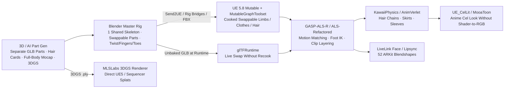
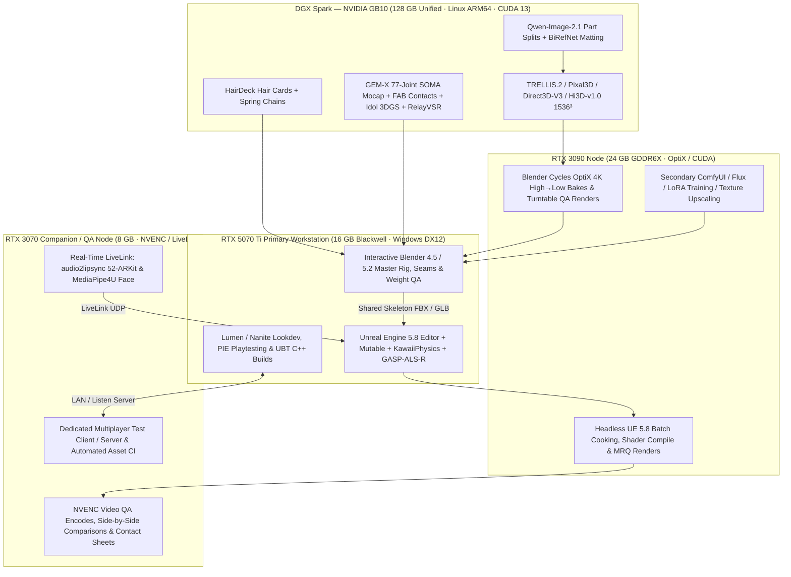

# Awesome Unreal Engine Game Templates, Blueprints & Pro Open-Source Frameworks

A massive, categorized catalog of **Unreal Engine 5 (UE 5.x–5.8)** game templates, Blueprint kits, official Epic samples, and production-grade free & open-source frameworks across every major game genre and engine subsystem.

> **Note on versions & licenses:** UE4 / UE 5.0–5.5 Blueprint projects typically upgrade cleanly to UE 5.8; C++ plugins/projects may require minor API updates on compile. Always check each repository's `LICENSE` before shipping a closed-source commercial game (GPL-2.0/3.0 repos are marked explicitly).

---

## 20-loop catalog updates

- [Unreal Engine](catalogs/UNREAL.md) — new gameplay samples, networking frameworks, and development tools.
- [Blender](catalogs/BLENDER.md) — modeling, rigging, rendering, asset interchange, and automation.
- [Godot](catalogs/GODOT.md) — playable 2D/3D demos and reusable Godot 4 recipes.
- [Unity](catalogs/UNITY.md) — game samples, Unity 6 templates, and package workflows.

## Table of Contents

1. [Official Epic Games Built-In Templates & Free Fab Samples](#1-official-epic-games-built-in-templates--free-fab-samples)
2. [Production-Grade Free & Open-Source Core Frameworks](#2-production-grade-free--open-source-core-frameworks)
3. [FPS, Arena, Tactical & Extraction Shooters](#3-fps-arena-tactical--extraction-shooters)
4. [Third-Person Action, Souls-like, Stealth, Parry & Fighting](#4-third-person-action-souls-like-stealth-parry--fighting)
5. [Action RPG, Top-Down ARPG (Diablo-like), cRPG & Roguelikes](#5-action-rpg-top-down-arpg-diablo-like-crpg--roguelikes)
6. [MOBA & Hero Arena](#6-moba--hero-arena)
7. [Inventory, Equipment, Quests, Dialogue & Visual Novels](#7-inventory-equipment-quests-dialogue--visual-novels)
8. [Survival, Crafting, Base Building & Horror](#8-survival-crafting-base-building--horror)
9. [Locomotion, Animation, Parkour & Secondary Hair/Cloth Physics](#9-locomotion-animation-parkour--secondary-haircloth-physics)
10. [Modular Character Creators, Mutable (UE 5.8), Runtime glTF/VRM & Facial Mocap](#10-modular-character-creators-mutable-ue-58-runtime-gltfvrm--facial-mocap)
11. [Platformer, Side-Scroller, Metroidvania & 2D / 2.5D](#11-platformer-side-scroller-metroidvania--2d--25d)
12. [RTS, Turn-Based Strategy, Tower Defense & City/Farm Builders](#12-rts-turn-based-strategy-tower-defense--cityfarm-builders)
13. [Racing, Vehicles, 6DOF Space Flight & Drone Simulators](#13-racing-vehicles-6dof-space-flight--drone-simulators)
14. [Card Games, Board Games & Puzzles](#14-card-games-board-games--puzzles)
15. [Multiplayer, Party, Co-op, Online Services (OSSv2/Steam/PlayFab) & MMO Backends](#15-multiplayer-party-co-op-online-services-ossv2steamplayfab--mmo-backends)
16. [VR / XR / AR](#16-vr--xr--ar)
17. [Portals, Physics Sandboxes, Chaos Destruction & Level Builders](#17-portals-physics-sandboxes-chaos-destruction--level-builders)
18. [AI, StateTree, 3D Navigation & Mass Entity Crowds](#18-ai-statetree-3d-navigation--mass-entity-crowds)
19. [World, PCG (UE 5.8), Weather, GPU Water, Foliage & 3D Gaussian Splatting](#19-world-pcg-ue-58-weather-gpu-water-foliage--3d-gaussian-splatting)
20. [Stylized / Anime Toon Rendering & Audio / MetaSounds DSP](#20-stylized--anime-toon-rendering--audio--metasounds-dsp)
21. [UI, Settings Menus, Loading Screens, Pooling, Validation, Telemetry & Testing](#21-ui-settings-menus-loading-screens-pooling-validation-telemetry--testing)
22. [Commercial / Pro Fab Frameworks (Reference)](#22-commercial--pro-fab-frameworks-reference)
23. [Giant Indexes, Blueprint Paste-Bins & Free Hubs](#23-giant-indexes-blueprint-paste-bins--free-hubs)
24. [Recommended Commercial-Safe Open-Source Stack (MIT / Apache-2.0)](#24-recommended-commercial-safe-open-source-stack-mit--apache-20)
25. [Blender ↔ UE 5.8 Modular Character, Full-Joint Rigging, Hair/Cloth & Mocap Pipeline](#25-blender--ue-58-modular-character-full-joint-rigging-haircloth--mocap-pipeline)
26. [Multi-GPU Compute Routing Pipeline (DGX Spark GB10 + RTX 5070 Ti + RTX 3090 + RTX 3070)](#26-multi-gpu-compute-routing-pipeline-dgx-spark-gb10--rtx-5070-ti--rtx-3090--rtx-3070)
27. [Free CC0 & Open-Source 3D Models, PBR Textures, HDRIs, Animations & Audio Hubs](#27-free-cc0--open-source-3d-models-pbr-textures-hdris-animations--audio-hubs)
28. [Blender 3D — Rigging, Weight Painting, Modular Characters & Game Rigs](#28-blender-3d--rigging-weight-painting-modular-characters--game-rigs)
29. [Blender 3D — Retopology, UV Unwrapping, Baking, LODs & Mesh Cleanup](#29-blender-3d--retopology-uv-unwrapping-baking-lods--mesh-cleanup)
30. [Blender 3D — Hard-Surface Modeling, CAD, Kitbashing & Add-on Indexes](#30-blender-3d--hard-surface-modeling-cad-kitbashing--add-on-indexes)
31. [Blender 3D — Hair Cards, Grooming, Cloth, Anime/NPR Shaders, Geometry Nodes & 3D Texturing](#31-blender-3d--hair-cards-grooming-cloth-animenpr-shaders-geometry-nodes--3d-texturing)
32. [Open-Source AI 3D Generation, Auto-Rigging, Hair Cards & Video-to-Mocap Repositories](#32-open-source-ai-3d-generation-auto-rigging-hair-cards--video-to-mocap-repositories)

---

## 1. Official Epic Games Built-In Templates & Free Fab Samples

### Built-In UE 5.8 Templates & Genre Variant Packs
Included offline in every Unreal Engine 5.8 installation under `<UE_5.8>/Templates/` (`FeaturePacks/*.upack` and `TemplateResources/Standard/Variant_*`):
- **Core Templates:** `TP_FirstPersonBP`, `TP_ThirdPersonBP`, `TP_TopDownBP`, `TP_VehicleAdvBP`, `TP_VirtualRealityBP`, `TP_HandheldARBP`
- **9 Built-In Genre Variant Packs:** `Variant_Combat`, `Variant_Shooter`, `Variant_Horror`, `Variant_Platforming`, `Variant_SideScroller`, `Variant_TwinStick`, `Variant_Strategy`, `Variant_Offroad`, `Variant_Timetrial`
- **Reference:** [Templates Reference](https://dev.epicgames.com/documentation/unreal-engine/unreal-engine-templates-reference) · [Samples & Tutorials](https://dev.epicgames.com/documentation/unreal-engine/samples-and-tutorials-for-unreal-engine)

### Official Free Epic Games Samples (Fab)

| Project | Focus | Link |
|---|---|---|
| **Lyra Starter Game** | Modular multiplayer FPS/TPS, GAS, CommonUI, GameFeatures | [Fab](https://www.fab.com/listings/93faede1-4434-47c0-85f1-bf27c0820ad0) · [Docs](https://dev.epicgames.com/documentation/unreal-engine/lyra-sample-game-in-unreal-engine) |
| **Game Animation Sample (GASP)** | Motion Matching, Choosers, traversal/parkour, modular AnimBPs | [Fab](https://www.fab.com/listings/880e319a-a59e-4ed2-b268-b32dac7fa016) |
| **Stack-O-Bot** | Third-person Blueprint platformer/puzzle (rebuilt for UE 5.6+) | [Fab](https://www.fab.com/listings/b4dfff49-0e7d-4c4b-a6c5-8a0315831c9c) · [Docs](https://dev.epicgames.com/documentation/en-us/unreal-engine/stack-o-bot-sample-game-in-unreal-engine?application_version=5.7) |
| **Cropout Sample Project** | Cross-platform top-down Casual RTS (Blueprints + CommonUI) | [Fab](https://www.fab.com/listings/bd733d81-7c29-44fe-b53f-65b14d06a9e2) · [Overview](https://www.unrealengine.com/blog/cropout-casual-rts-game-sample-project) |
| **Action RPG** | Official C++/Blueprint Action RPG (GAS, inventory, melee, save/load) | [Fab](https://www.fab.com/listings/ef04a196-03c1-4204-998a-c7d5264fade7) |
| **Multiplayer Shootout** | Official multiplayer lobby, matchmaking, and arena shootout Blueprints | [Fab](https://www.fab.com/listings/4d9fddcd-2c92-4d08-b359-ba4b0568fdfa?lang=en) |
| **Content Examples** | Per-feature Blueprint, Anim, Niagara, Material, and UMG showcase maps | [Fab](https://www.fab.com/listings/4d251261-d98c-48e2-baee-8f4e47c67091) · [Docs](https://dev.epicgames.com/documentation/unreal-engine/content-examples-sample-project-for-unreal-engine?lang=en-US) |
| **Epic Blueprints Showcase** | Level design tools, security systems, and AI Blueprint demos | [Fab](https://www.fab.com/listings/720af3f1-cd24-40a3-a881-ee695a7c9779?lang=en) |
| **A-COM Animation Sample** | Stylized biped & quadruped animation rigs/blueprints | [Fab](https://www.fab.com/listings/7a019296-852d-47b8-86ed-ddcf2835a352?lang=en) |
| **City Sample / Electric Dreams / Valley of the Ancient** | Open-world traffic/crowds, PCG, Substrate, Nanite/Lumen showcases | [Feature Examples](https://dev.epicgames.com/documentation/unreal-engine/engine-feature-examples-for-unreal-engine) · [Sample Games](https://dev.epicgames.com/documentation/unreal-engine/sample-game-projects-for-unreal-engine) |

---

## 2. Production-Grade Free & Open-Source Core Frameworks

| Framework | License | UE / Stack | What It Gives You | Link |
|---|---|---|---|---|
| **Omega Game Framework** | MIT | UE5 · C++/BP | Modular RPG/action framework: abilities, attributes, XP, turn order, inventory, equipment, save system, zone manager, FlowGraph integration | [GitHub](https://github.com/StudioSyndiCatCaius/OmegaGameFramework) · [Fab](https://www.fab.com/listings/1e72596a-b243-43b8-a6f2-b972570fb5f8?lang=en) · [Basic Template](https://www.fab.com/listings/59e40fc2-4d7b-4edf-8722-184da669a160) |
| **AyaDogGames GameplayFramework** | Apache-2.0 | UE 5.7 · C++/BP | Replicated data-driven GAS framework: `AbilitySet`/`PawnData`, CommonUI + MVVM, tag-mapped Enhanced Input, `FFastArraySerializer` inventory, AI/item spawners | [GitHub](https://github.com/AyaDogGames/GameplayFramework) |
| **GameCoreFramework (GCF)** | Open Source | UE5 · C++/BP | Lyra-inspired modular multiplayer framework with Dual ASC architecture, input routing, tickless event-driven design | [GitHub](https://github.com/asugeno/GameCoreFramework) |
| **XistCommonGameSample** | MIT | UE 5.7 · C++/BP | Clean single-player stripped setup of Lyra's `CommonGame`, `CommonUser`, `GameplayMessageRouter`, and `ModularGameplayActors` plugins | [GitHub](https://github.com/XistGG/XistCommonGameSample) |
| **ArtilleryEco** *(pre-alpha)* | MIT | UE5 · C++ | Off-game-thread deterministic gameplay & ability simulation backed by Jolt Physics (Barrage) and input-stream replication (Bristlecone) | [GitHub](https://github.com/OversizedSunCoreDev/ArtilleryEco) |
| **OpenUnrealUtilities (OUU)** | Open Source | UE4/5 · C++/BP | Studio-proven general-purpose Unreal C++/Blueprint utilities plugin | [GitHub](https://github.com/JonasReich/OpenUnrealUtilities) |
| **Unreal Angelscript** | Open Source | UE5 · C++ | Hazelight Studios' hot-reloading gameplay scripting language (vanilla engine plugin port) | [Docs](https://github.com/Hazelight/Docs-UnrealEngine-Angelscript) · [Plugin Port](https://github.com/WillGordon9999/UE-Angelscript) |
| **EssentialUE5BPs** | Open Source | UE5 · BP | Modular third-person Blueprints collection | [GitHub](https://github.com/lostcrowdev/EssentialUE5BPs) |
| **UE5 Game Starter Template** | Open Source | UE5 | General-purpose project starter | [GitHub](https://github.com/motionforge/Unreal-Engine-5-Game-Starter-Template) |
| **Nano** | Open Source | UE | Minimalist starter template for small/jam games | [GitHub](https://github.com/pfist/Nano) |
| **ProjectCallisto** | Open Source | **UE 5.8** · C++/BP | Action-RPG Gameplay Ability System technical showcase & event-driven combat architecture | [GitHub](https://github.com/ramzelsuarez/ProjectCallisto) |
| **UE5-GAS-Multiplayer-Framework** | Open Source | UE5 · C++ | Multiplayer GAS template with client prediction & AAA-style replication patterns | [GitHub](https://github.com/NickMC05/UE5-GAS-Multiplayer-Framework) |
| **ElementalArsenal** | Open Source | UE5 · C++/BP | Modular GAS equipment pipelines, automated elemental reactions (e.g., Fire + Oil = Explosion) & asset generation tools | [GitHub](https://github.com/hemalpatel2990/ElementalArsenal) |
| **GameplayActionFramework** | Open Source | UE5 · C++ | Lightweight GAS-inspired ability framework designed for single-player games with zero replication overhead | [GitHub](https://github.com/Viktor-Antonyak/GameplayActionFramework) |
| **ModularGameplayAbilities** | Open Source | UE5 · C++ | Lyra-inspired GAS boilerplate & modular ability extension plugin | [GitHub](https://github.com/MajorTomAW/ModularGameplayAbilities) |
| **ue5-gas-prototype** | Open Source | UE 5.6 · C++ | Dual ASC ownership patterns, native Gameplay Tags, Enhanced Input & reactive UI | [GitHub](https://github.com/nbertoa/ue5-gas-prototype) |
| **ue5-rpg-ability-system** | Open Source | UE5 · GAS | Skill book, action bar, cooldowns & animation-driven ability casting reference | [GitHub](https://github.com/Mustafa-Kum/ue5-rpg-ability-system) |

---

## 3. FPS, Arena, Tactical & Extraction Shooters

| Name | Source | UE / License | Highlights | Link |
|---|---|---|---|---|
| **GASShooter (UE 5.5)** | GitHub | UE 5.5 · MIT | Full multiplayer FPS/TPS built on Gameplay Ability System | [GitHub](https://github.com/pikogoro/GASShooter_UE55) |
| **GASShooter (Original)** | GitHub | UE4/5 · MIT | Canonical GAS shooter reference | [GitHub](https://github.com/tranek/GASShooter) |
| **Realistic Assault Rifle Template** | GitHub | UE5 · BP | Modular weapon attachments, animations, FPS Blueprint system | [GitHub](https://github.com/OctavianTocan/Realistic-Assault-Rifle-Template) |
| **Unreal Shooter Base** | GitHub | UE5 · C++/BP | Multiplayer shooter w/ GAS, AI Behavior Trees, networked physics | [GitHub](https://github.com/SucceedHQ-innovations/unreal-shooter-base) |
| **SuperSimpleFPSPack** | GitHub | UE 5.5 · BP | Extended First Person Shooter starter | [GitHub](https://github.com/KPettingerEEN/SuperSimpleFPSPack) |
| **UE5 Arena Shooter Sample** | GitHub | UE5 · C++ | Arena / boomer shooter movement & combat | [GitHub](https://github.com/KamikaziUk/UE5-Arena-Shooter-Sample) |
| **Blackline Contract (PTA)** | GitHub | UE 5.5 | Tactical extraction shooter prototype | [GitHub](https://github.com/triopstudios/blacklinecontract_pta) |
| **UE5 Weapon System** | GitHub | UE5 · BP/C++ | Projectiles, muzzle flash, bullet hole decals, impact VFX | [GitHub](https://github.com/ArtemChig/UE5-Weapon-System) |
| **UE5-EnhancedProjectile** | GitHub | UE5 · C++/BP | StateTree-driven projectile framework with pooling & prediction validation | [GitHub](https://github.com/HanYe0817/UE5-EnhancedProjectile) |
| **SimpleFPSTemplate** | GitHub | UE4/5 · C++ | Minimalist FPS starter by Tom Looman | [GitHub](https://github.com/tomlooman/SimpleFPSTemplate) |
| **Kosm Classic FPS Template** | GitHub | UE4 · BP | Classic arena shooter mechanics & pickups | [GitHub](https://github.com/vtx-factory/Kosm-Classic-FPS-Template-UE4) |
| **Project Isolation** | GitHub | UE · MIT | Open-source single-player FPS C++ codebase | [GitHub](https://github.com/whoisEllie/Project-Isolation) |
| **Free FPS Template & Tutorial** | Fab | UE5 · Free | Free starter FPS Blueprint project & tutorial | [Fab](https://www.fab.com/listings/6a0af880-2b74-480c-a82c-8e597918dffe?lang=en) |
| **Realistic FP Movement V1** | itch.io | UE5 · Free | Free realistic first-person movement template | [itch.io](https://treetygames.itch.io/realistic-first-person-movement-template-v1-in-unreal-engine-5-free-download) |

---

## 4. Third-Person Action, Souls-like, Stealth, Parry & Fighting

| Name | Source | UE / License | Highlights | Link |
|---|---|---|---|---|
| **CoopSoulsGame (UE 5.7)** | GitHub | UE 5.7 · C++/BP | Light/heavy/charge attacks, parry, dodge, backstab, poise, boss AI, lock-on | [GitHub](https://github.com/Roomixer/Souls-game-UE-5.7) |
| **Sekiro Clone (Action Adventure)** | GitHub | UE5 · C++ (GAS) | Deflect/parry, posture stagger, backstab & plunging deathblows, grappling hook, wall jump, stealth whistle, lock-on | [GitHub](https://github.com/kantam5/UE5-Action-Adventure-Sekiro-Clone) |
| **StealthDemo** | GitHub | UE 5.5 · C++ | Third-person stealth action: AI security cameras, patrol robots, Attack ↔ Search ↔ Patrol Behavior Trees | [GitHub](https://github.com/CanReader/StealthDemo) |
| **UE5 RPG Melee Combat System** | GitHub | UE5 · C++/BP | Modular melee combat: combo windows, input buffering, anim-driven hit detection | [GitHub](https://github.com/Mustafa-Kum/ue5-rpg-melee-combat-system) |
| **UE5 Soulslike Combat** | GitHub | UE 5.7 | Souls-like combat project | [GitHub](https://github.com/Kulahala/UE5-Soulslike-Combat) |
| **Soulsborne** | GitHub | UE5 | Third-person Souls-like project | [GitHub](https://github.com/St4rman/Soulsborne) |
| **Echoes of the Lost Sands** | GitHub | UE5 | Souls-like RPG with melee combat & AI enemies | [GitHub](https://github.com/Mecha-NOX/Echoes-of-the-Lost-Sands) |
| **MedivalCombatGame** | GitHub | UE5 · C++ | Souls-inspired medieval combat prototype | [GitHub](https://github.com/KevinRusev/MedivalCombatGame) |
| **UE5 Hack and Slash** | GitHub | UE5 · GPL-3.0 | Third-person hack & slash action game | [GitHub](https://github.com/willroberts/ue5-hack-and-slash) |
| **NightSkyEngine** | GitHub | UE · MIT | C++ fighting-game framework | [GitHub](https://github.com/WistfulHopes/NightSkyEngine) |
| **TargetSystemPlugin** | GitHub | UE4/5 | Dark Souls-style camera lock-on / targeting plugin | [GitHub](https://github.com/mklabs/ue4-targetsystemplugin) |
| **WeaponTrace-Unreal** | GitHub | UE · Plugin | Reliable melee weapon socket/sweep hit tracing | [GitHub](https://github.com/getnamo/WeaponTrace-Unreal) |
| **Enhanced Third Person Template** | Fab | UE5 · BP | Modernized drop-in third-person starter | [Fab](https://www.fab.com/listings/90517cb6-120b-4d8c-b8b3-1f9a74b91104?lang=en) |

---

## 5. Action RPG, Top-Down ARPG (Diablo-like), cRPG & Roguelikes

| Name | Source | UE / License | Highlights | Link |
|---|---|---|---|---|
| **ActionRoguelike (Tom Looman)** | GitHub | UE5 · C++/BP | Co-op action roguelike: abilities, AI, items, multiplayer (4.5k+★) | [GitHub](https://github.com/tomlooman/ActionRoguelike) |
| **Obsidian** | GitHub | UE5 · GPL-3.0 | Multiplayer Diablo-2-style GAS ARPG: procedural loot/affixes, replicated grid inventory, equipment mesh spawning, stash tabs, boss AI | [GitHub](https://github.com/intrxx/Obsidian) |
| **CharmingCraft** | GitHub | UE 5.3 · GPL-2.0 | Top-down low-poly RPG (Minecraft Dungeons / Albion Online): GAS item skills, modular armor/weapon assembly, chunks, farming & building | [GitHub](https://github.com/Caishangqi/CharmingCraft) |
| **UE5TopDownARPG** | GitHub | UE5 · C++/BP | Clean top-down ARPG starter (Ubisoft Sofia / Univ. of Sofia architecture course) | [GitHub](https://github.com/k1p1/UE5TopDownARPG) |
| **cRPG-Project** | GitHub | UE5 · C++/BP | Multiplayer turn-based cRPG: data-driven Gameplay Action System, encounter manager, inventory, DFS GOAP AI | [GitHub](https://github.com/e-oneill/cRPG-Project) |
| **ActionRPG-UE5** | GitHub | UE5 · C++/BP | Epic's official ActionRPG sample upgraded to UE5 | [GitHub](https://github.com/BoilTask/ActionRPG-UE5) |
| **ActionRPGV5** | GitHub | UE5 · MIT | Clean Action RPG sample for UE5 | [GitHub](https://github.com/dahlgrenmartin/ActionRPGV5) |
| **Open RPG Template** | GitHub | UE 5.4 · MIT | Open-source RPG starter template | [GitHub](https://github.com/polygonvariable/open-rpg-template) |
| **RPGTemplate** | GitHub | UE5 | Modular RPG project template | [GitHub](https://github.com/eren-pekdemir/RPGTemplate) |
| **ParagonGAS** | GitHub | UE5 · GAS | GAS combat system using free Fab Paragon assets | [GitHub](https://github.com/realchrisparker/ParagonGAS) |
| **UE5 C++ GAS Code Samples** | GitHub | UE5 · C++ | GAS abilities, attributes, effects, AI & RPG progression | [GitHub](https://github.com/jessebr2/UE5-Cpp-GAS-Code-Samples) |
| **GASDocumentation** | GitHub | UE4/5 · MIT | Definitive GAS documentation + multiplayer sample project | [GitHub](https://github.com/tranek/GASDocumentation) |
| **Solo-Leveling-ARPG** | GitHub | UE 5.7.2 · C++ | Large ARPG foundation: procedural dungeons (10 biomes / 6 ranks), world events, quests, guilds, NPC schedules (WIP) | [GitHub](https://github.com/clarkstone/Solo-Leveling-ARPG) |

---

## 6. MOBA & Hero Arena

| Name | Source | UE / License | Highlights | Link |
|---|---|---|---|---|
| **Tartarus Arena** | GitHub | **UE 5.8** · MIT | Full 5v5 MOBA (Smite-style Arena + 3-lane Conquest), GAS, 11 Paragon hero configs, 27-item shop, smart bots, LAN multiplayer, plus a Hades-style action prototype | [GitHub](https://github.com/BartekZawadzki/TartarusArena) |

---

## 7. Inventory, Equipment, Quests, Dialogue & Visual Novels

| Name | Source | UE / License | Highlights | Link |
|---|---|---|---|---|
| **InventoryPluginUE5** | GitHub | UE 5.6+ · MIT | Server-authoritative multiplayer spatial-grid inventory (`FInv_ItemFragment` + `FFastArraySerializer`), drag-drop UI, equipment socket spawning, weight system | [GitHub](https://github.com/alessandrobelli/InventoryPluginUE5) |
| **UE5 RPG Inventory System** | GitHub | UE5 · GAS/UI | Modular inventory, equipment stats & modular mesh swapping | [GitHub](https://github.com/Mustafa-Kum/ue5-rpg-inventory-system) |
| **InventorySystem (Hotbar)** | GitHub | UE5 · BP | Easy hotbar & inventory system | [GitHub](https://github.com/finalstack/InventorySystem) |
| **Free Modular List Inventory** | Fab | UE5 · Free | Free modular list inventory Blueprint system | [Fab](https://www.fab.com/listings/e28df43c-6ed8-4616-9d02-0fa3756f39f8?lang=en) |
| **Mountea Framework Suite** | GitHub | UE5 · MPL-2.0 / GPL-2.0 | Dialogue Tree editor + validator (MPL-2.0), Interaction System, Inventory & Equipment with visual slots (GPL-2.0) | [Org](https://github.com/Mountea-Framework) · [Dialogue](https://github.com/Mountea-Framework/MounteaDialogueSystem) · [Interaction](https://github.com/Mountea-Framework/MounteaInteractionSystem) · [Inventory](https://github.com/Mountea-Framework/MounteaInventoryEquipment) |
| **FlowGraph (MothCocoon)** | GitHub | UE5 · MIT | Production node-based narrative, quest & event scripting graph (1.8k+★) | [GitHub](https://github.com/MothCocoon/FlowGraph) |
| **SUQS** | GitHub | UE4/5 · MIT | Steve's data-driven Unreal Quest System | [GitHub](https://github.com/sinbad/SUQS) |
| **ArcActivities** | GitHub | UE5 | Custom graph editor for quests & gameplay activities | [GitHub](https://github.com/punyhumangames/ArcActivities) |
| **DlgSystem (NotYetGames)** | GitLab | UE4/5 · MIT | Graph-based branching dialogue plugin | [GitLab](https://gitlab.com/NotYetGames/DlgSystem) |
| **OpenRPG Modules** | GitHub | UE4/5 · BP | Modular Inventory, Quests, Stats, and 360° Radar | [Inventory](https://github.com/angelhodar/OpenRPG_Inventory) · [Quests](https://github.com/angelhodar/OpenRPG_Quest) · [Stats](https://github.com/angelhodar/OpenRPG_Stats) · [Radar](https://github.com/angelhodar/OpenRPG_RadarSystem) |
| **Shiden Visual Novel Editor** | GitHub | **UE 5.3–5.8** · MIT | Complete VN/narrative editor with live preview, 41 commands, branching, save/load, backlog, gallery, CSV/JSON I/O | [GitHub](https://github.com/HANON-games/Shiden) |
| **KaedeVN** | GitHub | **UE 5.8** · MIT | Script-driven visual novel runtime (Slate UI, KSC VM, shaders, sample 2D novel) | [GitHub](https://github.com/kaedeasset/kaedevn) |

---

## 8. Survival, Crafting, Base Building & Horror

| Name | Source | UE / License | Highlights | Link |
|---|---|---|---|---|
| **DyingCity** | GitHub | **UE 5.8** · C++ | Modular survival: AI, combat, inventory, dynamic world | [GitHub](https://github.com/HideInFade/DyingCity) |
| **ALIS** | GitHub | UE5 · C++ | Open-source survival game, modular plugins, JSON data-driven architecture | [GitHub](https://github.com/fallintodusk/alis) |
| **BiomeSurvivor** | GitHub | UE5 · Co-op | Open-world multiplayer survival: biomes, crafting, building, weather, LAN/co-op | [GitHub](https://github.com/KasparPlaas/BiomeSurvivor) |
| **Survival Prototype UE5** | GitHub | UE5 · BP | Blueprint interaction, inventory, and equipment handling | [GitHub](https://github.com/vatsalmandali/survival-prototype-ue5) |
| **EpicSurvivalGame** | GitHub | UE4/5 · MIT | Classic third-person survival reference (3.3k+★) | [GitHub](https://github.com/tomlooman/EpicSurvivalGame) |
| **Survival Horror Game Template** | GitHub | UE 5.6 | Starter survival horror project | [GitHub](https://github.com/TirdadMH/Survival-Horror-Game-Template) |
| **SurvivalHorrorProject** | GitHub | UE5 | 9 environmental puzzles, per-limb hit reactions, map & inventory | [GitHub](https://github.com/andrewRCr/SurvivalHorrorProject) |
| **Forest of Nightmares** | GitHub | UE5 · C++ | Cinematic horror survival with Lumen, Nanite & VSM | [GitHub](https://github.com/hunterleek/ForestOfNightmares) |
| **BloodMoon** | GitHub | UE5 · MIT | Third-person zombie survival shooter | [GitHub](https://github.com/FreshBakedCode/BloodMoon_Public) |
| **HordeTemplate** | GitHub | UE · MIT | Wave-based horde survival template | [GitHub](https://github.com/DasBander/HordeTemplate) |
| **Budget-Backrooms** | GitHub | UE · GPL-3.0 | Single-player Backrooms atmospheric horror | [GitHub](https://github.com/dabardibid/Budget-Backrooms) |
| **FREE Complete Horror Template** | Fab | UE5 · Free | Free horror jumpstart template | [Fab](https://www.fab.com/listings/e7196401-afca-474d-88b8-537606c8c1ad?lang=en) |
| **Free Horror Game Template [UE5]** | itch.io | UE5 · Free | Free downloadable UE5 horror template | [itch.io](https://visq.itch.io/free-horror-game-template-ue5) |

---

## 9. Locomotion, Animation, Parkour & Secondary Hair/Cloth Physics

| Name | Source | UE / License | Highlights | Link |
|---|---|---|---|---|
| **ALS-Refactored** | GitHub | UE5 · MIT | Production C++ rewrite of Advanced Locomotion System V4 | [GitHub](https://github.com/Sixze/ALS-Refactored) |
| **GASP-ALS-R** | GitHub | UE5 · MIT | Epic Motion Matching (GASP) + ALS-Refactored layering + GAS | [GitHub](https://github.com/SAM-tak/GASP-ALS-R) |
| **GASPALS** | GitHub | UE5 | GASP + ALS animation layering (1.1k+★) | [GitHub](https://github.com/PolygonHive/GASPALS) |
| **ALSXT** | GitHub | UE5 · Dual License | Extends `ALS-Refactored` into a modular GAS data-oriented character system | [GitHub](https://github.com/Voidware-Prohibited/ALSXT) |
| **ALS-Refactored-EOS** | GitHub | UE5 | Template combining ALS-Refactored + EOS + Steam + CommonUI | [GitHub](https://github.com/delebash/ALS-Refactored-EOS) |
| **GMCLocomotion** | GitHub | UE5 | General Movement Component + GASP Motion Matching & Warping | [GitHub](https://github.com/Dr-Rank/GMCLocomotion) |
| **MovementExhibition** | GitHub | UE5 · C++ | Replicated CharacterMovementComponent extension: grapple hook, rope, dive roll/dash, ramp physics sliding | [GitHub](https://github.com/zSelimReborn/MovementExhibition) |
| **Parkour & Climbing Systems** | GitHub | UE5 · C++/BP | Vaulting, ledge climbing, wall traversal | [C++ Parkour](https://github.com/RahulChandra99/ue5-cpp-parkour-climbing-mechanics) · [UE5ParkourSystem](https://github.com/peilunnn/UE5ParkourSystem) · [QGDeep Parkour](https://github.com/QGDeep/Parkour-System) |
| **Spider Procedural Locomotion** | GitHub | UE5 · Control Rig | Procedural multi-limb wall/ceiling locomotion | [GitHub](https://github.com/SupernerdX/UE5-Spider-Procedural-Locomotion) |
| **KawaiiPhysics** | GitHub | UE4/5 · MIT | Secondary AnimGraph bone physics for hair, skirts, sleeves, capes, and accessories | [GitHub](https://github.com/pafuhana1213/KawaiiPhysics) |
| **MallangPhysics** | GitHub | **UE 5.6–5.8** · MIT | GPU soft-body deformation on skeletal & static meshes | [GitHub](https://github.com/wjsekrud/MallangPhysics) |
| **ACL Plugin** | GitHub | UE4/5 · MIT | Animation Compression Library plugin (higher precision, lower RAM) | [GitHub](https://github.com/nfrechette/acl-ue4-plugin) |
| **motionmatchingreplicated** | GitHub | UE5 · MIT | Replicated UE5 Motion Matching locomotion sample (198★) | [GitHub](https://github.com/cenairaclub/motionmatchingreplicated) |
| **DaftMover** | GitHub | UE5 · MIT | Custom movement built on Unreal Engine 5's modern **Mover** framework | [GitHub](https://github.com/daftsoftware/DaftMover) |
| **ALSLyra** | GitHub | UE5 · C++ | Advanced Locomotion System V4 Refactored integrated into Lyra | [GitHub](https://github.com/UnrealEnginePersonal/ALSLyra) |

---

## 10. Modular Character Creators, Mutable (UE 5.8), Runtime glTF/VRM & Facial Mocap

| Name | Source | UE / License | Highlights | Link |
|---|---|---|---|---|
| **glTFRuntime** | GitHub | UE5 · MIT | Load `.glb`/`.gltf` meshes, skeletons, morph targets & animations **at runtime** for swappable modular limbs, outfits & hair | [GitHub](https://github.com/rdeioris/glTFRuntime) · [Docs](https://github.com/rdeioris/glTFRuntime-docs) |
| **Mutable Graph Toolset** | GitHub / Fab | **UE 5.8** | 22 native MCP tools to build Epic **Mutable** Customizable Object graphs (clothing, hair/grooms, body options), compile & preview | [GitHub](https://github.com/ITemre/MutableGraphToolset) · [Fab](https://www.fab.com/listings/aa935747-f923-4d4f-aa23-1b2a8e8a196d) |
| **FORMA Lite** | GitHub (Docs) | **UE 5.8** · BP | Blueprint character creator studio built on Mutable with third-person gameplay handoff (docs repo; project on Fab) | [GitHub](https://github.com/ITemre/FORMA-Lite) |
| **Project Phoenix (RTFKT)** | GitHub | UE5 · MIT | Open-source UE5 modular trait & wearable equip/edit studio + lighting maps | [GitHub](https://github.com/RTFKT-Ltd/ProjectPhoenix-UE5) |
| **VRM4U** | GitHub | UE5 · MIT | Runtime VRM anime character importer (skeleton retarget, spring bones, morphs, toon shaders) | [GitHub](https://github.com/ruyo/VRM4U) |
| **ue5-mmd-toolkit (AMAP5 V2)** | GitHub | UE5 | PMX/VMD model & motion pipeline generating native UE5 Skeletal Meshes and AnimSequences | [GitHub](https://github.com/AMAP-N/ue5-mmd-toolkit) |
| **unreal-audio2lipsync** | GitHub | UE5 | Audio-driven lipsync (HuBERT + Transformer → 52 ARKit blendshapes via LiveLink) | [GitHub](https://github.com/aaryansachdeva/unreal-audio2lipsync) |
| **unreal-motion (MediaPipe4U)** | GitHub | UE5 | Real-time webcam 52-ARKit facial tracking into UE5 over LiveLink | [GitHub](https://github.com/althropic/unreal-motion) |

---

## 11. Platformer, Side-Scroller, Metroidvania & 2D / 2.5D

| Name | Source | UE / License | Highlights | Link |
|---|---|---|---|---|
| **AP_Template (Action Platformer)** | GitHub | UE4/5 · MIT | Pure-Blueprint Swiss-army knife: grapple swing/pull, wall/rope/ledge/ladder/zipline climbing, portals, swimming + raft, endless runner, character switch | [GitHub](https://github.com/coquigames/AP_Template) |
| **TP_2DSideScrollerBP** | GitHub | UE5 · CC0 | Clean 2D side-scroller Blueprint template | [GitHub](https://github.com/CobraCodeDev/TP_2DSideScrollerBP) |
| **ModernSidescrollerTemplate** | GitHub | UE5–5.4 · BP | Updated 3D/2.5D side-scroller starter | [GitHub](https://github.com/matheuslaidler/ModernSidescrollerTemplate) |
| **UE5_2DPlatformer** | GitHub | UE5 · MIT | 2D platformer template | [GitHub](https://github.com/O-Y-G/UE5_2DPlatformer) |
| **PixelAdventure2D-UE5** | GitHub | UE5 · BP | Open-source 2D pixel-art Blueprint template | [GitHub](https://github.com/YspCoder/PixelAdventure2D-UE5) |
| **Captain 2D Platformer** | GitHub | UE5 · PaperZD | 2D platformer built with PaperZD + Blueprints | [GitHub](https://github.com/hnqca/captain2D-platformer-UE5) |
| **SideScrollerBP** | GitHub | UE5 · MIT | Blueprint side-scroller template | [GitHub](https://github.com/dlarkinc/SideScrollerBP) |
| **2D Hack & Slash Template** | GitHub | UE5 · BP | 2D side-scrolling combat template | [GitHub](https://github.com/Well-known-Game-Studio/2DHackSlash) |
| **UE5 Soul Boy** | GitHub | UE5 | 2.5D Souls-like dark fantasy sidescroller | [GitHub](https://github.com/3sannasia/UE5-Soul-Boy) |
| **UE4 Classic Templates for UE5** | GitHub | UE5 | Classic UE4 SideScroller2D, TwinStick, Flying & Rolling templates ported to UE5 | [GitHub](https://github.com/ScaerieTale/Unreal-Engine-4.27.2-Templates) |

---

## 12. RTS, Turn-Based Strategy, Tower Defense & City/Farm Builders

| Name | Source | UE / License | Highlights | Link |
|---|---|---|---|---|
| **Skald Turn-Based Strategy** | GitHub | UE5 · C++/BP | Full turn-based strategy codebase (4,200+ commits) | [GitHub](https://github.com/Matrocoles/Skald_TurnBasedStrategy_Code) |
| **TurnBasedTacticalCombat** | GitHub | UE5 | Grid tactical turn-based combat | [GitHub](https://github.com/justAbhi77/TurnBasedTacticalCombat) |
| **UnrealRTS** | GitHub | UE5 | RTS & tower defense foundation | [GitHub](https://github.com/gcclua/UnrealRTS) |
| **ue4-rts** | GitHub | UE4/5 · MIT | Real-time strategy plugin + showcase | [GitHub](https://github.com/npruehs/ue4-rts) |
| **tower-defense-ue5** | GitHub | UE5 | Tower defense starter project | [GitHub](https://github.com/WilkinGames/tower-defense-ue5) |
| **Hive Mind** | GitHub | UE5 | Hexagon-tile turn-based strategy & building | [GitHub](https://github.com/chFleschutz/hive-mind) |
| **FarmSimulator** | GitHub | UE5 | Farming & management building template | [GitHub](https://github.com/GP2P/FarmSimulator) |
| **city-form** | GitHub | UE · MIT | Open-source city-building project | [GitHub](https://github.com/JonathanWMorris/city-form) |
| **VaFogOfWar** | GitHub | UE · Plugin | Fog of War system for RTS/MOBA | [GitHub](https://github.com/ufna/VaFogOfWar) |

---

## 13. Racing, Vehicles, 6DOF Space Flight & Drone Simulators

| Name | Source | UE / License | Highlights | Link |
|---|---|---|---|---|
| **UE5 Vehicle Template** | GitHub | UE5 · BP | Modular driving mechanics + visual car damage | [GitHub](https://github.com/AnastasisMarinos/UE5-Vehicle-Template) |
| **KartingGame** | GitHub | UE5 · C++ | Multiplayer kart racing, vehicle physics & track tooling | [GitHub](https://github.com/HawkDev15/KartingGame) |
| **UE5 Steam Multiplayer Racing** | GitHub | UE 5.6 | Steam listen-server racing: lobby travel, countdown, win/loss | [GitHub](https://github.com/zawadAli/UE5-Steam-Multiplayer-Racing) |
| **RacingGame** | GitHub | UE5 | 3D racing: checkpoints, lap counter, custom tracks | [GitHub](https://github.com/prashannaantony/RacingGame) |
| **DriftScape** | GitHub | UE5 | Drift racing starter project | [GitHub](https://github.com/reyhan0173/DriftScape) |
| **DroneSimulator SDK** | GitHub | UE5 · GPL-3.0 | High-frequency multirotor physics (BEMT + arcade), PID controller, modular frames/motors/props/batteries, EdgeTX/DJI RC input | [GitHub](https://github.com/Evols/DroneSimulator) |
| **Unreal Space Program (JSBSim)** | GitHub | UE5 | Aerospace & flight physics simulator using JSBSim | [GitHub](https://github.com/finger563/unreal-space-program) |
| **FlightForge** | GitHub | UE · BSD-3 | Open-source quadcopter/drone flight simulator | [GitHub](https://github.com/ctu-mrs/flight_forge) |
| **Simple 6DOF Spaceship Example** | GitHub | UE4/5 · MIT | 6DOF zero-G spaceship Blueprints, HUD & space map | [GitHub](https://github.com/jawadato/simple-6DOF-component-example) |
| **UnrealEngineFlightProject** | GitHub | UE5 | Aircraft flight controller project | [GitHub](https://github.com/Michael-Yuan-Trebble/UnrealEngineFlightProject) |
| **PsRealVehicle** | GitHub | UE · Plugin | Force-driven vehicle simulation plugin | [GitHub](https://github.com/PushkinStudio/PsRealVehicle) |

---

## 14. Card Games, Board Games & Puzzles

| Name | Source | UE / License | Highlights | Link |
|---|---|---|---|---|
| **K_Cards Game Feature** | GitHub | UE5 · C++/BP | Turn-based card game framework using GAS, AI & custom attributes | [GitHub](https://github.com/Kodingroo/K_Cards-Game-Feature) |
| **ue5-cardgame** | GitHub | UE5 · MIT | Card game plugin for UE5 | [GitHub](https://github.com/perfect-hand/ue5-cardgame) |
| **ACGCard** | GitHub | UE4/5 | Hearthstone-style CCG sample | [GitHub](https://github.com/egojump/ACGCard) |
| **UE5 Chess** | GitHub | UE5 | Full 3D chess board & ruleset | [GitHub](https://github.com/fedeg202/Chess) |
| **CryptRaider** | GitHub | UE5 | 3D first-person environmental puzzle prototype | [GitHub](https://github.com/denyskryvytskyi/CryptRaider) |
| **Unreal Simon Game** | GitHub | UE 5.4 · C++ | 2D music/memory puzzle prototype | [GitHub](https://github.com/reuttaldev/Unreal-Simon-Game) |

---

## 15. Multiplayer, Party, Co-op, Online Services (OSSv2/Steam/PlayFab) & MMO Backends

| Name | Source | UE / License | Highlights | Link |
|---|---|---|---|---|
| **OnlineServicesSteam (OSSv2)** | GitHub | UE5 | Steam backend for UE5's Online Services (OSSv2) + Steam Datagram Relay net driver (works in PIE) | [GitHub](https://github.com/PoFigGames/OnlineServicesSteam) |
| **AdvancedSessionsPlugin** | GitHub | UE4/5 · MIT | Blueprint-exposed Steam/EOS/LAN sessions, lobbies, friends & voice | [GitHub](https://github.com/mordentral/AdvancedSessionsPlugin) |
| **EnhancedOnlineSessions** | GitHub | UE5 · MIT | Modern UE5 online session management plugin | [GitHub](https://github.com/MajorTomAW/EnhancedOnlineSessions) |
| **PlayFabMultiplayerUnreal** | GitHub | UE5 · MIT | Official PlayFab Online Subsystem plugin (lobbies, matchmaking, party) | [GitHub](https://github.com/PlayFab/PlayFabMultiplayerUnreal) |
| **Multiplayer Party Game Template** | GitHub | UE5 · C++ | Lobbies, modular minigames, abilities | [GitHub](https://github.com/rdelian/Multiplayer-Party-Game-Template-UE5) |
| **Bomber** | GitHub | UE5 · MIT | Clean modern UE5 multiplayer codebase | [GitHub](https://github.com/JanSeliv/Bomber) |
| **UE5 Online Multiplayer Adventure** | GitHub | UE5 · C++ | 2-player Steam co-op with GameInstance subsystem & RPCs | [GitHub](https://github.com/nbertoa/ue5-online-multiplayer-adventure) |
| **Make-Live Multiplayer** | GitHub | UE5 | Pixel Streaming multiplayer + GAS + World Partition | [GitHub](https://github.com/make-live/multiplayer) |
| **Horizon UE5 Template** | GitHub | UE5 | Dedicated game server starter template | [GitHub](https://github.com/Far-Beyond-Dev/Horizon_UE5_Template) |
| **Open World Server (OWS)** | GitHub | UE5 · MMO | Dedicated multi-zone MMO instance server backend | [GitHub](https://github.com/Dartanlla/OWS) |
| **VaRest / unreal-fetch** | GitHub | UE4/5 · MIT | Blueprint & C++ REST/JSON HTTP clients | [VaRest](https://github.com/ufna/VaRest) · [unreal-fetch](https://github.com/GameDev4K/unreal-fetch) |
| **Packt UE5 Multiplayer Samples** | GitHub | UE5 | Complete multiplayer book sample projects | [GitHub](https://github.com/PacktPublishing/Multiplayer-Game-Development-with-Unreal-Engine-5) |
| **Rollback-Core** | GitHub | UE5 · MIT | Deterministic GGPO-style rollback netcode: fixed-step sim, SaveGame-reflection state capture & UDP input redundancy | [GitHub](https://github.com/gregorik/Rollback-Core) |
| **Lyra Edgegap Dedicated Server Sample** | GitHub | **UE 5.8** | Epic's Lyra wired for EOS sessions, matchmaking & container dedicated servers | [GitHub](https://github.com/edgegap/game-sample-unreal-engine-lyra) |
| **EasyMatchmaking (EOS)** | GitHub | UE 5.6 · BP/C++ | EOS lobbies, sessions & dedicated servers with full Blueprint support | [GitHub](https://github.com/DanielKocan/EasyMatchmaking) |
| **ue5-steam-session-plugin** | GitHub | UE 5.6 · C++ | Steam listen-server lobby with seamless dedicated server travel on match start | [GitHub](https://github.com/dooyeonk/ue5-steam-session-plugin) |
| **Epic EOS Getting Started** | GitHub | UE5 · MIT | Official Epic Online Services integration samples | [GitHub](https://github.com/EpicGames/EOS-Getting-Started) |
| **Nakama Unreal SDK** | GitHub | UE4/5 · Apache-2.0 | Official open-source Nakama server SDK (accounts, chat, social, matchmaker, realtime multiplayer) | [GitHub](https://github.com/heroiclabs/nakama-unreal) |
| **Replication_Graph_UE5** | GitHub | UE5 · C++ | Network Replication Graph setup tuned for 100+ players | [GitHub](https://github.com/droganaida/Replication_Graph_UE5) |
| **NetworkReplication-UE5** | GitHub | UE 5.6+ · BP | Blueprint-friendly multiplayer networking & replication monitor without manual RPCs | [GitHub](https://github.com/straywriter/NetworkReplication-UE5) |
| **AccelByte EOS Voice / 4Players ODIN** | GitHub | UE5 | Real-time voice chat & spatialized 3D multiplayer voice SDK plugins | [EOS Voice](https://github.com/AccelByte/accelbyte-eos-voice-unreal) · [ODIN Voice](https://github.com/4Players/odin-unreal-demo) |

---

## 16. VR / XR / AR

| Name | Source | UE / License | Highlights | Link |
|---|---|---|---|---|
| **VRExpansionPlugin** | GitHub | UE4/5 · MIT | Industry-standard open-source VR framework (gripping, physics hands, climbing, sliders/levers, replication) | [GitHub](https://github.com/mordentral/VRExpansionPlugin) |
| **UE-VRHands-Template** | GitHub | UE5 · BP | Dynamic VR hands, touchscreens, grabbables & locomotion | [GitHub](https://github.com/DanielRBowen/UE-VRHands-Template) |
| **VR Multiplayer Racing** | GitHub | UE5 | Multiplayer VR racing with custom locomotion | [GitHub](https://github.com/SemyanovVisuals/race-multiplayer) |

---

## 17. Portals, Physics Sandboxes, Chaos Destruction & Level Builders

| Name | Source | UE / License | Highlights | Link |
|---|---|---|---|---|
| **Wormhole Portal** | GitHub | **UE 5.8** · C++/BP | Volumetric lensing wormhole portal plugin with bidirectional actor/projectile transit, portal-aware line traces, audio/light transmission & Portal Gun demo | [GitHub](https://github.com/TeamBeaverStudio/WormholePortal) |
| **Modular Mechanics Toolkit** | GitHub | UE 5.7 · MIT | Grid-free snapping building, tactile inertia physics grabber, Chaos destruction (`BPC_BuildThrowC4`), persistent world save/load | [GitHub](https://github.com/REPIRK/Modular-Mechanics-Toolkit-UE5) |
| **UE-Grapple-Game** | GitHub | UE5 · C++ | First-person grappling hook, physics whipping, wall climbing & turrets | [GitHub](https://github.com/juaxix/UE-Grapple-Game) |
| **WorldMason** | GitHub | UE5 · MIT | Spline, instanced mesh & dynamic mesh level-building Blueprint toolkit (walls, curved stairs, rooms, bridges, domes) | [GitHub](https://github.com/StudioSyndiCatCaius/WorldMason) |
| **RealtimeMeshComponent** | GitHub | UE5 · MIT | High-performance runtime procedural mesh renderer (replaces `ProceduralMeshComponent`) | [GitHub](https://github.com/TriAxis-Games/RealtimeMeshComponent) |
| **ProceduralDungeon** | GitHub | UE4/5 | Room-based procedural dungeon generator plugin | [GitHub](https://github.com/BenPyton/ProceduralDungeon) |

---

## 18. AI, StateTree, 3D Navigation & Mass Entity Crowds

| Name | Source | UE / License | Highlights | Link |
|---|---|---|---|---|
| **Gunfire3DNavigation** | GitHub | UE5 | Gunfire Games (*Remnant II*) open-source voxelized 3D navigation plugin for flying/vertical AI | [GitHub](https://github.com/GunfireGames/Gunfire3DNavigation) |
| **Nav3D** | GitHub | UE 5.6 | Sparse Voxel Octree 3D pathfinding with tactical reasoning | [GitHub](https://github.com/darbycostello/Nav3D) |
| **SDF_Grid_Navigation** | GitHub | UE5 | 6DOF volumetric Signed Distance Field + weighted A* navigation for flying, swimming & zero-G AI | [GitHub](https://github.com/Ribin545/SDF_Grid_Navigation) |
| **DLL Mass Units** | GitHub | UE5 · Apache-2.0 | Production Mass Entity crowd framework: movement, behavior LOD, engagement, scalable rendering & optional GAS | [GitHub](https://github.com/DigiLogicLabs/dll-mass-units) |
| **MassSample** | GitHub | UE5 · MIT | Community UE5 Mass Entity ECS showcase (1.1k+★) | [GitHub](https://github.com/Megafunk/MassSample) |
| **CTRL.StateTree** | GitHub | UE5 · MIT | Production StateTree tasks, utilities & property functions | [GitHub](https://github.com/ntystudio/CTRL.StateTree) |
| **Reasonable Planning AI** | GitHub | UE4/5 · MIT | Designer-driven Utility AI + GOAP extension for `AIModule` | [GitHub](https://github.com/hollsteinm/ReasonablePlanningAI) |
| **ParallelBehaviorUnreal** | GitHub | UE5 · C++ | Run multiple independent Behavior Trees in parallel on one AI pawn (combat + locomotion + dialogue) | [GitHub](https://github.com/ArtemIyX/ParallelBehaviorUnreal) |
| **Modular AI Framework / Combat EQS AI** | Fab | UE5 · BP | Blueprint data-driven enemy & EQS combat AI starters | [Modular AI](https://www.fab.com/listings/68dd9da0-80d0-4686-a8d6-92e0a3b5badd?lang=en) · [Combat EQS](https://www.fab.com/listings/517b6789-19bf-47db-9f55-facfa417559f?lang=en) |
| **Tactix** | GitHub | UE5 · C++ | Full tactical AI plugin: Utility AI, GOAP, HTN planning, cover system, influence maps, squads & formations integrated with BT/EQS | [GitHub](https://github.com/CanReader/Tactix) |
| **TacticalSquadAI** | GitHub | UE 5.7 · C++ | Coordinated tactical squad AI behaviors | [GitHub](https://github.com/eren-pekdemir/TacticalSquadAI) |
| **SmartObjectAI** | GitHub | UE5 | Smart Objects AI interaction template | [GitHub](https://github.com/AsmundSchei/SmartObjectAI) |
| **MassAIExample** | GitHub | UE5 | Mass Entity + Smart Objects + StateTree crowd interaction sample | [GitHub](https://github.com/Ji-Rath/MassAIExample) |
| **BTUtility** | GitHub | UE5 · MIT | Lightweight Utility AI response-curve nodes for Behavior Trees | [GitHub](https://github.com/ric-fm/BTUtility) |
| **HTN Example Project** | GitHub | UE4/5 | Hierarchical Task Network (HTN) planning plugin demo | [GitHub](https://github.com/maksmaisak/htn-example-project) |

---

## 19. World, PCG (UE 5.8), Weather, GPU Water, Foliage & 3D Gaussian Splatting

| Name | Source | UE / License | Highlights | Link |
|---|---|---|---|---|
| **EssentialUE5PCG** | GitHub | **UE 5.8** · MIT | Procedural Content Generation examples & graphs for UE 5.8 | [GitHub](https://github.com/lostcrowdev/EssentialUE5PCG) |
| **FluidForge** | GitHub | UE5 · MIT | GPU-accelerated real-time water simulation plugin | [GitHub](https://github.com/AlfonsoPrograms/FluidForge) |
| **OceanResearch** | GitHub | UE5 | Gerstner wave ocean, multi-point buoyancy, dynamic weather & Niagara spray | [GitHub](https://github.com/N3onNarwhal/OceanResearch) |
| **SimpleDayNightPlugin** | GitHub | UE5 | Latitude-accurate sun/moon cycle, seasons & constellation star sphere | [GitHub](https://github.com/DKesserich/SimpleDayNightPlugin) |
| **FoliageShadowImposters** | GitHub | UE5 | Adds shadow imposters to Nanite Foliage for higher FPS | [GitHub](https://github.com/SabreDartStudios/FoliageShadowImposters) |
| **VoxelPlugin** | GitHub | UE4/5 | Real-time procedural & destructible voxel worlds | [GitHub](https://github.com/Phyronnaz/VoxelPlugin) |
| **OpenLand** | GitHub | UE4/5 | Open-source landscape auto-material | [GitHub](https://github.com/GameDev4K/unreal-open-land) |
| **MLSLabs 3D Gaussian Splatting (3DGS / 4DGS)** | GitHub | UE5 | High-performance real-time 3DGS & dynamic 4D volumetric video renderer with Sequencer playback | [GitHub](https://github.com/mlslabs/MLSLabsGaussianSplattingRenderer-UE) |
| **PCGProTools** | GitHub | **UE 5.7–5.8** · C++ | Custom C++ PCG nodes, presets & debug utilities for placement, scattering & filtering | [GitHub](https://github.com/eXeViruZ/PCGProTools) |
| **PCGLayeredBiomes** | GitHub | UE5 | Multi-layered procedural biome generator built on UE5 PCG | [GitHub](https://github.com/lazycatsdev/PCGLayeredBiomes) |
| **RoadForge OSM Procedural City** | GitHub | UE 5.7 | OpenStreetMap-based procedural city road network generator | [GitHub](https://github.com/YuuhenR/roadforge-osm-ue5-procedural-city) |
| **Flow-Field City Generation** | GitHub | UE 5.6 · Python/EUW | HISM-accelerated procedural city generator via UE5 Python API & Editor Utility Widgets | [GitHub](https://github.com/Coi-Zhi/-Unreal-Engine-5.6-Flow-Field-City-Generation) |
| **ArcGIS CityEngine for Unreal** | GitHub | UE5 | Procedural urban/architecture modeling rules directly in Unreal | [GitHub](https://github.com/Esri/cityengine_for_unreal) |
| **WFCPlugin / Wave-Function-Collapse-UE5** | GitHub | UE5 · MIT | C++ Wave Function Collapse tile/environment procedural generators | [WFCPlugin](https://github.com/bohdon/WFCPlugin) · [WFC-UE5](https://github.com/DNL-22/Wave-Function-Collapse-UE5) |
| **Niagara Destruction Driver** | GitHub | UE5 | Converts Chaos Geometry Collections into high-FPS GPU Niagara-simulated destructibles | [GitHub](https://github.com/eanticev/niagara-destruction-driver) |
| **Vapor (Nubis Clouds)** | GitHub | UE5 | Physically-based volumetric cloud rendering plugin based on Horizon's Nubis | [GitHub](https://github.com/mxcop/vapor) |
| **WeatherEnvironmentSystem** | GitHub | UE5 | Persistent world clock, moving weather fronts, local wind, rain/snow, clouds & foliage response | [GitHub](https://github.com/James-Joslin/WeatherEnvironmentSystem) |
| **DynamicSkySystem / WeatherX** | GitHub | UE5 · BP/Niagara | Spatial & temporal weather transition plugins and dynamic sky rigs | [DynamicSkySystem](https://github.com/alexmegahat/DynamicSkySystem) · [WeatherX](https://github.com/fer0072/WeatherX) |
| **UE5NiagaraComputeShaderIntegration** | GitHub | UE5 | Niagara + Compute Shader GPU boids integration example | [GitHub](https://github.com/Shadertech/UE5NiagaraComputeShaderIntegration) |
| **VolumetricCloudsUnreal** | GitHub | UE5 | Ray-marching volumetric shader & cloud techniques | [GitHub](https://github.com/cavallimarko/VolumetricCloudsUnreal) |
| **AINiagara** | GitHub | UE5 | Natural-language Niagara particle system authoring inside Unreal Editor | [GitHub](https://github.com/andrehrferreira/AINiagara) |

---

## 20. Stylized / Anime Toon Rendering & Audio / MetaSounds DSP

| Name | Source | UE / License | Highlights | Link |
|---|---|---|---|---|
| **MooaToon** | GitHub | UE5 | Studio-grade cinematic anime/cel-shading renderer (custom shading model, hair/skin/rim/outline controls) | [GitHub](https://github.com/JasonMa0012/MooaToon) |
| **UE_CelLit** | GitHub | UE5 · MIT | Plug-in toon/cel shader for vanilla UE5 | [GitHub](https://github.com/shjh3117/UE_CelLit) |
| **UE5-StylizedPostProcess** | GitHub | UE5 | Stylized anime/painterly post-process pass | [GitHub](https://github.com/ymt3d/UE5-StylizedPostProcess) |
| **UE5-PSX-Game-Template** | GitHub | UE5 | Modular PSX retro graphics template (FPS movement, inventory, audio, sky/light) | [GitHub](https://github.com/AnastasisMarinos/UE5-PSX-Game-Template) |
| **Advanced-Outline-Shader-UE5** | GitHub | UE5 · HLSL | Edge-detection outline post-process shader in custom HLSL | [GitHub](https://github.com/Arystos/Advanced-Outline-Shader-UE5) |
| **CompushadyUnreal** | GitHub | UE5 · MIT | Easy GPU compute shader plugin for UE5 | [GitHub](https://github.com/rdeioris/CompushadyUnreal) |
| **UE5_ComputeShader / UnrealRDGLearning** | GitHub | UE5 · MIT | Global compute shaders, Render Dependency Graph (RDG) textures & GPU instancing examples | [UE5_ComputeShader](https://github.com/933yee/UE5_ComputeShader) · [UnrealRDGLearning](https://github.com/Ardaurum/UnrealRDGLearning) |
| **SceneViewExtensionTemplate** | GitHub | UE5 | Clean plugin template for custom UE5 rendering passes via `FSceneViewExtension` | [GitHub](https://github.com/A57R4L/SceneViewExtensionTemplate) |
| **UE5-Marching-Cubes** | GitHub | UE5 · MIT | GPU Marching Cubes via Render Dependency Graph (RDG) | [GitHub](https://github.com/Russell-Newton/UE5-Marching-Cubes) |
| **UnrealPostProcessingShaders / Retroreflections** | GitHub | UE4/5 · Apache-2.0 / MIT | Collection of post-processing & retroreflection shaders | [PostProcessing](https://github.com/UnrealVFX/UnrealPostProcessingShaders) · [Retroreflections](https://github.com/RDTG/UnrealEngineRetroreflections) |
| **ue5_custom_ssgi** | GitHub | UE5 | Custom SSGI implementation & profiling optimizations | [GitHub](https://github.com/whlee503/ue5_custom_ssgi) |
| **DLL Audio** | GitHub | UE5 · Apache-2.0 | Gameplay-tag driven audio events, sound definitions & listener-local budgets | [GitHub](https://github.com/DigiLogicLabs/dll-audio) |
| **Metagrain** | GitHub | UE5 · MIT | Granular synthesis nodes for UE5 MetaSounds | [GitHub](https://github.com/MaksymKokoiev/Metagrain) |
| **conv-reverb-plugin-ue5** | GitHub | UE5 | Real-time FFT overlap-add convolution reverb exposed as a native MetaSounds node | [GitHub](https://github.com/Raffiesaurus/conv-reverb-plugin-ue5) |
| **MetaSoundsSynthRepo** | GitHub | UE5 · MIT | Collection of open-source MetaSounds synthesizers | [GitHub](https://github.com/msp/MetaSoundsSynthRepo) |
| **RuntimeAudioImporter** *(UE5 fork)* | GitHub | UE5 · MIT | Load `.wav`/`.mp3`/`.ogg`/`.flac` at runtime | [Original (Archived)](https://github.com/gtreshchev/RuntimeAudioImporter) · [UE5 Fork](https://github.com/burhanaftab1/RuntimeAudioImporter) |
| **unreal-audio-dsp-template-UE5** | GitHub | UE5 | Template for custom MetaSound, SourceEffect & SubmixEffect C++ audio DSP plugins | [GitHub](https://github.com/alexirae/unreal-audio-dsp-template-UE5) |
| **MetaSound Branches** | GitHub | UE5 | Custom MetaSounds node pack for Windows & Mac | [GitHub](https://github.com/matthewscharles/metasound-branches) |
| **UE5 Wwise Footsteps** | GitHub | UE5 · Wwise | Surface-aware footstep audio system in Wwise + Blueprints/C++ | [GitHub](https://github.com/abovenoisestudios/ANE_Blog_UE5_Wwise_Footsteps) |
| **UE-AUDIO-MCP** | GitHub | UE5 | Natural-language Wwise + MetaSounds + Blueprint audio workflow automation | [GitHub](https://github.com/koshimazaki/UE-AUDIO-MCP) |

---

## 21. UI, Settings Menus, Loading Screens, Pooling, Validation, Telemetry & Testing

| Name | Source | UE / License | Highlights | Link |
|---|---|---|---|---|
| **Ultimate CommonUI Menu System** | GitHub | UE5 | Modular CommonUI options menu (DLSS/FSR/XeSS/TSR, Lumen, PostProcess, scalability) | [GitHub](https://github.com/Adriwin06/Ultimate-CommonUI-Menu-System) |
| **SettingsWidgetConstructor** | GitHub | UE 5.7+ | Auto-generates settings UI widgets from a DataTable | [GitHub](https://github.com/JanSeliv/SettingsWidgetConstructor) |
| **AsyncLoadingScreen / CommonLoadingScreen** | GitHub | UE5 | Non-blocking movie/widget loading screens between level loads | [AsyncLoadingScreen](https://github.com/truong-bui/AsyncLoadingScreen) · [CommonLoadingScreen](https://github.com/BastienVdW/CommonLoadingScreen) |
| **UE-BUITween** | GitHub | UE4/5 · CC0 | Lightweight C++/BP UMG UI tweening & easing library (320★) | [GitHub](https://github.com/benui-dev/UE-BUITween) |
| **UE5_PerspectiveMinimap** | GitHub | UE5 | 3D perspective minimap widget plugin | [GitHub](https://github.com/kjinwoo12/UE5_PerspectiveMinimap) |
| **Unreal5-ImGui / VesCodes ImGui** | GitHub | UE 5.4+ · MIT | Dear ImGui in-game debug menus & live telemetry inspectors | [Unreal5-ImGui](https://github.com/SLSNe/Unreal5-ImGui) · [VesCodes/imgui](https://github.com/VesCodes/imgui) |
| **PoolManager / UnrealObjectPooler** | GitHub | UE 5.7+ · MIT | World-subsystem actor/object pooling (bullets, enemies, VFX) | [PoolManager](https://github.com/JanSeliv/PoolManager) · [UnrealObjectPooler](https://github.com/FadeOutcast/UnrealObjectPooler) |
| **GameplayCameraToolset / Advanced-Camera-Manager** | GitHub | UE5 · MIT | Modular gameplay camera rigs & camera manager components | [GameplayCameraToolset](https://github.com/iEclisse/GameplayCameraToolset) · [Advanced-Camera-Manager](https://github.com/oivio/Advanced-Camera-Manager) |
| **ArcUI** | GitHub | UE5 · UMG | Context-based UI & Model-View-Presenter framework for UMG | [GitHub](https://github.com/ArcstoneGames/ArcUI) |
| **LazyGenericUIFramework** | GitHub | UE5 · CommonUI | Lyra-inspired layer stacking, gameplay tags & auto-discovering slot injection on CommonUI | [GitHub](https://github.com/Lazy-Jason/LazyGenericUIFramework) |
| **CaptionCue** | GitHub | UE5 · C++ | Certification-ready subtitles & closed captions (speaker colors, directional arrows, reading time, accessibility) | [GitHub](https://github.com/SimulatedFlow/ue-plugin-CaptionCue) |
| **QuickMenu-Plugin** | GitHub | UE 5.0–5.7 | Graph-powered customizable radial pie menu plugin | [GitHub](https://github.com/Bassounet/QuickMenu-Plugin) |
| **ModernUI_UE5 / Unreal-MVVM-Pattern-Examples** | GitHub | UE5 | Clean C++ CommonUI + Enhanced Input + MVVM UI reference implementations | [ModernUI_UE5](https://github.com/kosowskie/ModernUI_UE5) · [MVVM Examples](https://github.com/mab09/Unreal-MVVM-Pattern-Examples) |
| **DialogueTree (unraed)** | GitHub | UE5 · MIT | Lightweight free dialogue tree plugin for UE5 | [GitHub](https://github.com/unraed/DialogueTree) |
| **PhotoModePlugin_UE5** | GitHub | UE5 | Complete in-game Photo Mode with camera controls & customizable filter presets | [GitHub](https://github.com/KampaiRaptor/PhotoModePlugin_UE5) |
| **MP4Exporter / UnrealOtioExporter** | GitHub | UE5 · MRQ | Direct MP4 video export & OpenTimelineIO (OTIO) export plugins for Movie Render Queue | [MP4Exporter](https://github.com/sasmaster/MP4Exporter) · [OtioExporter](https://github.com/mvanneutigem/UnrealOtioExporter) |
| **RecordAnimEUWSample** | GitHub | UE5 · MIT | Record animations in Sequencer using an Editor Utility Widget | [GitHub](https://github.com/pafuhana1213/RecordAnimEUWSample) |
| **EA IRIS Photosensitivity Plugin** | GitHub | UE5 · BSD-3 | Electronic Arts' open-source photosensitivity analysis plugin for UE5 | [GitHub](https://github.com/electronicarts/IRIS-Unreal-Plugin) |
| **SPUD / SaveExtension** | GitHub | UE4/5 · MIT / Apache-2.0 | Persistent streaming-world & async slot save/load frameworks | [SPUD](https://github.com/sinbad/SPUD) · [SaveExtension](https://github.com/PipeRift/SaveExtension) |
| **DataConfig** | GitHub | UE4/5 · MIT | JSON & MsgPack serialization over Unreal's Property System (241★) | [GitHub](https://github.com/slowburn-dev/DataConfig) |
| **Netflix UnrealValidationFramework** | GitHub | UE5 · Apache-2.0 | Studio-grade automated asset validation framework | [GitHub](https://github.com/Netflix-Skunkworks/UnrealValidationFramework) |
| **UE5-AssetValidator-Plugin** | GitHub | UE 5.6 · C++ | Data-driven asset validation & auto-fix editor plugin | [GitHub](https://github.com/jingchengzhao-TA/UE5-AssetValidator-Plugin) |
| **Sentry Unreal SDK** | GitHub | UE5 · MIT | Production crash reporting & error telemetry SDK | [GitHub](https://github.com/getsentry/sentry-unreal) |
| **mod.io UE Plugin** | GitHub | UE5 | In-game UGC/mod browser, download & mount pipeline | [GitHub](https://github.com/modio/modio-ue) |
| **EnhancedUnrealSpecs** | GitHub | UE5 · MIT | BDD/unit test macros on top of Unreal's Automation & `CQTest` | [GitHub](https://github.com/OpenPF2/EnhancedUnrealSpecs) |
| **ElgEditorScripting / BlueprintMessageLog** | GitHub | UE5 | Editor Utility Widget scripting extensions & Blueprint → Message Log bridge | [ElgEditorScripting](https://github.com/ElgSoft/ElgEditorScripting) · [BlueprintMessageLog](https://github.com/aquanox/BlueprintMessageLogPlugin) |
| **UE5_DataTableGenerator** | GitHub | UE5 | Generate & append UE5 DataTables from natural language using local Ollama | [GitHub](https://github.com/mboard8070/UE5_DataTableGenerator) |
| **UnrealSharp (.NET 10 C#)** | GitHub | UE5 | Write UE5 games in C# (.NET 10) with Hot Reload | [GitHub](https://github.com/UnrealSharp/UnrealSharp) |
| **UnLua / Puerts / unreal-rust** | GitHub | UE4/5 | High-performance Lua, TypeScript & Rust scripting runtimes for Unreal Engine | [UnLua](https://github.com/Tencent/UnLua) · [Puerts](https://github.com/Tencent/puerts) · [unreal-rust](https://github.com/MaikKlein/unreal-rust) |
| **RE-UE4SS** | GitHub | UE4/5 | Injectable Lua modding framework, SDK generator & live property inspector | [GitHub](https://github.com/UE4SS-RE/RE-UE4SS) |
| **UE5 AI / MCP Automation Plugins** | GitHub | UE 5.4–5.8 | Open-source MCP & CLI bridges for agent-driven Blueprint/editor automation | [Unreal-MCP](https://github.com/IvanMurzak/Unreal-MCP) · [BlueprintEngine](https://github.com/Blueprint-Engine/BlueprintEngine) · [mcp-unreal](https://github.com/remiphilippe/mcp-unreal) · [NexusLink](https://github.com/bytepine/NexusLink) · [uemcp (MIT)](https://github.com/ATDev-Inc/uemcp) · [soft-ue-cli](https://github.com/softdaddy-o/soft-ue-cli) |
| **UnrealJolt (Jolt Physics)** | GitHub | UE5 · MIT | Jolt Physics engine integration plugin for UE5 | [GitHub](https://github.com/Yadhu-S/UnrealJolt) |
| **KinetiForge Vehicle System** | GitHub | UE5 · C++ | High-performance modular C++ vehicle physics with real-time parameter tuning | [GitHub](https://github.com/myoozy/KinetiForge-Vehicle-System) |
| **Async Chaos Suspension & Kinematics** | GitHub | UE5 · C++ | Async `FSimCallback` MacPherson & double-wishbone vehicle suspension physics | [Suspension](https://github.com/fgrenoville/Async-Physics-Suspension) · [Kinematics](https://github.com/fgrenoville/Async-Physics-Suspension-Kinematics) |
| **NetworkedPhysics** | GitHub | UE5 | Replicated physics pawn reference project | [GitHub](https://github.com/cem-akkaya/NetworkedPhysics) |
| **Deep-Cut Open-Source Genre Projects** | GitHub | UE5 | Football (LAN/Steam MP), Local MP Golf, Skateboarding Sim, 2.5D Metroidvania, Cozy Open World, Fighting Template | [ProVisionFootball](https://github.com/Voit89/ProVisionFootball) · [Golf-Mania](https://github.com/ChaseZardezed/Golf-Mania-Case-Study) · [Skateboard-Sim](https://github.com/omar94hamza/Skateboard-Sim-Prototype) · [ProjectLux](https://github.com/TinyAlmonds/ProjectLux) · [CozyTales](https://github.com/AndromeDIE/CozyTales) · [FightingTemplate](https://github.com/TanushKrashak/Ue5.0_FightingGameTemplate) |

---

## 22. Commercial / Pro Fab Frameworks (Reference)
*(Paid on Fab — listed separately from the free & open-source tools above)*

| Name | Genre | Link |
|---|---|---|
| **Ascent Combat Framework Ultimate (ACF U) V4.5** | Complete C++ Action RPG / Souls-like creator | [Fab](https://www.fab.com/listings/cc258205-8fcf-41e5-9b48-6ec44e46d7eb?lang=en) |
| **Hyper Multiplayer Survival Template Pro (MST) V4** | Full multiplayer survival, crafting & building | [Fab](https://www.fab.com/listings/6c97ce58-7cb5-4047-92f9-b060a860896d?lang=en) |
| **FPS Multiplayer Template 6** | Networked multiplayer FPS kit | [Fab](https://www.fab.com/listings/29219f54-56aa-45bb-92f9-01ca45833fe5?lang=en) |
| **Voyager: Third Person Shooter v3** | Cover, traversal, key doors, flashlight & inspection | [Fab](https://www.fab.com/listings/b3e6e357-0fff-4dec-9903-2d87a8f62b9a?lang=en) |
| **Easy TopDown Template V2.1** | Top-down survival action shooter / RPG | [Fab](https://www.fab.com/listings/5aa9fbdd-05ea-465c-911c-e6c9d2362edd?lang=en) |
| **Defender: Top-Down Shooter v3.3** | Top-down / twin-stick shooter | [Fab](https://www.fab.com/listings/502b6728-3e1c-4307-9996-2b97be4fe2e3) |
| **jRPG Template** | Turn-based JRPG party, battle & menu framework | [Fab](https://www.fab.com/listings/dc86686f-02fb-4ed0-a776-9b317c5848b0?lang=en) |

---

## 23. Giant Indexes, Blueprint Paste-Bins & Free Hubs

| Hub | What to Use It For | Link |
|---|---|---|
| **Fab — Unreal Engine** | Largest official catalog (filter **Price → Free**, **Blueprints**, **Tutorials & Examples**) | [fab.com/channels/unreal-engine](https://www.fab.com/channels/unreal-engine) · [Tutorials & Examples](https://www.fab.com/category/tutorials-examples) |
| **blueprintUE** | Thousands of copy-pasteable Blueprint node graphs (supports UE 5.8) | [blueprintue.com/type/blueprint](https://blueprintue.com/type/blueprint) |
| **itch.io Free UE Templates** | Indie Blueprint starters, PSX, horror & FPS kits | [itch.io Free UE Templates](https://itch.io/game-assets/free/tag-template/tag-unreal-engine) |
| **insthync/awesome-unreal** | 1.6k+★ categorized index of open-source UE4/UE5 repos | [GitHub](https://github.com/insthync/awesome-unreal) |
| **aiekick/Awesome_Unreal_Engine_4_-_5** | Shaders, procedural geometry, physics & tools mega-list | [GitHub](https://github.com/aiekick/Awesome_Unreal_Engine_4_-_5) |
| **SeeleAI/awesome-unreal-open-source-games** | Playable open-source Unreal projects sorted by genre | [GitHub](https://github.com/SeeleAI/awesome-unreal-open-source-games) |
| **SeeleAI/awesome-unreal-ai-tools** | Unreal MCP servers, AI agents & Blueprint automation | [GitHub](https://github.com/SeeleAI/awesome-unreal-ai-tools) |

---

## 24. Recommended Commercial-Safe Open-Source Stack (MIT / Apache-2.0)

If you want a drop-in, closed-source-safe UE 5.8 production stack:
- **Core / GAS / UI:** `AyaDogGames/GameplayFramework` (Apache-2.0) or `OmegaGameFramework` (MIT) + `XistCommonGameSample` (`CommonGame` / `GameplayMessageRouter`)
- **Locomotion + Hair/Cloth:** `ALS-Refactored` or `GASP-ALS-R` (MIT) + `KawaiiPhysics` (MIT)
- **Modular Runtime Assets:** `glTFRuntime` (MIT) + native UE 5.8 **Mutable**
- **Inventory & Equipment:** `InventoryPluginUE5` (MIT)
- **Quests & Narrative:** `FlowGraph` (MIT) + `SUQS` (MIT)
- **Save & Serialization:** `SPUD` (MIT) + `DataConfig` (MIT)
- **AI, Crowds & 3D Nav:** Native StateTree + `CTRL.StateTree` (MIT) + `DLL Mass Units` (Apache-2.0) + `Gunfire3DNavigation`
- **Pooling, Audio, Validation & Crash Telemetry:** `PoolManager` (MIT) + `DLL Audio` (Apache-2.0) + `Netflix UnrealValidationFramework` (Apache-2.0) + `sentry-unreal` (MIT)

---

## 25. Blender ↔ UE 5.8 Modular Character, Full-Joint Rigging, Hair/Cloth & Mocap Pipeline

End-to-end open-source tooling for bringing **modular 3D assets (swappable limbs, clothing, hair cards/grooms)** and **full-joint animated skeletons (30 finger bones, ankles/toes, limb twists, hair/cloth chains)** from Blender or generative 3D pipelines (TRELLIS.2, HairDeck, GEM-X/SOMA, 3DGS) into Unreal Engine 5.8.

### Blender ↔ Unreal Engine Bridges, Modular Rigs & Retargeters

| Tool | Side | UE / License | Highlights | Link |
|---|---|---|---|---|
| **BlenderTools (Send to Unreal)** | Blender → UE | MIT | One-click static/skeletal mesh & animation export from Blender straight into Unreal Engine (Epic original + active community fork) | [Poly-Hammer Fork](https://github.com/poly-hammer/BlenderTools) · [Epic Original](https://github.com/EpicGames/BlenderTools) |
| **Blender-For-UnrealEngine-Addons** | Blender → UE | Open Source | Battle-tested batch exporter for skeletal meshes, modular parts, sockets, collisions, LODs, and actions | [GitHub](https://github.com/xavier150/Blender-For-UnrealEngine-Addons) |
| **Rig-Bridge** | Blender | Open Source | One-click **Unreal Modular Control Rig-style** rigs in Blender supporting UE4/UE5, Mixamo, Daz, AccuRIG, and 16+ skeleton standards | [GitHub](https://github.com/MondRubberduck/Rig-Bridge) |
| **Bulletproof-Retarget** | Blender 5.0+ | Open Source | One-click animation retargeting across UE5, Rigify, Mixamo, OptiTrack, Auto-Rig Pro, Daz, and VRM | [GitHub](https://github.com/MondRubberduck/Bulletproof-Retarget) |
| **rigify-ue-bridge** | Blender → UE | Open Source | Exports Rigify characters and rebuilds editable Unreal Control Rigs | [GitHub](https://github.com/daim1993/rigify-ue-bridge) |
| **BVH-Motion-Retargeter** | Blender | Open Source | Retargets `.bvh` mocap (e.g., SOMA/optical clips) onto UE5, Mixamo, and VRM skeletons with production FBX export | [GitHub](https://github.com/BacteriaJun/BVH-Motion-Retargeter) |
| **uefn-blender-bridge** | Blender ↔ UEFN | Open Source | Live two-way FBX, material, texture, and save-triggered sync between Blender and UEFN | [GitHub](https://github.com/KiKoZl1/uefn-blender-bridge) |
| **Unreal-LiveLink-for-Blender** | Blender → UE | Open Source | Stream Blender armatures & animations live into Unreal Engine via LiveLink | [GitHub](https://github.com/W-Nabe/Unreal-LiveLink-for-Blender) |
| **blender-unreal-rig-utils** | Blender | GPL-3.0 | Character rigging helper utilities targeting Unreal Engine skeletons | [GitHub](https://github.com/greenpau/blender-unreal-rig-utils) |
| **Blender_to_UE_Plugin** | Blender → UE | Open Source | Clean static/skeletal/animation export with UE scale, normals, and materials | [GitHub](https://github.com/DanTheLion-git/Blender_to_UE_Plugin) |

### UE 5.8 Modular Assembly, Control Rig, Hair/Cloth Physics & LiveLink

| Tool | Role in Pipeline | UE / License | Highlights | Link |
|---|---|---|---|---|
| **UE 5.8 `Mutable` + MutableGraphToolset** | Modular character assembly | **UE 5.8** | Keep head, limbs, boots, garments, and hair separate on **one shared skeleton**, cull hidden body faces under clothing, merge draw calls; 22 MCP tools for automated Customizable Object graph building | [MutableGraphToolset](https://github.com/ITemre/MutableGraphToolset) · [Fab](https://www.fab.com/listings/aa935747-f923-4d4f-aa23-1b2a8e8a196d) |
| **glTFRuntime** | Runtime unbaked part swapping | UE5 · MIT | Load `.glb`/`.gltf` limbs, outfits, hair, skeletons, and morphs at runtime without offline editor recook | [GitHub](https://github.com/rdeioris/glTFRuntime) |
| **KawaiiPhysics** | Hair & loose cloth bone chains | UE4/5 · MIT | Drives hair-card spring chains, skirts, ribbons, and sleeves in AnimGraph with capsule collision against neck, shoulders, and thighs | [GitHub](https://github.com/pafuhana1213/KawaiiPhysics) |
| **AnimVerlet** | Cloth/hair/string Verlet dynamics | UE4/5 | Alternative AnimGraph Verlet dynamics solver for hair, cloth, strings, and soft attachments | [GitHub](https://github.com/chonjay21/AnimVerlet) |
| **unreal-groom-alembic-exporter** | Groom ↔ Blender round-trip | UE5 | Byte-identical UE5 Groom (hair, eyebrows, beard) export to Alembic `.abc` for Blender & Maya | [GitHub](https://github.com/effectustasi/unreal-groom-alembic-exporter) |
| **TwistedBytes Control Rig (TBCR)** | Control Rig reference | UE5 | Production Control Rig sample project for full-body/foot IK and procedural rig setups | [GitHub](https://github.com/twistedbytes-net/TBCR) |
| **Unreal-VBG_EditorRigTools** | Auto IK Rig setup | UE5 | Automatically generates IK Rig assets for compatible humanoid skeletons | [GitHub](https://github.com/Vortex-Basis-LLC/Unreal-VBG_EditorRigTools) |
| **MOVIN LiveLink Plugin V3** | Full-body LiveLink streaming | **UE 5.3–5.8** | Streams body motion and optional point clouds into UE5 via LiveLink | [GitHub](https://github.com/MOVIN3D/MOVIN-UELiveLink-Plugin-V3) |
| **Rokoko Studio Live** | Mocap LiveLink streaming | UE4/5 | Streams full-body, finger, and facial mocap live into Unreal Engine | [GitHub](https://github.com/Rokoko/rokoko-studio-live-unreal-engine) |
| **ACL Plugin** | High-joint animation compression | UE4/5 · MIT | Preserves finger, wrist, ankle, and toe precision on 65–95+ bone rigs while shrinking animation memory | [GitHub](https://github.com/nfrechette/acl-ue4-plugin) |
| **UE_CelLit / MooaToon** | Stylized anime lookdev in UE5 | UE5 · MIT / OS | Replaces Blender `Shader to RGB` cel nodes (which do not export over FBX/GLB) with native UE5 cel-shading and outlines | [UE_CelLit](https://github.com/shjh3117/UE_CelLit) · [MooaToon](https://github.com/JasonMa0012/MooaToon) |
| **unreal-audio2lipsync / MediaPipe4U** | 52-ARKit facial animation | UE5 | Drives facial morphs/blinks/lipsync from audio or webcam over LiveLink on top of body mocap | [audio2lipsync](https://github.com/aaryansachdeva/unreal-audio2lipsync) · [unreal-motion](https://github.com/althropic/unreal-motion) |
| **MLSLabs 3DGS Renderer** | Direct 3D Gaussian Splatting | UE5 | Renders `.ply` 3DGS/4DGS captures directly inside UE5 & Sequencer without lossy mesh conversion | [GitHub](https://github.com/mlslabs/MLSLabsGaussianSplattingRenderer-UE) |

### Minimal 4-Plugin Starter Kit (Modular Blender/AI Characters in UE 5.8)
1. **UE 5.8 `Mutable`** (built-in) + **`glTFRuntime`** — cooked wardrobe/limb swaps + fast unbaked `.glb` iteration
2. **`KawaiiPhysics`** — hair-card spring chains, skirts, sleeves, and accessories with body collision
3. **`GASP-ALS-R`** (with Epic's Game Animation Sample) — Motion Matching locomotion, foot/ankle IK, and mocap layering
4. **`UE_CelLit`** — clean anime/stylized shading in vanilla UE 5.8 without custom engine builds

---

## 26. Multi-GPU Compute Routing Pipeline (DGX Spark GB10 + RTX 5070 Ti + RTX 3090 + RTX 3070)

Reference workload-routing architecture for a 4-GPU home/indie studio running **AI 3D modular asset generation, full-joint mocap, Blender OptiX baking/rigging, and Unreal Engine 5.8** in parallel without VRAM OOMs or Windows commit crashes.

### Per-GPU Role & VRAM Budget Matrix

| Node | Hardware | Route Here (Best Fit) | Avoid Routing Here (Bottleneck) |
|---|---|---|---|
| **DGX Spark** | NVIDIA GB10 (**128 GB unified**, Linux ARM64, CUDA 13) | Heavy multi-stage AI 3D & ML that OOM 16–24 GB cards: Qwen-Image-2.1 part splits, TRELLIS.2 / Pixal3D, Direct3D-V3 / Hi3D-v1.0 (`1024³–1536³`), HairDeck, GEM-X 77-joint SOMA mocap, FAB contacts, Depth Pro 2, Idol 3DGS, RelayVSR 2×/4× video SR | Interactive UE 5.8 DX12 Editor; Blender Cycles GPU rendering (Linux ARM64 `sm_121` lacks Cycles CUDA/OptiX — falls back to CPU) |
| **RTX 3090** | **24 GB GDDR6X** (Ampere, CUDA + OptiX) | **Blender Cycles OptiX** baking (4K high→low Normal/AO/BaseColor, turntable & clay QA renders, dance stage renders); parallel ComfyUI/Flux/LoRA training; headless UE 5.8 batch cook, shader compilation, and Movie Render Queue (MRQ) | Interactive desktop editor work if already saturated by batch bakes/renders |
| **RTX 5070 Ti** | **16 GB GDDR7** (Blackwell, Windows DX12 SM6) | **Primary interactive workstation:** Unreal Engine 5.8 Editor, Mutable Customizable Object authoring, Lumen/Nanite lookdev, PIE gameplay testing, interactive Blender rigging/weight painting, UBT C++ compilation | Running local TRELLIS.2 / Flux (~14 GB peak) while UE 5.8 Editor (~6–8 GB) is open — offload AI inference to Spark or 3090 |
| **RTX 3070** | **8 GB GDDR6** (Ampere, NVENC) | **Always-on lightweight sidecar:** real-time LiveLink (`unreal-audio2lipsync`, `MediaPipe4U` webcam face capture), voice isolation / Whisper STT, FFmpeg NVENC side-by-side QA encodes, lightweight BiRefNet/2D tasks, dedicated multiplayer client/server & asset-validation CI | TRELLIS.2, Flux, 1536³ voxel refinement, heavy Lumen scenes, or large 4K GPU bakes |

### End-to-End 6-Stage Execution Flow (Modular Character + Full-Joint Animation)

1. **Stage 1 — Part Splitting & 3D Generation (`DGX Spark`):** Run Qwen-Image-2.1 splits (head, torso, left/right limbs, garments, boots) → TRELLIS.2/Pixal3D per-part `.glb` + Direct3D-V3/Hi3D refinement + HairDeck hair cards & spring-chain JSON. Runs with **0 MB VRAM used on Windows**.
2. **Stage 2 — 77-Joint Mocap & Audio Prep (`DGX Spark` + `RTX 3070`):** Extract 77-joint SOMA motion + FAB foot/hand contacts on **DGX Spark**; run voice isolation + `unreal-audio2lipsync` (52 ARKit blendshapes) on **RTX 3070**.
3. **Stage 3 — High→Low Baking & Texture Refinement (`RTX 3090`):** Offload Blender Cycles **OptiX** 4K Normal/AO/BaseColor bakes, retopo/UV cleanup, and clay/beauty turntable sheets to the **RTX 3090** (10×+ faster than CPU Cycles on Spark).
4. **Stage 4 — Shared-Skeleton Rigging & Modular Verification (`RTX 5070 Ti`):** Assemble all parts onto **one shared skeleton** in Blender (30 finger bones, fingertip/toe-tip markers, ankles, limb twists, HairDeck spring chains) while preserving separate swappable part objects; export `.blend` + modular `.fbx`/`.glb`.
5. **Stage 5 — UE 5.8 Assembly & Gameplay Integration (`RTX 5070 Ti` + `RTX 3070`):** Load parts via UE 5.8 **Mutable** (or `glTFRuntime` for unbaked live iteration), attach `KawaiiPhysics` for hair/cloth chains, layer mocap onto `GASP-ALS-R`, stream facial LiveLink from the **RTX 3070**, and test multiplayer/PIE against the **RTX 3070** client.
6. **Stage 6 — Batch Rendering, Packaging & Video QA (`RTX 3090` + `RTX 3070`):** Queue headless UE 5.8 MRQ renders / `BuildCookRun` packaging on the **RTX 3090**, then encode final H.264/HEVC comparisons & contact sheets via NVENC on the **RTX 3070**.

### Scheduling & Anti-OOM Guardrails
- **One heavy GPU/compile job per Windows card:** Never run UBT C++ builds, UE 5.8 MRQ, and local ComfyUI simultaneously on the **RTX 5070 Ti** (enforce RAM + Windows commit headroom + `nvidia-smi` VRAM floor checks before launch).
- **Serialize Spark GPU jobs + zero retention:** Guard Spark inference behind a single `GPU_LOCK`, verify `MemAvailable >= 12 GiB` before execution, unload model weights after each job, and sweep ephemeral artifacts so co-resident services stay healthy.
- **Keep Blender cycles/optix off Spark:** Use Spark for PyTorch/CUDA ML + headless mesh prep, and route all Cycles GPU bakes/renders to the **RTX 3090** (OptiX) or **RTX 5070 Ti** (when UE Editor is closed).
- **Blender 4.5 vs 5.x EEVEE compatibility:** Detect version dynamically (`'BLENDER_EEVEE'` on Blender 5.0+, `'BLENDER_EEVEE_NEXT'` on Blender 4.5 LTS) and always run headless scripts with `--python-exit-code 1`.

---

## 27. Free CC0 & Open-Source 3D Models, PBR Textures, HDRIs, Animations & Audio Hubs

| Library / Hub | License | Best For | Link |
|---|---|---|---|
| **Poly Haven** | CC0 | 1K–8K PBR textures, unclipped 16K+ HDRIs & realistic Blend/glTF/USD/FBX models | [polyhaven.com](https://polyhaven.com/) |
| **ambientCG** | CC0 | Huge library of free PBR materials, HDRIs & 3D assets | [ambientcg.com](https://ambientcg.com/) |
| **Kenney** | CC0 | 200+ consistent low-poly 3D kits, UI packs, sprites & SFX (GLB/FBX/PNG/WAV) | [kenney.nl/assets](https://kenney.nl/assets) |
| **KayKit (Kay Lousberg)** | CC0 | Stylized modular characters, dungeons & game-ready animation kits | [kaylousberg.com/game-assets](https://kaylousberg.com/game-assets) |
| **Quaternius** | CC0 | Free animated modular characters, creatures, nature, medieval, sci-fi & FPS packs | [quaternius.com](https://quaternius.com/) |
| **Poly Pizza** | CC0 / CC-BY | 10,700+ searchable free low-poly 3D models (characters, weapons, props, vehicles) | [poly.pizza](https://poly.pizza/) |
| **itch.io CC0 Free Game Assets** | CC0 | Massive filterable directory of public-domain 3D kits, textures, sprites & audio | [itch.io CC0](https://itch.io/game-assets/assets-cc0/free) |
| **Free Game Dev Assets (TMHSDigital)** | Verified Licenses | 450+ curated free 3D, 2D, character, animation, audio & shader sources with license audit | [Catalog](https://tmhsdigital.github.io/Free-Game-Dev-Assets) |
| **JackLuguibin/GameAssets** | Curated Index | Categorized GitHub index of free character, environment, PBR, UI, audio & VFX sources | [GitHub](https://github.com/JackLuguibin/GameAssets) |

---

## 28. Blender 3D — Rigging, Weight Painting, Modular Characters & Game Rigs

| Tool / Add-on | License | Highlights | Link |
|---|---|---|---|
| **gret (Game Rig & Export Toolkit)** | GPL-3.0 | Daily-driver Blender 4.1+ → UE toolkit (480★): **Mesh Graft** (seamless fur/part normal transfer), **RBF Mesh Retarget** (transfer outfits/shape keys across characters), **UE Collision Hulls**, **Vertex Group Bleed & Smooth Loops**, Apply Modifiers with Shape Keys, Static Mesh Morph UV encoding & batch Export Jobs | [GitHub](https://github.com/greisane/gret) |
| **MPFB2 (MakeHuman for Blender 2)** | AGPL / Open Source | Procedural human character generator directly inside Blender with modular clothing, skins, morphs & Rigify/game rigs | [GitHub](https://github.com/makehumancommunity/mpfb2) |
| **BlenRig** | GPL-3.0 | Studio-grade biped & facial rigging system with corrective cage deformation for Blender | [GitHub](https://github.com/jpbouza/BlenRig) |
| **GameRig** | Open Source | Game-engine-friendly auto-rigging built on top of Rigify (metarigs + clean deform hierarchies) | [GitHub](https://github.com/Arminando/GameRig) |
| **BlenderGameRig** | GPL-3.0 | Rigging framework for game development (hard fork of Rigify tuned for engine export) | [GitHub](https://github.com/SAM-tak/BlenderGameRig) |
| **Rigger** | Open Source | Generates full-control rigs, retargets, exports to game engines & animates from video | [GitHub](https://github.com/asu37/Rigger) |
| **vrm-addon-rigify-custom / vrm-rigify** | MIT | Generate Blender Rigify armatures & facial expression tools for VRM characters | [vrm-addon-rigify-custom](https://github.com/SYLQW/vrm-addon-rigify-custom) · [vrm-rigify](https://github.com/nanoskript/vrm-rigify) |
| **jd_rigging_tools** | GPL-3.0 | General-purpose Blender rigging helper utilities | [GitHub](https://github.com/jaldoyle/jd_rigging_tools) |

---

## 29. Blender 3D — Retopology, UV Unwrapping, Baking, LODs & Mesh Cleanup

| Tool / Add-on | License | Highlights | Link |
|---|---|---|---|
| **QRemeshify** | GPL-3.0 | Free open-source **QuadWild Bi-MDF** quad remesher extension for Blender 4.2+ (1.2k+★): symmetry, sharp/seam-guided edge flow, zero external installs | [GitHub](https://github.com/ksami/QRemeshify) |
| **TexTools for Blender** | GPL-3.0 | Industry-favorite Blender UV layout, texel density, straighten/rectify & texture map baking suite | [GitHub](https://github.com/franMarz/TexTools-Blender) |
| **Mio3 UV** | Open Source | Modern Blender UV unwrapping, gridify, alignment, sorting & packing toolkit | [GitHub](https://github.com/mio3io/mio3_uv) |
| **Instant Meshes** | BSD | Standalone interactive field-aligned quad/tri remesher for decimation & retopo | [GitHub](https://github.com/wjakob/instant-meshes) |
| **flow-lod** | Open Source | Automated LOD generation workflow add-on for Blender | [GitHub](https://github.com/solid-state-games/flow-lod) |
| **quadami / retopology_tool / remi** | Open Source | Lightweight Blender retopology & quad-flow utilities | [quadami](https://github.com/KajetanMuczynski/quadami) · [retopology_tool](https://github.com/postsilver/retopology_tool) · [remi](https://github.com/shaderko/remi-blender-addon) |
| **blender-meshtools-addon / CurioMesh** | Open Source | Mesh cleanup, editing & topology helper add-ons | [meshtools](https://github.com/sysoutch/blender-meshtools-addon) · [CurioMesh](https://github.com/CurioCrafter/CurioMesh) |

---

## 30. Blender 3D — Hard-Surface Modeling, CAD, Kitbashing & Add-on Indexes

| Tool / Add-on | License | Highlights | Link |
|---|---|---|---|
| **ARMORED-Toolkit** | Open Source | Fast hard-surface modeling, bevel, mirror & viewport productivity toolkit for Blender | [GitHub](https://github.com/ArmoredColony/ARMORED-Toolkit) |
| **rmKit** | Open Source | Precision mesh modeling & hard-surface utilities for game artists | [GitHub](https://github.com/roosterMAP/rmKit) |
| **hardflow** | Open Source | Hard-surface boolean & modeling workflow add-on | [GitHub](https://github.com/ugulay/hardflow) |
| **wanderer-cad / blender-cad-tools** | Open Source | Precision CAD-style snapping, dimensions & hard-surface tools in Blender | [wanderer-cad](https://github.com/Impressivetravel/wanderer-cad) · [blender-cad-tools](https://github.com/EleotleCram/blender-cad-tools) |
| **BlenderKit** | Open Source Client | In-Blender asset library client (free & pro models, materials, HDRIs, brushes) | [GitHub](https://github.com/BlenderKit/Blendkit) |
| **awesome-blender / awesome-3d-blender-addons** | Open Source | Massive curated master directories of free & open-source Blender add-ons | [awesome-blender](https://github.com/agmmnn/awesome-blender) · [awesome-3d-blender-addons](https://github.com/naranyala/awesome-3d-blender-addons) |

---

## 31. Blender 3D — Hair Cards, Grooming, Cloth, Anime/NPR Shaders, Geometry Nodes & 3D Texturing

| Tool / Add-on | License | Highlights | Link |
|---|---|---|---|
| **BlenderGBHTool** | Open Source | Procedural hair card & curve hair generator add-on for Blender | [GitHub](https://github.com/GixoXYZ/BlenderGBHTool) |
| **GroomLab** | Open Source | Universal procedural hair, fur & feather groom system for Blender & standalone | [GitHub](https://github.com/thekesslereffect/groomlab) |
| **Blender_APX_Addon** | MIT | Import/export `.apx` cloth, hair & destruction simulation files for Blender 5.0+ | [GitHub](https://github.com/ArdCarraigh/Blender_APX_Addon) |
| **BreathfangGeoNodes (DragonGraph)** | Free Commercial | Commercial-safe Geometry Nodes & shader node toolset pack | [GitHub](https://github.com/Breathfang/BreathfangGeoNodes) |
| **Anime-Tools** | Open Source | Anime character & shading utilities targeting Blender 4.5 LTS | [GitHub](https://github.com/AtomaHuro/Anime-Tools) |
| **NprEevee / npr-face-shader** | GPL-3.0 / OS | Non-photorealistic cel/toon shaders & Grease-Pencil-guided smooth anime face lighting | [NprEevee](https://github.com/kents00/NprEevee) · [npr-face-shader](https://github.com/EmuMan/npr-face-shader) |
| **Material Maker** | MIT | Free open-source node-based procedural PBR material & 3D painting studio (5.9k★, Substance Designer alternative) | [GitHub](https://github.com/RodZill4/material-maker) |
| **ArmorPaint + Blender Add-on** | Open Source | GPU-accelerated standalone 3D PBR texture painting tool + Blender live bridge | [ArmorPaint](https://github.com/armory3d/armorpaint) · [Blender Add-on](https://github.com/armory3d/armorpaint_blender) |

---

## 32. Open-Source AI 3D Generation, Auto-Rigging, Hair Cards & Video-to-Mocap Repositories

| Repository | License | Highlights | Link |
|---|---|---|---|
| **TRELLIS.2 / TRELLIS (Microsoft)** | MIT | State-of-the-art image-to-3D PBR mesh generation with structured 3D latents (world-aligned parts) | [TRELLIS.2](https://github.com/microsoft/TRELLIS.2) · [TRELLIS](https://github.com/microsoft/TRELLIS) |
| **TripoSG (VAST AI)** | MIT | High-fidelity 3D shape synthesis using large-scale rectified flow models | [GitHub](https://github.com/VAST-AI-Research/TripoSG) |
| **Hunyuan3D-2.1 / Hunyuan3D-Omni** | Open Source | High-fidelity image-to-3D assets with production-ready PBR materials & controllable generation | [Hunyuan3D-2.1](https://github.com/Tencent-Hunyuan/Hunyuan3D-2.1) · [Hunyuan3D-Omni](https://github.com/Tencent-Hunyuan/Hunyuan3D-Omni) |
| **HairDeck** | Apache-2.0 | Single-image → stylized colored UV hair cards + spring-bone physics chains (`.glb` + JSON) | [GitHub](https://github.com/hyz317/HairDeck) |
| **UniRig (VAST AI)** | Open Source | SIGGRAPH 2025 diverse skeleton auto-rigging & skinning foundation model (successor: SkinTokens) | [GitHub](https://github.com/VAST-AI-Research/UniRig) |
| **BiRefNet** | MIT | High-resolution dichotomous alpha matting & foreground segmentation for clean 2D-to-3D inputs | [GitHub](https://github.com/ZhengPeng7/BiRefNet) |
| **GVHMR** | Open Source | SIGGRAPH Asia world-grounded 3D human motion recovery from monocular video | [Official](https://github.com/zju3dv/GVHMR) · [Modernized Fork](https://github.com/ryanrudes/gvhmr) |
| **ComfyUI-3D-Pack** | Open Source | Extensive ComfyUI node suite for 3D meshes, UV textures, 3DGS & multi-view generation | [GitHub](https://github.com/MrForExample/ComfyUI-3D-Pack) |
| **awesome-comfyui** | GPL-3.0 | Curated directory of ComfyUI custom nodes & generative pipelines | [GitHub](https://github.com/ComfyUI-Workflow/awesome-comfyui) |
